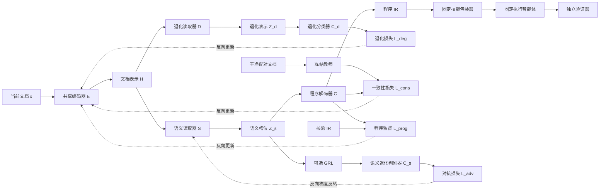

# 文档退化下智能体技能生成的程序知识保持与鲁棒学习研究方案

**版本：3.0**  
**日期：2026 年 9 月 27 日**  
**用途：导师讨论、研究立项与后续实验设计**  
**研究定位：以现象验证和实证比较为主线，将单路径鲁棒学习与双路径辅助学习纳入统一检验。**

本方案依据原文正文版本 2.0（2026 年 9 月 26 日）重写，保留原方案文件。文献范围以截至本方案日期可获取的一手论文及官方资料为准。下文描述的是拟开展的研究，尚未取得本项目的实验结果；模型结构可实现不等于科学假设已经成立。

---

## 1. 研究摘要、研究问题与可检验假设

### 1.1 研究摘要

智能体技能生成将文档中的操作知识转化为可复用的步骤、约束与检查规则，再供执行智能体完成后续任务。实际文档可能存在冗余说明、相邻流程混入、格式弱化、叙述顺序变化及关键规则分散。这些变化即使没有删除必要信息，也可能使生成器遗漏条件、误连依赖、混淆适用范围或新增无依据的规则。技能随后被重复使用，因此生成阶段的程序知识损失可能影响多个下游任务。

本研究首先建立文档、程序规则与执行结果之间可追踪的评测链路，检验可恢复退化是否造成稳定且具有实际意义的端到端性能损失。其次，比较完整文档输入、清洗、直接技能生成、结构化提取和数据增强能够解释或修复多少损失。在存在残余问题时，研究配对程序监督、干净教师一致性，以及由共享编码器、语义路径、退化辅助路径和程序解码器组成的双路径候选方法。双路径的核心待验证问题是：在控制数据、教师、额外标签、参数、计算与调参机会后，退化辅助学习能否在强单路径模型之上带来独立增益。

研究同时检验两项要求：表达方式变化时应保持程序行为；合法需求变化时应相应修改程序。主要评价对象是生成技能在未参与生成和优化的新任务上的执行成功率，而非技能文本相似度。合成控制实验用于识别退化及其作用条件，自然配对文档用于检验外部适用性。最终贡献可以是可靠的评测资源、具有解释力的经验发现，或经严格对照支持的恢复方法；不预设双路径必然优于简单方法。

### 1.2 研究问题

1. **RQ1：退化现象。** 在程序信息仍可从输入恢复的条件下，哪些文档变化会降低技能执行表现？影响是否跨流程家族、生成重复和执行重复成立？
2. **RQ2：知识损失。** 失败涉及条件、依赖、异常、副作用还是输出契约？长度、位置、干扰与结构标记分别起什么作用？
3. **RQ3：恢复方法。** 清洗、直接生成、显式程序 IR、数据增强和教师一致性分别能修复多少损失？增加中间结构是否也可能造成瓶颈？
4. **RQ4：双路径增量。** 退化辅助路径是否提供了超出额外监督和普通多任务学习的收益？哪些数据条件下有效或无效？
5. **RQ5：适用边界。** 改善能否迁移到新家族、自然文档与未知退化，同时保留干净能力和合法语义变化响应？

### 1.3 可检验假设及其否定条件

下表中的“实际意义界值”由应用中的失败成本、开发阶段的测量精度和可接受收益预先确定。正式测试开始后不再依据结果调整。统计不显著不自动等于影响很小；支持“小影响”需要足够精确的区间估计或预先规定的等效性检验。

| 假设 | 具体主张 | 支持条件 | 削弱或否定条件 |
|---|---|---|---|
| H1a：退化总影响 | 在定义明确的可恢复退化分布上，基准生成流程相对干净输入存在具有实际意义的配对执行损失 | 配对损失方向稳定，区间支持预定实际意义，且跨独立家族复现；结果不依赖无效扰动、静默截断或环境错误 | 审核后效应消失；或足够精确的区间排除了预定有意义损失。区间过宽仅说明证据不足 |
| H1b：额外结构影响 | 对指定退化，在控制长度、证据覆盖与相关位置后，仍存在由条件范围、结构组织或干扰引起的残余影响 | 匹配实验中仍有稳定差异，且错误类型与被操纵因素一致 | 精确区间排除该条件下的有意义残余；这只否定该机制主张，不否定 H1a |
| H2：双路径增量 | S3 相对 S2 的增益不能完全由额外标签、参数、计算或调参机会解释 | S3−S2 为正且有实际价值，在同标签单头等强对照后仍成立，并通过干净能力与语义变化约束 | S3 与 S2 等效、劣于 S2，或收益被同标签普通辅助头、等计算延长训练解释；此时不保留双路径结构优势主张 |
| H3a：表达不变与变化响应兼容 | 鲁棒学习提高表达等价对的程序正确性，同时能正确响应合法语义变化 | 原始及变化版本均正确，变化规则正确更新，未变化规则保持；优于仅提高表面一致性的模型 | 输出趋同但共同出错；合法规则变化被忽略；依靠牺牲变化响应换取抗扰性 |
| H3b：干净能力保持 | 鲁棒训练后的干净执行表现，相对共同起点 S0 不劣于预设容忍范围 | 干净成功率差值的区间下界高于非劣界值；S3 还需与 S2 比较 | 未达到非劣性标准则暂不支持；若区间显示明显超出容忍范围的损失，则反对该主张 |
| H3c：外部泛化 | 选定方法的增益可迁移到预先声明的未知条件 | 在独立家族、自然配对文档及指定未知退化上分别获得支持 | 收益仅见于已知合成模板、同源改写或单一执行器；收缩到得到支持的条件 |

H1a 的存在不意味着必须提出新模型。H1b、H2 和 H3 的证据分别决定机制解释、方法贡献及适用范围。IR 的价值作为独立比较问题检验，不将“结构化必然更好”设为前提。

### 1.4 证据表述规则

- **已有文献支持：** 已发表论文或预印本在其任务和设置下报告的结果，不直接等同于本项目结果。
- **可推导结论：** 由任务定义、前向连接或评测协议直接得到的结论，例如仅通过辅助损失连接的分支可以在满足条件时从推理图中删除。
- **合理假设：** 有机制动机但尚未在目标任务验证，例如退化分类有助于编码器学习更稳定的程序表示。
- **必须实验证明：** 性能提升、语义保持、未知退化泛化及任何结构优势。

本研究不把“尚未检索到完全相同工作”视为创新性充分证据，也不把已规划的防护措施表述为已经验证的可靠性。

## 2. 相关工作、现有证据与预期贡献

### 2.1 文档到技能与技能生成评测

| 工作 | 已有任务、机制及证据来源 | 对本研究的启示与差异 |
|---|---|---|
| [Anything2Skill](https://arxiv.org/abs/2606.09316) | 从文档知识构建可调用技能，包含知识组织、技能契约与 SkillBank；以工具相关任务检验技能使用 | 提供文档到技能的直接系统基线。拟增加受审核的配对退化、程序规则级诊断和家族外测试，不能将文档到技能本身列为新任务 |
| [SkillGenBench](https://arxiv.org/abs/2605.18693) | 以文档或仓库为来源，评价任务相关及任务无关的技能生成；将生成与后续执行分开，并使用固定执行设置及任务判定 | 是直接评测对照。拟扩展点是同源可恢复退化、合法语义变化、程序错误追踪及配对统计，而非首次以执行评价生成技能 |
| [SkillAlchemy](https://arxiv.org/abs/2608.23417) | 利用需求发现、证据范围管理和技能编译组织生成；部分实验已对来源加入无关、冲突或对抗内容 | 已涉及来源扰动，不能声称技能来源鲁棒性从未研究。拟扩大到系统的语义保真干预、自然配对及受控训练比较；其额外检索证据需单列权限 |
| [SkillAxe](https://arxiv.org/abs/2606.10546) | 利用评估与诊断反馈反复改进技能，分析技能触发、使用和质量问题 | 作为反馈优化路线；其开发任务、执行结果与评估调用均是额外信息和成本，不能与纯文档方法混为同一权限 |

SkillGenBench 与本研究最关键的差异在于估计对象：前者主要比较技能生成流程的任务效用，本研究进一步比较同一程序知识在不同文档条件下的效用变化，并检验恢复方法是否保持对真实需求变化的敏感性。只有这些新增维度经过独立审核、足够广的家族覆盖和可靠判题后，才可能形成新的评测贡献。

### 2.2 文档规范化、工具探索与反馈优化

| 工作 | 输入信息与核心机制 | 拟采用的比较方式 |
|---|---|---|
| [EASYTOOL，NAACL 2025](https://aclanthology.org/2025.naacl-long.44/) | 将冗长或组织不佳的工具文档提炼为统一说明，整理功能和调用信息 | 在工具文档子集复现其核心组织流程，再接固定技能生成器；普通一次 LLM 清洗另设基线，不以 EASYTOOL 命名 |
| [DRAFT，From Exploration to Mastery](https://arxiv.org/abs/2410.08197) | 通过工具探索、反馈分析与文档改写改善工具理解 | 使用开发环境交互后生成技能，记录探索次数、工具返回信息及修订成本；保留原方法的工具访问能力 |
| [PLAY2PROMPT，Findings of ACL 2025](https://aclanthology.org/2025.findings-acl.1347/) | 通过工具试玩优化说明并生成示例，论文包含文档噪声或缺失条件 | 可比较额外行为证据能否修复静态文档难题；文档缺失组不能直接并入可恢复、同目标的一致性训练 |
| [GEPA](https://arxiv.org/abs/2507.19457) | 从轨迹和自然语言反思迭代优化提示，并保留互补候选 | 用训练／开发任务优化提取提示；若优化对象改为技能文本，明确说明适配。所有轨迹和选择预算计入总成本 |
| [Reflexion，NeurIPS 2023](https://arxiv.org/abs/2303.11366) | 将任务反馈转化为语言反思和记忆，支持后续尝试 | 作为反馈学习背景；不与 GEPA 合并，也不将原方法直接称为离线文档到技能生成器 |

**文献校正：** 本地文件名含“GEPA-NeurIPS-2023-reflexion”的 PDF 正文是 Reflexion。GEPA 为另一篇论文，其官方 arXiv 页面当前注明 ICLR 2026 接收。文献表按正文身份分别列出。DRAFT 及 PLAY2PROMPT 的收益不能证明仅依赖文档的表示学习一定有效，因为它们可以获取新的工具行为信息。

### 2.3 鲁棒表示与技能失效的证据边界

[RobustVisRAG](https://arxiv.org/abs/2602.22013) 在视觉退化下研究视觉检索增强生成，包含专门的退化表示、对齐或分离约束及相应任务目标。本研究借鉴其“任务信息与退化信息可分工建模”的动机，但文本中的条件、依赖和接口符号不能直接类比视觉失真。本方案的退化分类辅助头不等同于该论文的完整机制，其结果不能直接证明本方案有效。

[RoTBench](https://aclanthology.org/2024.emnlp-main.19/) 表明工具接口扰动值得单独评估。部分名称变化要求同步改变正确调用的字面符号：即使工具功能相同，输出程序也未必应逐字不变。因此，此类条件应采用接口映射后的等价标准，或作为合法语义／环境变化扩展，不能直接套用共同 IR 目标。

[Lost in the Middle](https://aclanthology.org/2024.tacl-1.9/) 及[相关信息距离研究](https://aclanthology.org/2025.findings-acl.28/)支持长文中的位置与信息分布可能影响模型使用证据，但没有直接回答程序技能能否保留全部约束。[Agent Skills Can Be Harmful](https://arxiv.org/abs/2608.11888) 分析了技能诱发失败案例；这支持检查错误要求与遗漏约束，不能据其筛选案例推断所有技能的失败发生率，也不能直接把失败归因于源文档退化。

[SkillLens／From Raw Experience to Skill Consumption](https://arxiv.org/abs/2605.23899) 研究经验提取与技能消费，提示技能文本看似合理不保证执行收益。两份同题本地文件合并为一条参考文献。[SkillJack](https://arxiv.org/abs/2608.03509) 涉及恶意经验污染及持久技能后门；它为来源追踪提供动机，但攻击安全与本研究的非恶意可恢复退化属于不同问题。

### 2.4 五维预期贡献及成立条件

| 维度 | 相对已有工作的拟新增内容 | 必须补足的证据 |
|---|---|---|
| 问题 | 将同一程序知识在不同来源表达下的保持，以及真实规则变化的正确响应联合定义 | 证明二者可可靠区分；明确可恢复范围及应用价值 |
| 方法 | 系统比较配对监督、教师一致性及双路径退化辅助学习 | 强单路径、同标签普通辅助头、同预算和直接技能训练对照后的增量 |
| 评价 | 把规则、依赖、异常及副作用错误与端到端任务表现连接起来 | 独立验证器、语义等价判定、生成／执行重复及家族聚类统计 |
| 数据集 | 提供按家族隔离的干净—退化—合法变化组，并加入自然配对文档 | 来源授权、退化有效性审核、自然覆盖、去重及泄漏审计 |
| 经验发现 | 识别何时清洗已经足够、何时 IR 或双路径有益，以及何时产生负作用 | 跨条件复核、充分精度、可复现的失效边界，而非单一平均分 |

上述均为预期贡献。若双路径不成立但其他证据可靠，可形成实证或 benchmark 论文；若仅得到有限场景的明确结论，可据此考虑更窄的方法或 Findings 路线。论文类型变化不降低数据、对照与推断要求。

## 3. 任务定义及可恢复退化边界

### 3.1 输入、输出与评价对象

记第 $i$ 个源流程的规范知识为 $P_i^*$，经核验的干净文档为 $x_i^c$。退化操作 $T_{d,a}$ 具有类型 $d$ 和强度 $a$，生成 $x_i^d=T_{d,a}(x_i^c)$。上标 $d$ 泛指某个退化条件，具体类型、强度和生成种子另行记录。合法规则变化后的文档记为 $x_i^s$，其目标为 $P_i^{s*}$。允许进一步生成 $x_i^{s,d}$，但该文档应保持的是变化后的知识。

生成器只接收当前条件文档、统一的任务说明和流程标识，输出程序 IR 或直接输出技能。统一用 $c\in\mathcal C$ 表示文档条件，其中 $x_{i,\mathrm{clean}}=x_i^c$；$x_{i,c}$ 也可对应退化或合法变化版本。IR 路线使用固定包装器 $W$：

$$
\widehat P_{i,c,g}=f_\theta(x_{i,c};\omega_g),\qquad
K_{i,c,g}=W(\widehat P_{i,c,g}),\qquad
Y_{i,c,q,g,r}=V_{i,c}\!\left(A(K_{i,c,g},q;\xi_r)\right)\in\{0,1\}.
$$

其中，$q$ 为该流程下未参与技能生成的新任务；$g$ 为技能生成重复，$\omega_g$ 表示其随机性；$r$ 为固定技能的执行重复，$\xi_r$ 表示其随机性；$A$ 是冻结的执行智能体及其工具环境。$V_{i,c}$ 是独立验证器：表达等价条件共用同一规格，合法语义变化条件使用更新后的规格。随机性记号不意味着服务一定支持用户指定随机种子。第 8 节比较多个方法时，再为结果增加方法下标 $m$。

技能应支持一类流程内多个输入实例。生成阶段提供流程适用范围，但不提供锁定测试任务、隐藏答案、测试验证器或测试轨迹。每次生成后固定技能，再对多个新任务执行，防止把测试时临时解题误算为可复用技能生成。

### 3.2 可恢复性的操作定义

主研究要求退化文档与干净文档在给定工具环境中的程序知识等价：

$$
\mathcal K(x_i^d)\equiv\mathcal K(x_i^c)=P_i^*,\qquad
\mathcal K(x_i^s)=P_i^{s*}\not\equiv P_i^*.
$$

$\mathcal K$ 表示文档在指定范围内表达的程序要求，并非假定存在无误的自动提取器。等价性通过逐条规则、条件范围、引用关系及必要任务实例审核建立。退化文档必须仍包含确定正确行为所需的信息；不能依靠审核者对干净原文的记忆补全。

审核采用两步：一名审核者仅依据候选退化文档恢复规则并标注不确定项；另一名审核者对照独立规格检查恢复结果及语义变化。分歧进入仲裁。自动关键词检查仅作初筛，不能证明否定词、表格映射、时间顺序及例外范围没有改变。

| 条件类别 | 正确目标 | 是否进入主一致性训练 |
|---|---|---|
| 表达变化且知识完整 | 与干净文档相同的程序要求 | 是，经审核后使用共同目标 |
| 合法修改选择规则、阈值或异常策略 | 按新规则更新的目标及判题 | 可作为监督样本；只与其自身语义等价版本做一致性 |
| 关键规则删除、相互冲突或指代不可判定 | 部分程序和明确未决项，必要时请求澄清 | 不使用原干净完整程序作为共同目标 |
| API、工具版本或允许副作用发生变化 | 与新环境一致的程序及验证器 | 单列适应性扩展，不能当作纯表达噪声 |
| 恶意指令或后门污染 | 依据安全任务另行定义 | 不进入本方案主结论 |

### 3.3 与相邻研究问题的关系

本任务涉及信息抽取，但目标包含可执行的条件和依赖关系；涉及工具使用，但主要研究技能生成阶段的信息保持；涉及提示鲁棒性，但扰动对象是外部程序知识来源。RAG 与长上下文是输入组织手段，清洗是恢复基线，均可能解释或解决问题。若效果完全来自更好的检索覆盖或避免截断，论文应围绕该机制收缩，不宣称发现了独立的表示学习难题。

文档退化的**总影响**允许通过长度、关键规则位置和规则间距离产生。机制实验在匹配这些因素后估计的是另一种条件效应。不得一边声称测量总影响，一边通过控制中介因素把它排除；也不得把自然文档中相关因素共同变化的结果直接解释成某个单独因素的因果效应。

## 4. 数据来源、家族划分、自然文档与退化构造

### 4.1 数据来源与流程选择

第一阶段优先选择可确定性执行和判题的程序任务，例如 CSV 数据处理、命令行文件操作及稳定 API 的组合流程。流程须具有可检验的条件、边界情况或副作用约束，不能全部退化为执行器凭常识即可解决的单命令问答。首轮使用固定工具原语；不同时引入任意代码生成、动态工具发现等额外不确定性。

候选来源包括公开工具文档、教程、工作流说明和许可允许研究使用的仓库材料。登记源 URL、版本或提交、许可证、采集日期、工具环境及是否由模型参与整理。测试来源在生成器与执行器运行时均不能从索引、缓存或本地路径意外读回。模型预训练污染难以完全排除，应结合文档特有的规则、合法变化版本与无技能基线诊断，而不声称已经消除。

### 4.2 分层单位与数据隔离

建立“家族—源流程—文档版本—任务实例—生成重复—执行重复”的层级。家族依据共同的流程模板、工具语义、仓库来源与规则结构划分；同一模板的多次改写、同一流程的不同文档版本以及退化变体必须留在同一分区。共享大量材料的仓库优先整体划分；无法做到时，单独说明重叠及其限制。

先划分探索集、训练集、开发集和锁定测试集，再构造退化与语义变化。探索集用于调整 schema、审核流程和工具环境；开发集用于模型选择、阈值及预算设计；锁定测试集不用于挑选扰动、提示、清洗器、教师或规则模板。统计中的独立样本量主要由家族数量及家族间差异决定，改写数量不能替代独立家族。

流程筛选以可验证性和预先声明的领域覆盖为依据，不根据测试集上的退化幅度选样。若设置“干净条件可靠”的辅助子集，必须依据开发证据或独立预设规则选取；完整合格测试集仍是主要报告对象。

### 4.3 五类合成退化

| 类型 | 构造原则 | 强度记录 | 必须审核的语义条件 |
|---|---|---|---|
| D1 冗余扩写 | 插入真实但重复的背景、解释或等价例子 | 总 token 增幅、冗余比例及插入位置 | 不增加新的强制要求，不改变例子与规范的地位 |
| D2 相邻流程混入 | 加入主题相近但适用范围明确的其他流程 | 干扰 token 比例、语义相近程度及交错方式 | 当前目标流程可被唯一识别；邻近规则不能被误标为当前要求 |
| D3 格式弱化 | 弱化标题、列表或表格外观，保留可恢复的关系信息 | 被改变的结构标记比例、表格和层级类型 | 条件范围、否定、单位、字段映射及代码边界仍明确 |
| D4 叙述重排 | 改变说明段落的叙述位置，保留显式依赖和时序词 | 移动比例、位移及依赖跨度 | 不改变规范要求的执行顺序；无时序证据时不能任意重排 |
| D5 规则分散 | 把相关规则分布到更远章节，并保留清楚引用 | 规则间 token 距离、跨章节数量及引用链长度 | 所有必要规则在输入范围内，引用对象唯一且可追踪 |

每类先构造低、高两个强度及干净参照；具体数值由自然语料分布、可恢复性审核和预算共同确定。原方案的扩写比例等可用作探索起点，不能为了获得显著下降不断提高强度。锁定测试中的强度区间应在模型比较前冻结。

五类因素可能重叠。例如 D1 同时增加长度，D5 可能改变位置。为每个样本记录长度、关键规则位置、相关距离、结构标记、干扰来源和分块情况。主实验报告各操作的总影响；另设正交或匹配实验分析机制，不把操作名称当作已经独立识别的原因。

全部输入应完整覆盖必要证据。超长文档采用所有方法一致的全覆盖分块协议，或进入明确标注的超长子集；禁止静默截断。对检索方案分别测量证据召回与给定完整证据后的生成表现，避免把检索遗漏全部归因于技能生成器。

### 4.4 自然配对文档

自然材料优先使用真实存在的详略版本、格式迁移版本或经确认没有程序规则变化的历史版本。每对文档独立核对规则与工具版本，不凭标题相同推断等价。若只有一份组织较差的自然文档，可制作“保守整理版本”：仅重排、去冗余或恢复明确结构，逐项登记改动，不从外部知识添加缺失要求。

自然原文与人工整理文档的差异不必称为随机退化的因果效应。该组主要检验受控合成实验的结果能否在实际材料中重现，并报告人工整理及选择偏差。真正缺失信息的自然文档单独进入不可恢复扩展，不能为凑配对样本补写隐含知识。

自然测试按来源家族隔离，并尽可能覆盖不同写作风格、工具、复杂度和退化组合。报告自然材料与合成材料的统计差异、无效配对比例和审核分歧，而不是只展示少量成功案例。

### 4.5 合法语义变化与审核记录

从明确规格出发构造最小规则变化，例如“保留最新记录”改为“保留最早记录”、并列时优先顺序变化、允许覆盖改为禁止覆盖。同步更新 IR、技能参考、任务及验证器，同时保留其他规则。变化必须在真实流程中合理，避免使用仅靠关键词替换即可识别的模板。

训练集中给 S1、S2、S3 提供相同的合法变化监督，测试保留未见过的取值、组合或变化模板。为部分变化版本再生成表达退化，形成 $x^c,x^d,x^s,x^{s,d}$ 四元组，使模型不能把“所有配对输入都输出相同答案”当作训练捷径。

数据登记至少包含家族标识、源流程、来源版本、条件类型、强度、文档哈希、规则清单、目标版本、审核结论与未决项。试点逐条审核；扩大后对高风险操作保持严格审核，并对其他部分做预先定义的独立抽查。发现无效退化时按统一规则返工或排除，记录比例与原因，不依据哪个模型失败决定取舍。

## 5. 程序 IR、语义等价性、证据来源与技能包装

### 5.1 IR 的定位与表达范围

程序中间表示（IR）首先是监督和错误定位接口，是否具有方法优势由实验决定。优先复用已有技能契约的字段，不将重新命名字段视为算法创新。首版覆盖有条件分支、显式依赖、有限迭代、异常处理和副作用约束的流程；对复杂循环、并发或事务补偿超出表达范围的情况明确标注，不强行压入错误结构。

| 字段 | 必须表达的内容 | 验证要点 |
|---|---|---|
| `goal`、`scope` | 程序目标、适用与不适用条件 | 能区分目标流程与邻近流程 |
| `inputs`、`tool_contracts` | 输入类型、必需字段、工具及版本、参数语义 | 不以变量名相似替代真实接口一致 |
| `preconditions` | 执行前必须满足的条件 | 明确不满足时的行为 |
| `steps`、`depends_on` | 原子或适当粒度的操作、数据流与依赖 | 节点引用存在，依赖及数据来源正确 |
| `branches`、`exceptions` | 条件、分支动作、错误处理及停止条件 | 否定、阈值、作用范围和优先级完整 |
| `invariants`、`effects` | 全程约束、允许及禁止的副作用 | 包含文件覆盖、状态修改与重复执行约束 |
| `outputs`、`checks` | 输出类型、内容契约与完成判据 | 检查真实内容与行为，不只检查“有输出” |
| `unresolved` | 来源不足、冲突或无法确定的要求 | 不将缺少依据的猜测包装为确定规则 |

依赖图采用稳定节点标识及规范化序列，首版只允许明确可展开的 `for_each`。条件失败和异常终止作为显式动作处理。若需要表达新控制结构，先验证 schema 的充分性，再扩大领域；不能把 schema 本身不能表达的任务用于证明模型不够鲁棒。

### 5.2 等价程序与规范化监督

不同拓扑排序、变量命名、步骤合并或等价条件写法可能对应相同程序。训练可以使用固定规范序列以降低目标歧义，但评价不以 JSON 完全一致、节点位置一致或字符串相似作为最终正确性标准。规则级判定关注操作条件、依赖与效果；执行判定关注任务域内的真实行为。

对多个合法序列化形式，采用预先定义的规范化、允许的等价映射或多参考标注。有限测试全部通过只证明在这些测试上的行为一致，不构成一般程序等价证明。不能通过删除难判字段来提高等价率，也不能把所有措辞不同的规则都判成遗漏。

### 5.3 provenance 与语义目标分离

每条程序规则另存证据记录：当前输入文档的片段、位置、来源版本，以及该规则属于直接陈述、明确组合推导还是未决。位置和原文措辞随退化变化，因此不纳入要求逐字不变的程序一致性目标。证据记录不直接写入模型必须跨文档保持一致的字段。

provenance 用于追踪无依据新增规则、错误引用和范围混淆；它本身也需要审核，不能视为模型“给出引用即正确”。教师与标注者可依据核验规格制作训练目标，测试生成器只可引用当前输入，不能访问隐藏干净副本或参考 IR。

### 5.4 确定性技能包装

IR 路线由固定包装器生成适用范围、输入、步骤、分支、约束、输出及检查说明。包装器只读取 IR，不重新调用模型或阅读源文档补写规则。固定工具资源可包含通用原语，不能藏入参考答案、测试任务或完整目标流程，避免把生成质量问题变成调用现成答案。

原生系统基线保留其必要技能资源和自身格式，另报告资源权限；统一 IR 路线共用同一包装器。直接技能生成作为完整对照，不强制经 IR 转换。包装器、执行器或资源变化须单独消融，不能把其收益归到表示学习。

### 5.5 贯穿示例与瓶颈诊断

示例流程为：合并多个订单 CSV，以 `order_id` 去重；将 `updated_at` 解析到统一时区，保留最新记录；同一时刻保留输入顺序靠后的记录；非法时间停止并报告；生成新文件且不覆盖原始输入。

该流程至少包含“解析先于比较”的依赖、时间并列分支、非法时间异常及输入保护约束。验证器应覆盖乱序时间、不同时区、并列时间、非法时间和原文件保持。只检查文件存在或行数减少不足以判分。“保留最新”改为“保留最早”时，只有选择规则及相关参考结果改变，其余约束仍需保留。

分别诊断两类瓶颈：一是显式 IR schema 是否遗漏源程序能表达的知识；二是固定语义槽位是否限制模型提取和生成复杂流程。通过参考 IR 经包装后执行、直接技能与 IR 对照、槽位容量曲线及按规则复杂度分层测试区分它们。若直接技能在干净与退化条件均更好，应保留该结果并调整 IR 的定位；不能因中间表示更易展示而优先认定其科学价值。

## 6. 单路径和双路径模型设计

### 6.1 共同主干与语义槽位

采用可访问隐藏状态并支持受控解码接口的开放文本模型。共享编码器 $E$ 编码文档，语义读取器 $S$ 通过一组可学习查询从文档表示读取信息，程序解码器 $G$ 据此生成 IR：

$$
H=E(x),\qquad
Z_s=S(H;Q_s),\qquad
p_\theta(y\mid x)=\prod_{t=1}^{T}p_G(y_t\mid y_{<t},Z_s).
$$

其中 $H\in\mathbb R^{B\times L\times h}$，$Q_s\in\mathbb R^{M\times h}$，$Z_s\in\mathbb R^{B\times M\times h}$。$B$、$L$、$h$、$M$ 分别为批大小、输入长度、隐藏维数和槽位数；$T$ 为 IR 序列长度。语义槽位是潜在表示，不预设某一槽必然对应某个 schema 字段；若加入字段专用查询，须另列结构假设与消融。

$G$ 的唯一文档记忆为 $Z_s$，另可读取统一生成说明和自身已生成前缀。不得从原始输入 token、原文 KV cache、额外检索结果或隐藏交叉注意力通道绕过该接口。采用分块输入时，聚合步骤归入 $E$，所有同架构方法共享；分块证据丢失单独记录。

槽位数与读取器深度只在开发集选择。可以从少量预设容量开始，比较规则数量、依赖深度和文档长度增加时的知识保留及计算成本。固定槽位构成经验上的容量约束，但不能仅凭张量维数断言其数学上必然丢失某类信息；瓶颈是否发生需通过任务表现验证。

### 6.2 双路径 E–S–D–G

双路径在共同主干后增加独立退化读取器 $D$ 和分类器 $C_d$：

$$
Z_s=S(H),\qquad Z_d=D(H),\qquad
\widehat P=G(Z_s),\qquad
\widehat{\boldsymbol d}=C_d(Z_d).
$$

$Z_d\in\mathbb R^{B\times h_d}$ 汇总退化相关信息。$S$ 与 $D$ 的前向输出互不输入对方；$G$ 不读取 $Z_d$ 或预测标签。标签仅在训练损失中使用，测试生成时既不提供真实类型，也不依赖退化分类正确。

实线表示前向信息或损失输入，虚线突出共享主干及对抗项的反向作用，未展开全部梯度边。完整参数职责如下。

| 组件 | 前向用途 | 接收的训练信号 | 推理是否保留 |
|---|---|---|---|
| $E$ | 当前文档编码 | 程序监督、一致性、退化监督；可选反向对抗梯度 | 保留 |
| $S$ | 从 $H$ 提取语义槽位 | 程序监督、一致性；可选反向对抗梯度 | 保留 |
| $G$ | 由槽位生成 IR | 程序监督、一致性 | 保留 |
| $D,C_d$ | 预测退化类型 | 退化监督 | 删除 |
| $C_s$ | 从 $Z_s$ 预测退化 | 正常分类梯度；其输入端使用 GRL | 删除 |
| 冻结教师 | 提供干净输入下的分布 | 无参数更新 | 删除 |
| 包装器、执行器、验证器 | 构造技能及评价 | 不参与梯度训练 | 按生成、执行、评测职责使用 |

### 6.3 双路径的独立假设与解释限制

**合理假设：** 退化辅助任务迫使共享编码器识别文档的组织变化，可能有助于语义读取器在不同表达下提取稳定规则。另一种同样合理的可能是：退化分类只学习长度或模板特征，与生成无关；也可能与程序学习竞争表示容量而降低效果。

**可推导结论：** 在上述前向图中，$D$ 对生成的作用只能通过训练时共享 $E$ 的更新发生。若阻断退化损失到 $E$ 的梯度，且不存在共享状态或优化耦合，辅助头本身不能向 $G$ 提供新证据。

**待验证主张：** S3−S2 检验“增加退化辅助学习”的整体效果；只有进一步击败同标签、同预算的普通辅助头，才能讨论专门读取路径的结构价值。当前结构属于共享编码器的多任务辅助学习，不因分出两个头就自动实现语义与退化的解耦。如果普通池化分类头可以复现全部收益，应以更简单的辅助学习解释结果。

本研究不将双路径称为已经实现的“因果感知模型”。因果解释至少需要明确干预变量、适用假设和排除替代解释的证据；低相关性、正交约束或某个探针预测失败均不充分。表示解耦研究亦强调归纳偏置与监督的作用，但其理论结论不能不加条件地移植到本任务。[相关基础研究](https://proceedings.mlr.press/v97/locatello19a.html)

### 6.4 推理时删除辅助模块的条件

部署保留 $E\rightarrow S\rightarrow G\rightarrow W$。删除 $D,C_d,C_s$ 和教师成立的条件是：这些模块没有前向输出供语义路径使用，没有共享运行统计或训练后仍执行的状态更新，也不改变主路径掩码、位置编码和随机数使用。训练所得 $E,S,G$ 权重必须完整保留。

验证时固定输入、权重、数值精度和解码设置，关闭随机失活；比较删除前后的 $Z_s$、多个解码位置的 logits 及确定性生成结果，检查差异是否落在预设数值容差内。重新加载部署模型后重复核对。该检查只能证明删除辅助计算未改变已训练模型的推理，不证明训练中的辅助分支无用。

## 7. 训练目标、训练流程与公平对照

### 7.1 符号与程序监督

对经审核的等价对 $(x^c,x^d,y)$，$y$ 为同一规范 IR 的 token 序列。定义按样本归一化的程序交叉熵：

$$
\ell_{\mathrm{CE}}(x,y)
=-\frac{1}{\sum_{t=1}^{T}m_t}
\sum_{t=1}^{T}m_t\log p_\theta(y_t\mid x,y_{<t}),
$$

$$
\mathcal L_{\mathrm{prog}}
=\mathbb E_{(x^c,x^d,y)\sim\mathcal D_{\mathrm{eq}}}
\left[\frac{\ell_{\mathrm{CE}}(x^d,y)+\alpha\ell_{\mathrm{CE}}(x^c,y)}{1+\alpha}\right].
$$

$m_t\in\{0,1\}$ 为有效目标掩码，包含结束符，不包含填充位置；$\alpha\geq0$ 为干净监督权重。先对每个样本归一化，再按预设抽样权重取平均，避免长目标无意获得更高样本权重。数据集 $\mathcal D_{\mathrm{eq}}$ 也可含 $(x^s,x^{s,d},y^s)$，其目标必须是变化后的程序。

不与任何等价退化配对的干净或合法变化样本使用同样的 $\ell_{\mathrm{CE}}$，其抽样比例固定并在 S1—S3 间一致。不可恢复文档不进入上述共同完整目标；若开展扩展实验，另用部分 IR 和未决项监督。

### 7.2 干净教师一致性

教师 $p_T$ 从干净训练所选检查点复制并冻结。对于等价对，在相同正确目标前缀下，让学生在退化输入上的分布接近教师在干净输入上的分布：

$$
\mathcal L_{\mathrm{cons}}
=\mathbb E_{\mathcal D_{\mathrm{eq}}}
\left[
\frac{1}{\sum_t w_t}
\sum_t w_t\,
D_{\mathrm{KL}}\!\left(
p_T(\cdot\mid x^c,y_{<t})
\,\Vert\,
p_\theta(\cdot\mid x^d,y_{<t})
\right)
\right].
$$

$w_t\in\{0,1\}$ 为有效目标与可选教师可靠性掩码的交集，默认等于 $m_t$。若无可靠位置，跳过该样本的一致性项并报告覆盖率，仍保留程序监督。词表、目标规范、温度及掩码规则在 S2、S3 中相同，默认温度为 1；改变温度时明确概率变换和缩放规则。

该目标对齐程序输出分布，不对长度及位置已经变化的输入 token 强制逐位对齐。教师不是真值：核验 IR 始终是主监督，并报告教师规则正确率、执行表现和筛选覆盖。对合法变化样本，只允许使用读取相应 $x^s$ 的可靠教师预测；不得以原 $x^c$ 的预测约束 $x^s$。教师在变化规则上不可靠时，使用正确监督并屏蔽对应一致性，而非要求学生继承错误。

### 7.3 退化监督

主试验先使用干净及单类退化六分类，类型 $d\in\{0,1,2,3,4,5\}$，其中 0 表示干净：

$$
\mathcal L_{\mathrm{deg}}
=\mathbb E_{(x,d)}\left[-\log C_d(D(E(x)))_d\right].
$$

若训练加入混合退化，统一改为五维多标签目标 $\boldsymbol d\in\{0,1\}^{5}$，干净为全零：

$$
\mathcal L_{\mathrm{deg}}^{\mathrm{multi}}
=-\mathbb E\left[\frac{1}{5}\sum_{k=1}^{5}
\left(d_k\log\widehat d_k+(1-d_k)\log(1-\widehat d_k)\right)\right].
$$

两种协议分别声明，不能在实验后混用最有利结果。合法语义变化不是“退化类别”；变化版本也具有其表达退化标签。保持规则变化和退化标签独立组合，避免分类器把语义变化识别为应当消除的噪声。

批次中同一退化跨多个家族出现，并避免家族、来源、文件名与退化类型绑定。记录标签可由长度、固定插入语或格式模板预测的程度，加入长度匹配及跨生成器测试。分类准确率高只说明标签可预测，不等于程序知识保持更好。

### 7.4 可选 GRL 对抗目标

仅在 S3 的基础效果和训练稳定性明确后研究 S3+adv。令 $C_s$ 从池化语义表示预测退化，使用梯度反转层（GRL）：

$$
\mathcal L_{\mathrm{adv}}
=\mathbb E\left[
\operatorname{CE}\left(C_s\!\left(\operatorname{GRL}_{1}(\operatorname{pool}(Z_s))\right),d\right)
\right],
$$

$$
\operatorname{GRL}_{1}(z)=z,\qquad
\frac{\partial\operatorname{GRL}_{1}}{\partial z}=-I.
$$

多标签协议相应使用二元交叉熵。总计算目标为：

$$
\mathcal L
=\mathcal L_{\mathrm{prog}}
+\lambda_{\mathrm{cons}}\mathcal L_{\mathrm{cons}}
+\lambda_{\mathrm{deg}}\mathcal L_{\mathrm{deg}}
+\lambda_{\mathrm{adv}}\mathcal L_{\mathrm{adv}}.
$$

所有权重非负。$C_s$ 接收正常梯度以减小分类误差；$E,S$ 通过 GRL 接收该项的反向梯度，试图使退化更难从语义表示预测；$G$ 不接收对抗项。GRL 内部系数固定为 1，只由外部 $\lambda_{\mathrm{adv}}$ 控制强度，避免重复缩放。S3 默认 $\lambda_{\mathrm{adv}}=0$。该实现遵循[域对抗训练的梯度反转机制](https://jmlr.org/papers/v17/15-239.html)，并不直接继承其域适应理论保证。

退化信息可能帮助恢复文档，强制完全消除它也可能有害。对抗项必须通过规则正确性、干净非劣性和合法变化响应联合评价，不能以探针分类下降作为成功标准。后验探针采用独立数据和多个容量，仅作诊断，不以一个弱探针证明表示不含退化信息。

### 7.5 S0—S3+adv 的定义

| 编号 | 结构与训练 | 新增信息或目标 | 核心比较 |
|---|---|---|---|
| S0 | 干净程序监督的 $E$–$S$–$G$ | 核验干净程序及干净形式的合法变化目标 | 共同起点与干净能力参照 |
| S1 | 从共同 S0 出发，使用干净、退化及合法变化监督 | 数据增强与程序监督 | S1−S0；另以继续干净训练控制额外预算 |
| S2 | S1 的结构与数据，加冻结教师一致性 | 共同教师提供的输出分布 | S2−S1 |
| S3 | S2 加 $D,C_d$ 及退化监督 | 退化标签和辅助梯度 | **S3−S2**，并与同标签、同预算对照比较 |
| S3+adv | S3 加 $C_s$ 与 GRL | 语义表示上的对抗约束 | S3+adv−S3 |

同一训练种子下 S1、S2、S3 从同一个 S0 权重开始，使用相同数据顺序及抽样规则；S3 不从已经额外训练完成的 S2 继续而不给 S2 同等机会。若研究继续训练变体，单列实验并提供相同继续预算的 S2。

### 7.6 训练流程与目标冲突检查

1. **验证干净接口。** 使用核验样本确认 $E$–$S$–$G$ 能学习有效 IR，参考 IR 包装后可通过执行判题。干净提取已经明显不足时，先处理接口或目标表达问题。
2. **建立共同起点。** 在训练集训练 S0，以开发规则质量及开发执行表现选择检查点；冻结教师。测试集不参与教师选择或可靠性掩码制定。
3. **构造同一训练流。** S1—S3 共享等价对、合法变化样本、来源权重和训练目标；读取干净配对是训练期特权，所有比较如实列明。
4. **执行鲁棒训练。** 按目标更新相应参数，教师及执行器不更新。E、S、G 的可训练范围一致；新读取器和分类器正常训练，不将未适配的解码器固定为先天劣势。
5. **检查冲突与退化。** 记录各目标量级、共享参数梯度及开发集规则错误。必要时在开发阶段调整权重；梯度冲突统计只提供线索，不能独自解释性能因果关系。
6. **锁定模型并评测。** 按统一的开发选择规则选模型，冻结后生成技能和运行测试；技能不会因测试轨迹被再次修改。

### 7.7 公平对照与替代解释

| 替代解释 | 必须安排的对照或记录 | 可支持的判断 |
|---|---|---|
| 额外退化标签有效，与专门路径无关 | S2 加直接从池化 $H$ 预测同一标签的普通辅助头；保持标签、样本和选择预算一致 | 区分辅助监督整体收益与专门读取器增量 |
| S3 只是参数更多 | 等参数的单路径读取器或解码容量对照；同时报告训练及部署参数 | 检查额外容量能否解释收益 |
| S3 只是计算更多 | 同训练 token 主比较，加总计算预算接近的 S2 延长训练／容量配置，报告实际时间与计算 | 同 token 和同计算是两种比较，不宣称同时完全相同 |
| 标签任务通过共享主干起作用 | 阻断退化损失到 $E$ 的梯度，保留辅助头训练 | 检查主干梯度通道是否必要；该对照本身不证明语义分离 |
| 分类只记住标签模板 | 跨家族标签平衡、长度匹配、未见扰动生成模板；必要时加入随机标签诊断 | 识别捷径；随机标签难度不同，不能作为唯一归因证据 |
| 学习收益来自额外教师或筛选 | S2、S3 共用教师、缓存、掩码和覆盖率 | 排除教师信息差异 |
| 优化机会更多 | 统一开发指标、候选次数和总搜索预算；记录失败运行 | 排除只为 S3 精调的偏差 |
| IR 方法得到了更多监督 | 直接技能训练对照使用由同一核验规格得到的目标，并匹配数据与预算 | 区分结构接口与监督信息效应 |

普通辅助头若与所实现的 $D$ 在功能和参数上已相同，就不再把二者当作不同算法；此时“双路径”只作为结构描述，方法结论限定为退化监督的多任务学习效果。参数、训练 token、FLOPs／运行时间、教师成本和超参数搜索通常不能同时精确匹配，应公开各项差异，并使用互补对照定位原因。

## 8. 基线、诊断实验、泛化测试及统计协议

### 8.1 基线体系与职责

| 编号 | 处理流程 | 回答的问题 |
|---|---|---|
| N | 无技能，执行器只接收任务及通用工具说明 | 执行器先验能力是否已经足够 |
| R | 核验程序或人工参考技能，经相同任务执行 | 环境和执行器能否实现正确规则；属于诊断参照，不是数学上界 |
| D_doc | 执行时直接提供当前条件文档 | 文档直接使用是否已经足够；与技能复用比较信息量和成本 |
| B0 | 固定版本及配置的 Anything2Skill 原生流程 | 文档到技能系统基线 |
| B1 | 确定性去重、格式整理后接 B0 | 低成本清洗能修复多少 |
| B2 | 一次 LLM 规范化后接 B0 | 显式文本清洗能修复多少 |
| B3 | 一次提示直接提取统一 IR，再确定性包装 | 无鲁棒训练时结构化提取的作用 |
| F | 直接生成完整技能文本及获准资源 | 取消显式 IR 是否更优；完整运行，不选择性替代失败样本 |
| F_train | 使用同源核验规则导出的技能目标训练直接生成器 | 排除训练监督不同造成的 IR 优势 |
| S0—S3+adv | 第 7 节定义的统一结构训练系列 | 分离增强、一致性、退化辅助及对抗项 |

辅助基线包括 EASYTOOL、DRAFT、PLAY2PROMPT、SkillAlchemy，以及 SkillAxe／GEPA 的明确适配。先保证 N、R、D_doc、B0—B3、F 及有竞争力的简单方法可复现，再决定完整训练矩阵。D_doc 与退化读取器 $D$ 使用不同记号，避免混淆。

提示式生成基线尽可能使用相同底座、文档覆盖、解码设置及输出预算；若原生方法依赖不同模型，原生结果与同底座适配结果分别标注。训练方法比较共享底座和可训练范围；提示式与训练式结果同时列出监督差异，不把跨模型或跨监督水平的差值解释为结构效果。生成重复数、候选选择与自动修复权限同样纳入预算匹配。

清洗方法对干净与退化输入都运行，不能只给退化条件额外处理而把干净条件直接跳过。清洗不得读取配对干净文档、参考规则或测试判题反馈。每条方法保留真实失败，不将不同基线中最成功的输出拼成未声明的混合系统。

### 8.2 信息权限与成本分层

| 设置 | 允许的信息 | 禁止或隔离的信息 | 比较原则 |
|---|---|---|---|
| 静态文档生成 | 当前条件文档、固定通用工具说明、训练阶段授权数据 | 测试干净副本、隐藏规格、测试任务与轨迹 | 主比较设置；推理时仅当前文档 |
| 文档检索／来源扩展 | 预先声明的公开资料与检索范围 | 隐藏测试规则和测试答案 | 单列新增证据、检索覆盖与成本 |
| 工具交互 | 开发环境中的工具调用及返回 | 锁定测试实例、隐藏验证器细节 | DRAFT、PLAY2PROMPT 保留完整能力；在同权限下增加可比恢复方案 |
| 轨迹反馈优化 | 训练／开发任务表现与轨迹，限定的评分信号 | 锁定测试反馈及反复试榜 | SkillAxe、GEPA 统一调用和选择预算 |

保留两种结果：方法原生能力设置与信息权限匹配设置。前者反映实际可用性，后者帮助解释差异。不能剥夺竞争方法的核心信息后宣称全面领先，也不能把工具试玩发现的新知识归功于静态文档鲁棒表示。

### 8.3 诊断实验

**（1）总影响与机制。** 首先比较同源干净文档及五类退化的配对结果。随后按问题选择长度匹配、关键规则位置平衡、统一分块、完整证据输入和邻近内容相似度控制。设置“只有长度变化”“相同长度下结构变化”等条件；这些实验估计具体机制，不替代真实操作的总影响。

**（2）程序错误与执行错误。** 对照规则清单统计遗漏条件、错误依赖、异常缺失、错误工具约束、副作用违反及无依据新增规则。用参考 IR 替换预测 IR，并在相同包装器和执行器下测试，诊断损失是否可由程序提取解释。替换实验改变了信息条件，不能据此直接计算严格的因果中介比例。

**（3）IR 与槽位。** 比较 F、F_train、B3 和 S 系列；对槽位数、流程复杂度及目标长度做预设分层。若统一 schema 不能表达参考技能，先判为接口覆盖问题。参考 IR 能执行而预测 IR 不能执行，才进一步研究提取和表示。

**（4）双路径必要性。** 重点比较 S3−S2、S3 与同标签普通辅助头、去除退化损失、阻断退化梯度、去除一致性，以及 S3+adv−S3。主要消融先注册，其他结构尝试列为探索，避免以大量尝试中的最佳结果解释机制。

**（5）不变性与变化响应。** 在四元组上同时检查程序正确性、变化规则更新及不变规则保留。故意始终复制同一程序的模型应无法通过。合法变化对应的验证器要包含能区分旧规则与新规则的输入，否则输出没有变化也可能虚假通过。

**（6）技能消费。** 固定技能供给用于隔离生成质量；需要自动选择技能时另设路由实验。记录执行器是否读取、遵守或忽略技能。若无技能 N 已接近参考 R，应检查任务是否对文档知识真正敏感，而非继续在饱和任务上比较细微提升。

### 8.4 泛化测试矩阵

| 测试维度 | 训练与测试关系 | 能支持的范围 |
|---|---|---|
| 未见家族 | 模板、源流程及同源文档严格隔离 | 对新程序知识的迁移 |
| 未见强度 | 类型已见，强度超出训练范围但仍可恢复 | 强度外推；不等于未知退化类型 |
| 未见组合 | 单类已见，组合未见 | 退化组合泛化 |
| 留一类型 | 训练及调参不接触某种退化，轮换预设类型 | 对指定未知类型的泛化；推理无需该类型标签 |
| 未见扰动生成器 | 不同模板、人工改写或另一模型构造 | 避免只识别合成模板 |
| 自然配对文档 | 不依赖同一合成操作器，来源独立 | 自然材料外部适用性 |
| 执行器／模型迁移 | 主实验冻结执行器，复核时更换指定模型 | 技能收益是否依赖单一消费者 |

泛化维度分别报告，不能把某一个通过称为“普遍泛化”。留一类型试验不得使用该类型的开发表现选超参数。未知类别无需辅助分类头在测试时识别正确，但仍需明确其训练标签空间。执行器更换后重新报告其无技能与参考技能表现。

### 8.5 主要指标与估计对象

设 $\mathcal F$ 为测试家族集合，$\mathcal I_f$ 为家族 $f$ 内源流程集合，$\mathcal Q_i$ 为流程 $i$ 的测试任务集合。对方法 $m$、条件 $c$、生成重复 $g$ 和执行重复 $r$，结果记为 $Y_{m,i,c,q,g,r}$。若某条件包含多个预定文档变体，先按固定权重在条件内平均，不能把变体当作新的独立家族。

$$
\overline Y_{m,i,c}
=\frac{1}{|\mathcal Q_i|\,n_g\,n_r}
\sum_{q\in\mathcal Q_i}\sum_{g=1}^{n_g}\sum_{r=1}^{n_r}
Y_{m,i,c,q,g,r},
$$

$$
\widehat{\mathrm{SR}}_{m,c}
=\frac{1}{|\mathcal F|}\sum_{f\in\mathcal F}
\frac{1}{|\mathcal I_f|}\sum_{i\in\mathcal I_f}
\overline Y_{m,i,c}.
$$

主指标采用家族等权、家族内流程等权的宏平均；样本微平均作为补充。若重复次数不等，先在各自层级平均并报告缺失，不能使用上述平衡设计分母。所有方法使用相同任务集合与条件权重。

配对退化损失及双路径执行增量定义为：

$$
\widehat\Delta_{m,c}
=\widehat{\mathrm{SR}}_{m,\mathrm{clean}}
-\widehat{\mathrm{SR}}_{m,c},
\qquad
\widehat\Gamma_c
=\widehat{\mathrm{SR}}_{\mathrm{S3},c}
-\widehat{\mathrm{SR}}_{\mathrm{S2},c}.
$$

对退化集合 $\mathcal C_d$ 的汇总使用预先冻结的权重 $\pi_c$，且 $\sum_{c\in\mathcal C_d}\pi_c=1$。主方法比较为 $\widehat\Gamma_{\mathrm{deg}}=\sum_c\pi_c\widehat\Gamma_c$，并联合报告干净非劣性。$\Gamma$ 表示方法增量，与程序解码器 $G$ 区分。另报告退化损失减少量 $\widehat\Delta_{\mathrm{S2},c}-\widehat\Delta_{\mathrm{S3},c}$；二者不等同，因为干净表现也可能改变。不得通过降低干净成功率来制造更小的退化损失。

所有预定合格任务进入端到端分母。无效 IR、技能生成失败、预算耗尽及技能导致的执行失败均计为失败。条件执行成功率可另报，但不能仅在“成功生成技能”的子集上替代主指标。对确认的基础设施故障实行统一重试规则，报告不可观测比例与保守敏感性分析，不能选择性删除低分记录。

### 8.6 补充指标

| 指标 | 定义与解释 |
|---|---|
| 程序规则保留 | 核验规则中被语义正确保留的比例；另外报告关键规则全部保留率、错误新增规则和范围错误 |
| 输出与副作用合规 | 输出契约、异常行为及禁止副作用分别通过的比例；不与普通规则平均掩盖高风险失败 |
| 干净非劣性 | $C_m=\mathrm{SR}_{m,\mathrm{clean}}-\mathrm{SR}_{\mathrm{S0},\mathrm{clean}}$；区间下界高于 $-\varepsilon$ 才支持非劣，S3 还报告相对 S2 的差值 |
| 表达保持 | 等价版本的正确率及共同正确比例；单纯输出一致而共同错误不计为成功 |
| 合法变化响应 | 原始与变化版本均正确、目标规则按要求变化且其他规则保持的联合通过率；另报条件于原始正确的响应率及其分母 |
| 四元组联合正确 | $x^c,x^d,x^s,x^{s,d}$ 均满足各自规则和判题的比例，避免局部指标互相掩盖 |
| 不可恢复校准 | 仅在扩展组报告关键缺失识别、未决项及无依据补全；不并入主可恢复成功率 |
| 波动 | 固定技能的执行波动、独立生成技能间波动、训练种子差异分别报告 |
| 成本 | 标注、退化构造、教师、训练、调参、检索、工具试玩、技能生成及执行的时间和调用成本 |

联合正确率应预先固定生成与执行重复的配对方式，在独立会话中运行；不能在每个版本中事后挑出最好的输出组合。若将四个二元结果相乘统计联合成功，应说明重复配对或独立采样方式，以免把生成／执行随机性误判为语义变化能力。

复用成本统一按任务次数 $n$ 报告：

$$
C_{\mathrm{total}}(n)
=C_{\mathrm{data}}+C_{\mathrm{train}}+C_{\mathrm{search}}
+C_{\mathrm{compile}}+n\,C_{\mathrm{execute}}.
$$

其中教师与标签制作计入数据或训练成本，开发期工具交互计入搜索成本。分别列出一次性研究成本、部署生成成本和每次执行成本。只有在相同复用次数及环境下，才能比较技能编译摊销后的效率。

### 8.7 重复、统计与样本量

**重复层级。** 先用试点估计固定技能的执行波动，再确定每个技能的执行重复数；独立重复生成技能以估计生成波动。训练方法还需多个训练种子。所谓“相同 seed”不能保证不同 API 或不同输出序列具有共同随机噪声，应以相同任务、环境快照和成对比较为主要控制。各条件执行顺序随机化或交错安排，记录模型版本及服务变化。

**主要推断。** 对同一家族的所有方法和条件保留配对关系，以家族为聚类单位进行配对 bootstrap 或预先声明的分层模型估计，默认报告效应值及 95% 置信区间，并注明多重比较调整状态。bootstrap 次数和随机种子在分析前固定；家族很少时重采样不能弥补独立信息不足，应展示逐家族结果并限制结论。训练种子结果单独列出，不以最佳种子代替均值；对种子均值的家族区间明确说明其条件于已运行的种子，若要推断训练随机性则另建相应层级。

**样本量设计。** 利用独立试点家族估计家族间变异、同源相关及测量误差，根据主要效应区间的目标宽度或预设检验功效规划家族数量。增加生成与执行重复可降低测量噪声，不能替代扩大独立来源。预算不足以达到目标精度时，将结论界定为探索性，而不采用通用的“若干流程即可发表”标准。

**检验顺序。** 预先指定 H1a 的基准方法与退化汇总、H2 的 S3−S2 及同标签对照、干净非劣性和变化响应为主要检验。确认性多重比较使用预定的层级检验或 Holm 校正；类型、强度及错误细分为次要分析，未预设的发现清楚标为探索并在独立数据复核。

**判断规则。** 对越大越好的增益，区间下界高于 0 支持方向优势，高于预设实际意义界值 $\delta$ 才支持至少该量级的收益；仅点估计高于 $\delta$ 时不得作同等强度结论。若上界低于 $\delta$，可排除预设有意义收益，但不自动等于零；等效性需要区间落在事先规定的等效范围内。干净非劣性单独使用 $\varepsilon$，不把“未显著下降”当作证明。

### 8.8 独立验证器与泄漏审计

验证器在待比较模型输出产生前，依据核验规则和独立参考实现编写。至少验证：正确实现通过；去掉关键条件、颠倒依赖、改变边界、忽略异常或违反副作用的错误变体失败。不能由被测生成器单独生成答案并判定自身正确。确需模型辅助评分时，保留确定性检查与人工抽查，并报告评分误差。

锁定测试的规则、实例、参考技能和验证器与训练、教师缓存、检索索引及优化轨迹隔离。执行会话和文件环境每次恢复，防止已有输出或历史记忆泄漏。若允许自动修复非法结构，所有相关方法采用相同修复权限和次数，并计入生成成本；修复阶段不得接收隐藏测试反馈。

## 9. 阶段推进、继续条件与失败后的调整

### 9.1 六阶段推进

阶段验收依据证据，不以固定周数或已投入的训练成本决定是否继续。双路径已作为完整候选方法纳入设计，但其大规模训练投入应建立在可信评测、可测残余问题和有效单路径对照上。

| 阶段 | 核心工作与交付 | 继续条件 | 停止或调整条件 |
|---|---|---|---|
| 1：可信评测 | 小规模核验来源、规格、IR、包装、执行与判题；运行 N、R 及干净基线；区分生成和执行波动 | 正确参考可完成任务，关键错误变体能被拒绝，输入覆盖与结果可追踪 | 参考持续失败、判题不敏感、来源不确定或任务不依赖文档时，先修复评测，不解释模型效果 |
| 2：现象验证 | 在独立探索家族构造五类退化及合法变化，完成审核；比较预定 B0 等方法的总影响，并做少量机制控制 | 至少在明确现实条件下观察到可复核损失，或获得值得系统验证的小影响证据 | 审核后退化改变真值则重建；高精度结果排除有意义损失时停止以该退化为核心的方法投入 |
| 3：简单方法 | 完成 D_doc、清洗、EASYTOOL 适配、直接技能与 IR 对照，测成本及错误类型 | 仍有稳定的生成端残余错误，且有理由预计训练可改善；或简单方法已提供有价值的经验发现 | 清洗或直接生成已解决目标范围内问题时，优先固化简单方案，研究转向适用边界及成本解释 |
| 4：单路径 | 建立 S0、S1、S2 与 F_train；检查教师质量、IR 容量、干净保持和变化响应 | 共同接口可靠，强单路径仍存在有实际价值的残余问题，数据精度足以比较 | schema 或槽位导致主要损失时先处理接口；S2 无益则保留 S1，不为了凑方法层次继续叠加 |
| 5：双路径 | 完整比较 S3−S2、同标签普通辅助头、等预算对照及可选 S3+adv；验证模块可删除 | 多种子有稳定增量迹象，同时满足干净与变化响应要求，主要替代解释被约束 | 精确结果排除有意义增量，或收益完全由简单辅助头解释时停止专门双路径创新主张 |
| 6：泛化复核 | 冻结设置后完成新家族、自然文档、未知类型／组合、执行器迁移及成本复核 | 主张在声明的范围内获得独立支持，能够形成可复核论文证据 | 仅合成有效则限定范围；正式结果反转则如实报告，不继续调整测试集来恢复结论 |

探索阶段可逐步增加流程数量，但正式规模必须重新依据独立家族数与目标精度设计。若设置中期扩样，应提前规定最大预算、扩样依据及适用统计方法，不能在看到显著性后随时停止或继续采样。

### 9.2 九种失败情景及研究调整

| 情景 | 对原主张的影响 | 可保留的论点与继续条件 |
|---|---|---|
| A：退化影响很小 | 若区间足够精确，反对相应条件下的 H1a；若区间很宽，仅证据不足 | 保留模型在哪些现实变化下稳定的经验结果；只有范围明确、对照充分且能解释既有预期时才继续扩为实证研究 |
| B：影响主要由长度、位置或截断解释 | 长度和位置解释不否定总影响；截断造成的信息缺失不支持可恢复生成主张 | 转向上下文组织、证据覆盖或成本边界；检验简单组织方法是否已经足够 |
| C：清洗已经解决 | 恢复问题成立，但复杂训练的必要性减弱 | 保留规范化效果、损坏条件及成本比较；不继续以模型复杂度作为贡献 |
| D：直接技能优于 IR | 反对统一 IR 更优或当前 schema 充分的主张 | 将 IR 保留为诊断标注，采用直接生成作为恢复主线；只有识别可修复瓶颈后再研究 IR 架构 |
| E：S2 与 S3 等效或 S3 更差 | 不支持 H2，不能宣称退化专门路径有独立价值 | 保留增强／一致性结果；若无效边界跨条件稳定，可形成辅助任务何时无益的经验发现 |
| F：S3 收益由标签或预算解释 | 存在辅助监督收益，但专门结构归因失败 | 使用最简单有效辅助头，重新表述为多任务训练发现；不保留解耦或结构创新主张 |
| G：鲁棒性提高但干净或变化能力受损 | 不支持相应 H3，可能学到忽略输入或不恰当不变性 | 重新设计语义变化训练和损失权重；必须在独立复核中恢复联合正确性后才能继续方法主张 |
| H：合成有效、自然无效 | 限制 H3c，不能声称解决现实文档问题 | 分析合成分布偏差及自然知识缺失；若扩展数据仍不能迁移，结论限定于控制实验 |
| I：判题、家族隔离或监督被污染 | 核心性能估计失去可信依据 | 修复后在新隔离数据重测；旧结果只能作为问题诊断，不进入主要支持证据 |

### 9.3 最小可形成论文证据的研究路径

1. **现象成立或被精确限定。** 建立独立判题与配对材料，回答退化总影响及其范围。若只能说明“结果波动较大”，继续改善测量；若有证据说明影响很小，不转而无限增大噪声。
2. **确定简单方法的解释程度。** 至少比较完整文档、清洗、直接技能和结构化提取，给出残余错误及成本。若简单方法已充分解决，论文应围绕经验发现和边界，而非强行加入双路径。
3. **针对残余问题检验恢复方法。** 有限预算下先形成可靠 S1／S2；在此基础上检验 S3，并完成决定结构归因的同标签及计算对照。训练方法有效只是候选贡献，尚需泛化和联合正确性证据。
4. **以独立泛化决定主张。** benchmark 路线需要足够覆盖、可靠审核、可复现协议及强基线；实证路线需要跨家族、跨条件且可解释的发现；方法路线还需要独立增量和适用边界。证据只支持窄结论时，采用与其相符的论文范围。

最小路径不要求所有候选方法都成功，也不承诺发表概率。优先资源顺序为验证器与数据可信度、现象测量、强简单对照、训练比较，最后才是更复杂结构与大规模搜索。

## 10. 风险、预期成果及参考文献

### 10.1 核心风险与防护

| 风险 | 威胁的结论 | 本方案的防护及仍需取得的证据 |
|---|---|---|
| 退化实际上删除或改变关键知识 | “相同程序知识在表达退化下丢失” | 独立恢复与规格对照、自然配对改动记录；必须报告审核有效率及争议，不能只声称已检查。若大量主样本不等价，**这是致命风险**，针对可恢复退化主张 |
| 验证器不能识别关键错误，或测试知识泄漏 | 执行成功率及方法优势 | 参考实现与错误变体测试、家族隔离、缓存和权限审计。若核心测试被污染，**这是致命风险**，针对现有性能结论，需新数据重测 |
| 双路径收益没有独立归因 | 专门路径、解耦或因果机制贡献 | 同标签普通辅助头、等参数／计算对照和梯度阻断。若收益被完全解释，**这是致命风险**，仅针对专门结构创新主张，不否定数据与实证贡献 |
| 不变性训练压制真实规则变化 | 可用的程序知识保持及鲁棒恢复 | 合法变化训练、更新后的教师目标与验证器、四元组联合正确。必须同时检查旧规则被替换和其他规则保留 |
| IR／槽位限制与教师错误传播 | 将训练或接口缺陷误判为退化困难 | 参考 IR 执行、直接生成对照、容量曲线、教师可靠性及监督覆盖；以诊断结果决定是否保留接口 |
| 自然数据不足、家族少或合成捷径突出 | 外部泛化与统计结论 | 来源独立的自然测试、未见模板、家族级区间及精度规划；预算不足时收缩适用范围 |
| 基线适配不忠实或总成本不透明 | 公平性与实用价值 | 保存方法版本、核心步骤、适配点、信息权限及完整成本；预设比较与调参预算 |

当前最强的研究依据是：技能效用必须通过消费和执行评价，已有工作已提示错误要求、遗漏约束及文档组织问题值得研究。最弱且最需要检验的假设是：在强一致性单路径之外，专门退化读取路径还能取得具有实际价值且可泛化的增量。两者应保持分开，避免用前者替后者提供证明。

### 10.2 预期成果

1. **数据与审核资源：** 可追溯的程序文档、规则清单、家族划分、五类退化、自然配对及合法变化组；按许可证决定开放范围。
2. **评测协议：** 独立任务验证器、错误变体、固定技能消费流程、分层重复及统计规范。
3. **基线与候选方法：** 清洗、直接技能、IR、S0—S3+adv 的完整配置，以及方法适配和信息成本登记。
4. **经验结论：** 退化何时有害、损失位于何处、简单方法解释多少、双路径在哪些条件有效或无效。
5. **论文材料：** 主结果、泛化、联合正确性、成本及失败分析；所有论点以实际取得的证据确定。

正式实验前形成冻结登记：数据版本与家族划分、模型及提示、IR 和包装器、工具与执行器、主要比较、条件权重、实际意义界值、非劣界值、重复次数、最大预算、故障处理及统计方法。正式测试后的修改作为新版本或探索分析另报。

### 10.3 研究辅助工具与文献使用说明

用户提供的本地论文使用 MarkItDown 提取为 Markdown 后用于阅读，原方案依据实际正文核对；公式、标题及关键方法以原文或官方页面交叉核对，提取文本不能替代原文中表格和图示的含义。本方案的证据区分与实验审查参考了 `scientific-critical-thinking` 技能，依其来源规范列入 Scientific Agent Skills 文献。该资源论文不提供本研究任务的有效性证据。

下列文献按论文身份去重。已核实的正式发表信息予以标注，其余以可访问预印本入口登记；预印本存在不代表结论已被独立复现。实施时还需保存实际采用的论文版本、官方代码提交与适配差异。

### 10.4 参考文献

1. Pan, Q., et al. (2026). **Anything2Skill: Compiling External Knowledge into Reusable Skills for Agents.** [论文](https://arxiv.org/abs/2606.09316)；[官方 AutoSkill4Doc 代码](https://github.com/ECNU-ICALK/AutoSkill/tree/main/AutoSkill4Doc)。
2. Zhou, Y., et al. (2026). **SkillGenBench: Benchmarking Skill Generation Pipelines for LLM Agents.** [论文](https://arxiv.org/abs/2605.18693)。
3. Wang, H., et al. (2026). **SkillAlchemy: Open-World Agent Skill Creation.** [论文](https://arxiv.org/abs/2608.23417)。
4. Gautam, S., Radhakrishna, A., & Gulwani, S. (2026). **SkillAxe: Sharpening LLM-Authored Agent Skills Through Evaluation-Guided Self-Refinement.** [论文](https://arxiv.org/abs/2606.10546)。
5. Yuan, S., et al. (2025). **EASYTOOL: Enhancing LLM-based Agents with Concise Tool Instruction.** NAACL 2025. [正式论文](https://aclanthology.org/2025.naacl-long.44/)。
6. Qu, C., et al. (2025). **From Exploration to Mastery: Enabling LLMs to Master Tools via Self-Driven Interactions.** ICLR 2025；方法简称 DRAFT. [论文](https://arxiv.org/abs/2410.08197)。
7. Fang, W., et al. (2025). **PLAY2PROMPT: Zero-shot Tool Instruction Optimization for LLM Agents via Tool Play.** Findings of ACL 2025. [正式论文](https://aclanthology.org/2025.findings-acl.1347/)。
8. Agrawal, L. A., et al. (2026). **GEPA: Reflective Prompt Evolution Can Outperform Reinforcement Learning.** ICLR 2026；预印本初版发表于 2025 年. [论文及接收信息](https://arxiv.org/abs/2507.19457)；[官方代码](https://github.com/gepa-ai/gepa)。
9. Shinn, N., et al. (2023). **Reflexion: Language Agents with Verbal Reinforcement Learning.** NeurIPS 2023. [论文](https://arxiv.org/abs/2303.11366)。
10. **RobustVisRAG: Causality-Aware Vision-Based Retrieval-Augmented Generation under Visual Degradations.** (2026). [论文](https://arxiv.org/abs/2602.22013)。
11. Ye, J., et al. (2024). **RoTBench: A Multi-Level Benchmark for Evaluating the Robustness of Large Language Models in Tool Learning.** EMNLP 2024. [正式论文](https://aclanthology.org/2024.emnlp-main.19/)。
12. Dong, G., et al. (2026). **Agent Skills Can Be Harmful: An Empirical Study of Skill-Induced Failures in LLM Agents.** [论文](https://arxiv.org/abs/2608.11888)。
13. Huang, Z., et al. (2026). **From Raw Experience to Skill Consumption: A Systematic Study of Model-Generated Agent Skills.** SkillLens. [论文](https://arxiv.org/abs/2605.23899)；[官方项目](https://microsoft.github.io/SkillLens/)。本地“SkillLens”与“From Raw Experience to Skill Consumption”合并登记。
14. Ying, Z., et al. (2026). **SkillJack: Persistent Skill Backdoors in Self-Evolving Agents.** [论文](https://arxiv.org/abs/2608.03509)。
15. Liu, N. F., et al. (2024). **Lost in the Middle: How Language Models Use Long Contexts.** TACL. [正式论文](https://aclanthology.org/2024.tacl-1.9/)。
16. **Distance between Relevant Information Pieces Causes Bias in Long-Context LLMs.** (2025). Findings of ACL. [正式论文](https://aclanthology.org/2025.findings-acl.28/)。
17. Ganin, Y., et al. (2016). **Domain-Adversarial Training of Neural Networks.** JMLR, 17(59): 1–35. [正式论文](https://jmlr.org/papers/v17/15-239.html)。
18. Locatello, F., et al. (2019). **Challenging Common Assumptions in the Unsupervised Learning of Disentangled Representations.** ICML. [正式论文](https://proceedings.mlr.press/v97/locatello19a.html)。
19. Kassis, T., Agarwal, V., He, Y., Patel, D., & Brueckner, A. M. (2026). **Scientific Agent Skills: A Library of Procedural Knowledge for Research Agents.** [论文](https://arxiv.org/abs/2609.00065)。用于研究辅助资源说明；论文明确未报告任务层面的有效性评测。
