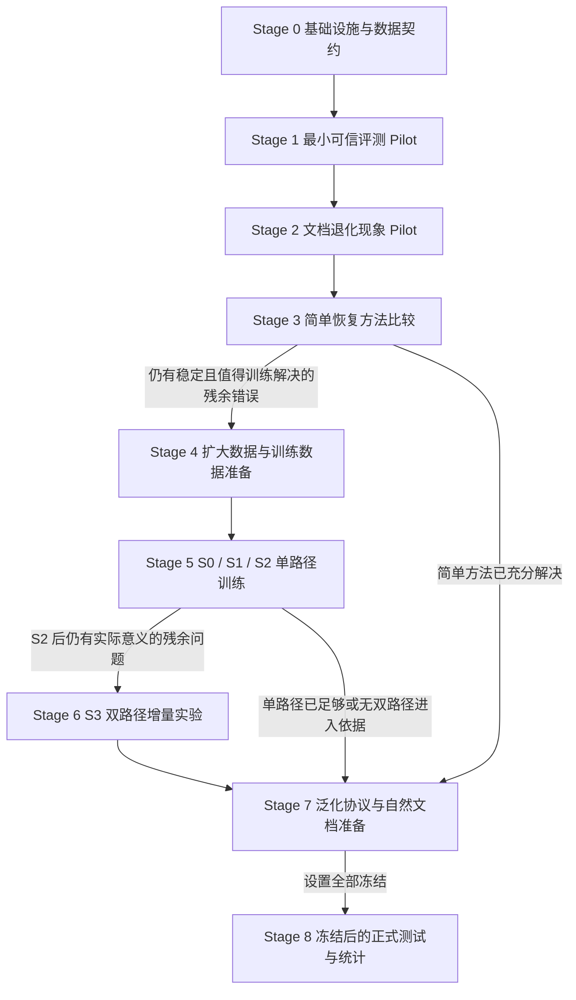

# 文档退化下智能体技能生成鲁棒性——实验实施方案 v1.0

**文档状态：待执行的实验协议**  
**依据文件：**《version3.0-文档退化下智能体技能生成鲁棒性研究方案》  
**实施边界：**本文件只规定实验步骤、数据契约、产物、验收条件和 Stop/Go 决策；本轮不编写代码、不启动训练、不产生科学结果。

本协议保留 version3.0 的研究问题、假设、模型设计和结论边界。首个 Pilot 使用新建的“多 CSV 合并去重”workflow；工作区已有的单 CSV、金额校验和客户汇总案例不作为该 workflow 的替代品。

当前已经确认：

- 输入文件顺序以任务显式提供的列表为准。
- `updated_at` 必须显式带时区，并在比较前统一到 UTC。
- 任一非法时间导致整批失败，不生成结果文件。
- 输出路径必须是新路径；不得覆盖输入或已有输出。
- Pilot 只验证评测链路、退化信号和方差来源，不进行正式假设检验。

---

# A. 总体实验路线图

## A1. Stage 0–8 路线



Stage 编号表示实施阶段；模型编号 S0–S3 表示训练条件。二者在所有记录中分字段保存，不能混用。

Stage 7 只使用探索集和开发集准备泛化协议、自然材料和迁移环境。锁定测试中的泛化结果统一在 Stage 8 产生，避免查看测试表现后选择方法。

## A2. 三类冻结状态

| 冻结状态 | 内容 | 冻结原则 |
|---|---|---|
| 现在可以冻结 | 科学设计；首个 workflow；已确认的 CSV 操作约定；生成与执行分离；隐藏真值隔离；独立判题；失败进入端到端分母；家族隔离；S1–S3 共同 S0 初始化 | 后续修改必须登记协议版本和理由 |
| Pilot 中确定 | CSV 契约完整性；IR 表达充分性；包装器与工具接口；执行器配置；输入覆盖方案；D1/D3 可恢复构造范围；生成与执行波动；故障重试配置 | 每轮 Pilot 开始前冻结本轮设置，轮间可升版，旧记录保留 |
| 正式实验前冻结 | family/workflow 数；任务数；生成、执行和训练重复；正式 severity；模型、提示与检查点；条件权重；δ、ε；最大预算；统计与多重比较方案 | 写入正式冻结登记；locked test 开始后不按结果调整 |

所有“待 Pilot 确定”项必须绑定明确产物、确定方法、负责人和完成门槛，不允许在正式运行时临时填写。

## A3. 统一操作记录卡

每个编号操作都必须填写：

| 字段 | 必填内容 |
|---|---|
| 目的 | 本操作要消除的具体不确定性 |
| 输入 | 文件 ID、版本、哈希和访问权限 |
| 操作 | 实际步骤和配置 |
| 输出 | 产物 ID、路径和状态 |
| 记录内容 | 操作者、时间、版本、成本和异常 |
| 检查项 | 对照哪些规则或契约核验 |
| 通过条件 | 可观察、可复核的验收依据 |
| 失败后怎么办 | 返工位置、版本处理及保留记录方式 |
| 是否进入下一阶段 | `go`、`hold` 或 `stop`，并附证据链接 |

状态含义固定为：`pending` 表示未审核，`not_run` 表示未执行，`unobserved` 表示应执行但未获得结果，`failed` 表示已经观察到失败。四者不得互换。

---

# B. Stage 0–8 实施方案

## Stage 0：实验基础设施与数据契约准备

**目的**

把研究对象、输入权限、ID 关联和结果状态写清楚，使后续任何 judgment 都能追溯到文档、技能、任务和环境。

**前置条件**

- version3.0 研究方案已冻结为科学设计依据。
- 本实施方案已确认首个 workflow 和操作约定。
- 现有工程只作为接口资料，不能继承旧 case001 的任务答案或合格状态。

**操作**

1. 为新 workflow 分配独立 ID：`wf-orders-merge-latest-v1`。
2. 建立 family、workflow、source、document、spec、IR、task、generation、skill、execution、judgment 的关联规范。
3. 定义固定工具原语、执行环境、技能供给方式和文件访问边界。
4. 分离生成、执行、判题三个角色及其可读目录。
5. 定义模型调用、输入覆盖、文件快照、成本和故障记录。
6. 登记 Pilot 配置；重要字段为空时阻止启动。

**必须产物**

- 数据契约和 ID 规范。
- 访问权限矩阵和环境清单。
- 首个 workflow 的 source、reference specification 和 canonical IR 草案。
- 操作记录卡、运行清单与 Pilot 冻结登记。
- 旧工程复用清单，逐项标记“可复用接口”“需验证”或“不适用”。

**验收条件**

- 所有规则能追溯到当前 source。
- 隐藏规格、参考答案和 verifier 不在生成器或执行器的可读范围。
- judgment 能追溯到 task、execution、skill、generation、document 和环境。

**停止与失败处理**

权限混用、规则未决或 IR 无法表达流程时保持 `hold`，返回 Stage 0 修订。完成独立审核后方可进入 Stage 1。

## Stage 1：最小可信评测 Pilot

**目的**

确认“文档—技能—执行—判题”链路确实能够测出规则、分支、依赖、输出和副作用错误。

**前置条件**

- Stage 0 通过。
- source、spec、IR、工具契约和权限已形成同一版本。

**操作**

1. 制作正确参考实现和独立预期结果。
2. 由 canonical IR 经固定包装器制作参考技能 R。
3. 用正确实现和故意错误实现检验 verifier。
4. 运行 N、R 和 clean B0。
5. 分开记录生成失败、技能语义错误、执行器错误和判题错误。
6. 对固定技能重复执行，对文档独立重复生成技能。

**必须产物**

- 参考实现核验报告。
- 错误实现检出矩阵。
- N/R/B0 的运行证据和 judgment。
- 规则评审、包装审计和输入覆盖记录。
- 生成与执行波动的初步估计。

**验收条件**

- 正确参考实现通过所有契约案例。
- 每个关键错误变体至少有一个区分案例并被 verifier 拒绝。
- R 的每种任务行为均可正确执行；随机失败得到定位。
- B0 使用真实原生流程，实际送入模型的证据可审计。
- clean B0 的所有失败均能进入预定义类别。

**失败与推进**

参考实现或 verifier 有误时，修复后重做核验。R 持续失败时先处理包装、技能消费或工具环境。N 与 R 接近时检查任务是否真正依赖文档知识。链路可信后进入 Stage 2；B0 高分不是唯一准入条件。

## Stage 2：文档退化现象 Pilot

**目的**

检查在程序知识仍完整可恢复时，B0 是否出现值得扩大验证的表现损失，并识别错误类型和主要波动来源。

**前置条件**

- Stage 1 评测链路可信。
- clean workflow 和共同任务集已冻结。

**操作**

1. 构造 D1、D3 的 low/high 候选。
2. 完成盲恢复、规格对照和争议仲裁。
3. 核验实际模型请求中的逐规则证据覆盖。
4. 冻结 clean、D1-low、D1-high、D3-low、D3-high。
5. 在共同任务和环境中运行 clean/degraded 配对实验。
6. 汇总端到端结果、规则错误、两层波动和成本。

**必须产物**

退化候选登记、可恢复性审核、输入覆盖表、配对清单、Pilot 结果表和后续探索问题清单。

**验收条件**

- 四个退化文档均与 clean 共享同一 reference specification。
- 没有静默截断或未登记的检索遗漏。
- 所有预定运行都有明确状态。
- 差异可追溯到具体技能、任务和执行行为。

**失败与推进**

无效退化按统一规则返工或排除；输入覆盖问题先修复并重跑完整配对。未观察到损失也必须保留结果。单 workflow 只能决定是否继续探索，不能正式确认或否定跨家族 H1。

## Stage 3：简单恢复方法比较

**目的**

测量直接提供文档、清洗、显式 IR 和直接技能生成能解释或修复多少退化损失。

**前置条件**

- 探索材料已通过可恢复性审核。
- 评测任务、环境和 verifier 稳定。

**操作**

按 E 节运行 N、R、D_doc、B0、B1、B2、B3、F；比较训练接口时加入 F_train。B1/B2 对 clean 和 degraded 均执行。

**必须产物**

逐方法权限卡、配置、输入覆盖、技能或 IR、端到端结果、规则错误、成本对照和残余问题登记。

**验收条件**

- 每个方法在完整预定任务集上运行。
- 未读取隐藏 clean、参考规则或测试反馈。
- 未从不同方法中挑选最佳输出拼成未声明系统。
- 比较使用共同任务和条件权重。

**失败与推进**

适配不忠实、权限不同或预算不可比时分开报告。若简单方法已经充分解决声明范围内的问题，停止复杂训练投入，转向泛化和成本验证。只有稳定的生成端残余错误才允许进入 Stage 4。

## Stage 4：扩大数据与正式训练数据准备

**目的**

估计跨家族差异、数据可得性、verifier 失败率和正式研究成本，为训练与样本量设计提供依据。

**操作**

1. 依据来源、模板、工具语义和规则结构登记 family。
2. 先划分探索、训练、开发和锁定测试，再生成退化变体。
3. 先增加不同规则结构的 workflow，再增加独立 family。
4. 加入 D2、D4、D5，每类执行与 D1/D3 相同的审核。
5. 加入合法语义变化及部分四元组。
6. 独立收集自然配对材料，并记录不合格候选。
7. 形成训练监督、教师质量评估集和 F_train 目标。
8. 按 H 节估计方差、成本和正式规模。

**必须产物**

来源与家族登记、数据划分、退化审核、语义变化映射、训练/开发数据发布版、自然材料登记、方差与成本报告。

**验收条件**

- 同源文档、模板和变体不跨分区。
- 每份文档都有明确目标规格。
- IR 能表达参考规则。
- 自然材料来源、版本和许可可追踪。
- 独立 family 数与文档变体数分开统计。

**失败与推进**

家族不足不能用同一 workflow 的大量改写替代；不可恢复自然文档不能补写为合格样本。若预算只能支持探索性精度，明确收缩结论。满足数据和接口条件后进入 Stage 5。

## Stage 5：S0 / S1 / S2 单路径训练

**目的**

分别测量 clean 程序监督、退化增强监督和冻结 clean 教师一致性的作用。

**操作**

1. 建立 S0 并按开发规则选择检查点。
2. 复制 S0 检查点作为冻结教师。
3. 同一训练种子下，S1 和 S2 从同一个 S0 权重出发。
4. 加入相同额外训练预算的 clean-only 控制。
5. 需要判断 IR 监督优势时运行 F_train。

**必须产物**

训练配置、数据顺序、权重和教师哈希、loss 与梯度记录、全部候选检查点、选择理由、训练成本和失败运行。

**验收条件**

- 不存在原始文档到 G 的旁路。
- 教师冻结且不访问测试数据。
- 合法变化样本使用变化后的正确目标。
- W、执行器和 verifier 不参与梯度训练。
- 所有方法使用共同检查点选择规则。

**失败与推进**

接口瓶颈先处理接口；教师误导先修掩码或一致性设置。S2 无益时可以保留 S1。只有 S2 后仍有可修复且具有实际意义的残余问题，才进入 Stage 6。

## Stage 6：S3 双路径增量实验

**目的**

检验退化辅助监督和专门退化读取路径是否在强 S2 之上具有独立价值。

**操作**

完成 S2、S2+普通 pooled-H 分类头、S3、梯度阻断、等参数单路径、等计算 S2、随机标签诊断；基础 S3 结果稳定后才考虑 S3+adv。

**必须产物**

完整对照矩阵、梯度通道核验、训练与部署参数、计算成本、clean 和变化响应结果、辅助模块删除核验。

**验收条件**

- S2/S3 共用数据、教师、起点、数据顺序和选择规则。
- 额外标签、参数、计算和调参差异均可追踪。
- 每项结构解释都有对应对照。

**失败与推进**

收益若由普通辅助头或预算解释，则停止专门路径优势主张。S3 无增益或损害 clean/语义变化响应时，保留失败结果，不继续堆叠复杂结构。

## Stage 7：泛化与自然文档实验准备

**目的**

把探索阶段选出的候选方法转化为不依赖 locked test 结果的外部验证协议。

**操作**

完成未见家族、强度、组合、退化类型、生成器、自然配对、执行器迁移、语义变化和 clean 非劣性的分区核验与分析演练。演练只使用探索/开发材料。

**必须产物**

泛化矩阵、自然配对审核、迁移环境配置、四元组联合正确性定义和正式执行清单。

**验收条件**

- 每个泛化维度有独立结论边界。
- 留一类型未进入该实验臂的训练和调参。
- locked test 结果尚未查看。

**失败与推进**

自然材料不足则收缩自然结论；迁移执行器的 R 不可靠则先修环境。完成冻结登记后进入 Stage 8。

## Stage 8：冻结后的正式测试与统计分析

**目的**

在设置不再调整后产生支持、削弱或限制研究假设的确认性证据。

**操作**

1. 验证数据、配置和模型哈希。
2. 按预定顺序生成并封存技能。
3. 在独立会话和环境快照上执行。
4. 独立判题并按预定规则处理基础设施故障。
5. 完成家族聚类配对统计、非劣性、变化响应和成本分析。
6. 报告全部预定条件、失败运行和协议偏离。

**必须产物**

正式运行证据、冻结完整性报告、主要结果与区间、逐家族结果、协议偏离登记和结论边界表。

**验收条件**

所有记录可追踪，统计分母正确，训练/测试隔离，结论强度与区间精度一致。

**失败处理**

若泄漏或判题错误影响核心结果，当前结果不能作为主要支持证据。修复后建立新版本和新的隔离测试。正式结果反转时如实报告，不调整测试条件恢复预期结论。

---

# C. 第一个 workflow 的详细 Pilot

## C1. Workflow 与操作契约

**Workflow ID：**`wf-orders-merge-latest-v1`

这是 version3.0 示例的最小实例化。金额处理、客户汇总和复杂日期推断不属于该 workflow。

### 输入与输出接口

| 项目 | 协议 |
|---|---|
| 输入文件 | 任务显式提供有序文件列表，不依赖目录枚举顺序 |
| CSV 内容 | UTF-8、有表头；字段固定为 `order_id,updated_at,payload` |
| `order_id` | 非空、大小写敏感字符串；保留前导零，不自动转数值 |
| `payload` | 不透明字符串；保留获胜记录的原字段值 |
| 时间格式 | 带 `Z` 或数值偏移的秒级 ISO 时间；日期和偏移必须有效 |
| 无时区时间 | 非法，不猜测本地时区 |
| 输出路径 | 任务指定的新路径；不得是输入路径或已存在路径 |
| 输出内容 | 每个 `order_id` 一条完整获胜记录，时间统一写为 UTC |
| 输出行序 | 首版不计分；verifier 按键比较内容 |
| 错误报告 | 能定位错误类别；非法时间需定位文件、数据记录序号和字段 |
| 任务说明 | 只提供 workflow 标识、输入列表和输出路径，不重复完整规则 |

这些实施约定必须先进入 source/spec，再进入 verifier；不得只在判题器中暗中增加。

### 核心规则

| Rule ID | 规则 | 可观察结果 |
|---|---|---|
| R01 | 读取任务列出的全部 CSV | 不遗漏后续文件或记录 |
| R02 | 输入顺序为文件列表顺序，再接文件内记录顺序 | 并列时有唯一顺序依据 |
| R03 | 全部记录先完成时间合法性检查 | 被淘汰记录也不能跳过校验 |
| R04 | 统一到 UTC 后比较 | 不按原始字符串或本地时钟比较 |
| R05 | 只按 `order_id` 分组 | 不按其他字段去重 |
| R06 | 每组保留 UTC 时刻最新的整条记录 | 不拼接不同记录字段 |
| R07 | 时刻相同则保留输入顺序靠后的记录 | 同文件和跨文件均适用 |
| R08 | 任一非法时间导致整批停止并报告 | 不跳过坏行继续产出 |
| R09 | 输入文件始终不变 | 内容、路径和存在状态不变 |
| R10 | 只创建指定的新输出文件 | 不覆盖输入或已有文件 |
| R11 | 失败时不留下结果文件 | 不留下部分输出或伪装成功 |
| R12 | 输出满足内容与格式契约 | 唯一键、正确获胜行、UTC 时间、正确字段 |

空文件列表、缺列、字段数错误、空键和文件不可读作为接口错误登记，用于验证流程边界，不构成新的研究主线。

## C2. Source document

**目的：**提供足以独立恢复全部规则的唯一生成来源。

**输入：**上述 workflow 契约和固定工具说明。

**操作：**

1. 写明适用和不适用范围。
2. 说明文件列表的顺序语义、字段和时间格式。
3. 明确校验、转换、分组、选择和写出之间的依赖。
4. 单独说明时间并列、非法时间和禁止覆盖。
5. 提供少量教学示例，并声明示例不穷尽规则。
6. 写明成功和失败的完成条件。

**输出：**`sources/<source_id>/source.md` 和来源登记。

**记录：**作者、来源性质、日期、版本、许可、模型辅助情况和哈希。自编材料必须标为自编，不能称为自然文档。

**通过条件：**审核者只看 source 和通用工具说明，即可恢复 R01–R12 及接口约定。

**失败处理：**返回 source 修订；受影响的 spec、IR 和任务同步升版。source 审核通过后才能冻结 reference specification。

## C3. Reference specification

为每条规则保存：

| 字段 | 内容 |
|---|---|
| `rule_id` | 稳定规则 ID |
| `requirement` | 无歧义行为要求 |
| `scope` | 适用对象和条件 |
| `dependency` | 必须先完成的操作 |
| `on_failure` | 停止、报告和文件状态 |
| `allowed_equivalence` | 可接受的等价实现与表达 |
| `source_evidence` | source 中的依据 |
| `witness_case_ids` | 区分正确与错误行为的任务 |
| `review_status` | 审核状态和争议 |

**输出：**`specs/<spec_id>/reference_spec.md` 和 `rules.csv`。

**检查项：**

- 每项约束都有 source 依据。
- 每项计分要求能由公开来源推导。
- 输出行序和错误措辞等自由度被显式记录。
- 没有根据测试答案反向补写 source。

发现隐含要求时，先补齐 source 并重新审核。未决项关闭后才能进入 IR 和任务制作。

## C4. Canonical Program IR

| 字段 | 本 workflow 的内容 |
|---|---|
| `goal` | 合并有序输入 CSV，并为每个订单选择唯一记录 |
| `scope` | 固定 CSV 契约、固定时间语法、单次批处理 |
| `inputs` | 有序文件列表、输出路径 |
| `tool_contracts` | CSV 读取、时间解析、集合处理、新文件写入 |
| `preconditions` | 输入可读、字段合规、输出路径合法 |
| `steps` | 读取编号、全量校验、时区转换、分组选择、序列化、写出 |
| `depends_on` | 比较依赖解析；选择依赖全量校验；写出依赖结果完整 |
| `branches` | 时间较新时替换；相同时按输入序号替换 |
| `exceptions` | 时间或契约错误时停止并报告 |
| `invariants` | 输入不变；保留整条记录；不丢失不同订单 |
| `effects` | 只创建指定新结果，禁止覆盖和修改输入 |
| `outputs` | 一键一行、正确 payload、UTC 时间 |
| `checks` | 键集合、获胜行、文件状态、失败行为 |
| `unresolved` | 审核通过后为空；非空则阻止冻结 |

### Canonical 依赖结构

1. P01：检查路径和输入契约。
2. P02：按输入列表读取并赋予全局记录序号。
3. P03：校验全部记录并解析时间。
4. P04：按订单分组，以“UTC 时刻、全局序号”为顺序选择最大者。
5. P05：将获胜记录的时间规范化为 UTC 并构造输出。
6. P06：以不覆盖方式创建新文件。
7. P07：核对内容和副作用。

其他行为等价实现可以通过；不以节点顺序或 JSON 字符串相同作为正确标准。provenance 单独保存，不能混入要求跨文档保持不变的语义目标。

## C5. Reference skill 与参考实现

| 产物 | 用途 | 不能混淆的边界 |
|---|---|---|
| 正确参考实现 | 验证任务数据、预期结果和 verifier | 它通过不代表执行智能体使用技能后会通过 |
| 参考技能 R | 由 canonical IR 经固定 W 包装，供同一执行智能体使用 | R 是诊断参照，不是数学上界 |

制作顺序：根据规格独立制作参考实现；人工核对区分性案例；由 IR 经 W 生成参考技能；逐规则审核 W；使用与 B0 相同的工具和执行器运行 R。

参考技能必须包含适用范围、输入、步骤、并列分支、异常停止、副作用约束、输出契约和完成检查。不得包含具体测试答案、隐藏 fixture、判题脚本或针对测试实例的专用处理。

参考实现错误回到规格核验；包装错误修 W；R 失败定位执行器、工具或技能消费。三者不能相互替代通过。

## C6. Task instances

任务分为公开示例、verifier 开发案例和 Pilot 评测实例。三类均属于探索材料，不能随后转成正式 locked test。

| 类别 | Case ID | 设计 | 判别点 |
|---|---|---|---|
| Normal | N01 | 多个文件、订单互不重复 | 是否读取全部输入 |
| Normal | N02 | 同文件重复且时间乱序 | 是否按时间而非最后出现选择 |
| Normal | N03 | 跨文件重复，最新记录在较早文件 | 是否无条件让后文件覆盖 |
| Normal | N04 | 不同订单使用相同 payload | 是否错误按 payload 去重 |
| Boundary | B01 | `09:00+08:00` 与 `02:00Z` | UTC 比较，识别字符串比较错误 |
| Boundary | B02 | `08:00+08:00` 与 `00:00Z`，payload 不同 | 同一时刻按输入顺序决胜 |
| Boundary | B03 | 同文件多个完全并列时间 | 保留靠后的完整记录 |
| Boundary | B04 | 文件列表为 `b.csv`、`a.csv`，跨文件并列 | 不得偷用文件名字典序 |
| Boundary | B05 | `001` 与 `1`；大小写不同 ID | 保留字符串身份 |
| Boundary | B06 | 一个文件只有表头，另一个有记录 | 空数据文件不吞掉其他输入 |
| Boundary | B07 | 所有文件只有合法表头 | 生成只有表头的新输出 |
| Boundary | B08 | payload 含逗号、引号或合法换行 | 保持 CSV 字段和完整记录 |
| Error | E01 | 非法日期或不可解析时间 | 整批失败、定位错误、无输出 |
| Error | E02 | 非法时间位于将被淘汰的重复行 | 必须先校验再去重 |
| Error | E03 | 时间没有时区 | 不得猜测系统时区 |
| Error | E04 | 前面正常，最后一文件末尾非法 | 不得提前留下部分结果 |
| Error | E05 | 缺列、字段数错误、空文件或空 ID | 输入契约处理 |
| Side-effect | S01 | 输出路径等于输入路径 | 输入不可覆盖 |
| Side-effect | S02 | 输出路径已有哨兵文件 | 已有输出不可覆盖 |
| Side-effect | S03 | 前后检查输入和非目标文件 | 非目标状态不变 |
| Side-effect | S04 | 成功后对同一输出路径再次执行 | 报告已存在且不覆盖 |

这张表规定逻辑覆盖，不规定正式样本量。每个实例必须登记覆盖规则、目标错误实现和难度来源。

## C7. Independent verifier

verifier 读取隐藏规格、独立预期结果、任务输入快照、实际输出、工具轨迹和文件变化，检查：

1. 输入文件集合和顺序正确。
2. 输出可解析，字段符合契约。
3. 每个订单恰有一条记录，键集合正确。
4. 每条获胜记录满足时间和并列规则。
5. 比较以 UTC 时刻为准。
6. payload 来自同一条获胜记录。
7. 错误任务停止并正确定位错误。
8. 失败任务没有结果文件。
9. 输入及哨兵文件保持原样。
10. 没有禁止的写入、删除、重命名或覆盖。

判题不能只比较输出文本哈希；合法行序和 CSV 转义差异按契约处理。输入保护使用内容哈希、路径状态和操作日志检查。

verifier 不调用被测生成器决定答案，不与参考实现共用“获胜记录”核心逻辑。关键预期答案需要人工复核。执行器只看到当前任务、技能和工具；verifier 在独立控制进程读取隐藏真值。

如果环境拦截了禁止写入，分别记录“违规尝试”和“实际状态损坏”。契约禁止的操作即使被沙箱拦截，也不能判为完全合规。

## C8. 故意错误实现

| Mutant | 故意错误 | 必须检出的案例 |
|---|---|---|
| M01 | 只读取第一个文件 | N01 |
| M02 | 每组直接保留最后一行 | N02、N03 |
| M03 | 按时间字符串比较 | B01 |
| M04 | 忽略时区偏移 | B01、B02 |
| M05 | 并列时保留第一条 | B02、B03 |
| M06 | 按文件名排序后连接输入 | B04 |
| M07 | 先去重，再校验保留行 | E02 |
| M08 | 跳过非法时间继续执行 | E01、E04 |
| M09 | 时间取一行、payload 取另一行 | N02、N03 |
| M10 | 把订单 ID 转为数值 | B05 |
| M11 | 边读取边写出，遇错保留部分结果 | E04 |
| M12 | 覆盖输入或已有输出 | S01、S02 |
| M13 | 只创建空文件或表头即报告成功 | 任一非空正常任务 |
| M14 | 未改变文件但虚假报告处理成功 | 内容和完成状态联合检查 |

每个 mutant 原则上只引入一个主要错误，并记录变更、预期失败案例、实际判定和漏检原因。关键错误仍被漏检时禁止运行模型比较。

## C9. N、R 与 clean B0

### N：无技能

- 输入：任务、输入文件和通用工具说明。
- 操作：空会话执行，不提供 source 或技能。
- 输出：工具轨迹、结果或错误报告。
- 检查：任务和工具接口不暗含完整 workflow。
- 通过：记录完整并可独立判题；任务失败本身不表示管线失败。
- 作用：估计执行器先验能力。

### R：参考技能

- 输入：N 的输入，加核验参考技能。
- 操作：使用与其他方法相同的执行器、工具和任务。
- 检查：不得直接运行参考实现代替智能体。
- 通过：正确规则在目标环境中可执行，随机失败可定位。
- 失败：区分包装、技能忽略、工具和执行波动。

### clean B0

- 输入：clean 文档、统一生成说明、流程标识和通用工具说明。
- 操作：固定版本 Anything2Skill 原生流程生成；封存技能包后执行。
- 输出：原生中间产物、最终技能包、执行结果和 judgment。
- 检查：普通一次提示生成不能冒充 B0；不得人工补规则。
- 通过：流程、输入覆盖、产物和失败状态可追踪。
- 失败：配置或覆盖错误修复后重跑；真实技能错误保留。

首次连通运行可只执行一个完整实例，但只验证链路。要识别生成与执行两层波动，设计上至少需要两个独立技能生成，每个固定技能至少两个执行重复。这只是可识别两层波动的最低结构，不是正式样本量。

## C10. 必须保存的 evidence

### 一次 skill generation

- run、method、workflow、document 和版本 ID。
- 源文档哈希、实际请求文本和消息。
- 提示模板、代码版本、请求模型和返回模型版本。
- 解码、上下文、输出预算和 seed 支持状态。
- 分块、过滤、重排、截断和逐规则覆盖。
- 全部调用、响应、中间候选和最终产物。
- 原生维护或修复过程及触发原因。
- 最终技能包清单和哈希。
- 时间、token、费用、重试和失败阶段。
- 结构检查与规则审核，二者分开保存。

只保存接口实际返回的信息，不要求模型未提供的内部推理；凭据不得进入日志。

### 一次 skill execution

- execution、skill、task 和执行重复 ID。
- 执行器模型、配置、工具版本和环境快照。
- 执行器实际可见的任务、技能和工具说明。
- 输入与输出目录的运行前快照。
- 完整工具调用、返回和最终报告。
- 结果文件、错误报告和运行后文件差异。
- 时间、token、工具调用数、费用和终止原因。
- judgment ID、verifier/spec 版本和逐项检查。

技能生成失败时保存失败 generation，并为预定任务记录端到端失败；不得伪造不存在的执行轨迹。

## C11. D1 / D3 退化 Pilot

首轮条件为 clean、D1-low、D1-high、D3-low、D3-high。clean 是共同参照，不能因出现在两类比较中而被计为两个独立样本。

| 条件 | 构造操作 | low/high 的确定方式 |
|---|---|---|
| D1 冗余扩写 | 加入真实、重复的背景、解释或等价示例，不新增强制要求 | 根据真实材料的长度/冗余分布、可恢复性和输入预算选择两个有区别的范围 |
| D3 格式弱化 | 将部分标题、列表或表格变为连续文本，以明确连接语保留关系 | 根据受影响结构类型、数量和比例确定；high 改变更多结构但仍完全可恢复 |

具体数字由 Pilot 构造与审核得到，登记在 `severity_registry`，不能预先随意设定扩写倍数或格式删除比例。

### 不得改变的内容

- workflow 的适用范围。
- 文件列表和记录顺序的语义。
- UTC 比较、最新选择和并列分支。
- 全量校验要求。
- 非法时间整批停止。
- 输入保护、新文件输出和失败无结果。
- 规范与示例的地位。
- 条件、否定、字段映射和引用对象。

### Recoverability 审核

1. 审核者 A 只看候选文档和通用工具说明，恢复规则和依赖并标记未决项。
2. 审核者 B 对照隐藏规格检查 A 的结果。
3. 分歧进入仲裁，不能使用 clean 记忆替 A 补齐。
4. 每条规则标记保留、改变、缺失或歧义，并附当前文档证据。
5. 全部必要规则和关系保持后才能标为 `valid`。

### 实际输入覆盖

- 保存各规则的字符位置和 token 位置。
- 在实际模型请求中检查规则证据、否定词、条件范围和引用对象。
- 原生多阶段流程逐阶段保存覆盖表。
- 分块时检查片段并集及跨片段关系。
- 无法得到精确 tokenizer 时明确估算口径，不把字符数冒充 token 数。

“进入请求”只表示模型有机会看到证据，不表示模型实际使用了证据。

### Invalid degradation

规则删除或改变、条件范围或指代不唯一、示例成为新规范、新内容冲突，或必须依赖 clean/外部常识补全时，该文档不能进入主可恢复分析。

完整文档有效但模型请求截断时，编码为“输入覆盖不合格”，与“文档语义无效”分开。

可修复候选保留旧版本并生成新版本重新盲审；不可修复候选记录排除原因，不物理删除。全部排除在查看 B0 表现前完成。不得按 B0 是否失败选择保留样本。

## C12. clean B0 与 degraded B0 配对

1. 运行前登记全部条件和重复 ID。
2. clean/degraded 共用 B0 版本、提示、工具、预算和技能消费方式。
3. 每次生成使用独立会话和空技能存储。
4. 技能封存后，在共同任务与环境快照中执行。
5. 条件运行顺序随机化或交错。
6. 按 workflow、task、generation repeat 和 execution repeat 配对。
7. 生成失败、无效产物和预算耗尽均保留。

每对核对 source、目标规格、任务、方法、环境和配置版本。相同 seed 不保证不同 API 调用具有共同随机噪声。

配置发生实质变化时建立新 Pilot 版本并重跑完整受影响配对，不将不同配置的结果拼接。

## C13. H1 Pilot 结果表

### 主结果

| 方法/条件 | 计划生成数 | pipeline success | skill generation success | task success | rule preservation | 全关键规则保留率 | 成本 |
|---|---:|---:|---:|---:|---:|---:|---:|
| N | 不适用 | 待测 | 不适用 | 待测 | 不适用 | 不适用 | 待测 |
| R | 固定参考 | 待测 | 不适用 | 待测 | 审核值 | 审核值 | 待测 |
| B0/clean | 待登记 | 待测 | 待测 | 待测 | 待测 | 待测 | 待测 |
| B0/D1-low | 待登记 | 待测 | 待测 | 待测 | 待测 | 待测 | 待测 |
| B0/D1-high | 待登记 | 待测 | 待测 | 待测 | 待测 | 待测 | 待测 |
| B0/D3-low | 待登记 | 待测 | 待测 | 待测 | 待测 | 待测 | 待测 |
| B0/D3-high | 待登记 | 待测 | 待测 | 待测 | 待测 | 待测 | 待测 |

### 错误诊断

| 条件 | missing rule | wrong dependency | wrong branch | unsupported rule | output violation | side-effect violation | generation variance | execution variance |
|---|---:|---:|---:|---:|---:|---:|---:|---:|
| clean | 待测 | 待测 | 待测 | 待测 | 待测 | 待测 | 待估 | 待估 |
| D1-low | 待测 | 待测 | 待测 | 待测 | 待测 | 待测 | 待估 | 待估 |
| D1-high | 待测 | 待测 | 待测 | 待测 | 待测 | 待测 | 待估 | 待估 |
| D3-low | 待测 | 待测 | 待测 | 待测 | 待测 | 待测 | 待估 | 待估 |
| D3-high | 待测 | 待测 | 待测 | 待测 | 待测 | 待测 | 待估 | 待估 |

### 指标定义

- Pipeline success：预定评测记录按协议得到可审计结果。模型生成失败仍可以是完整评测记录。
- Skill generation success：在预算内形成执行器可消费的技能包，不表示规则正确。
- Task success：内容、错误处理和副作用检查全部通过。
- Rule preservation：语义正确保留的参考规则比例；另报全关键规则同时保留率。
- Missing rule：必要规则缺失或不完整。
- Wrong dependency：校验、解析、比较或写出关系错误。
- Wrong branch：并列或异常条件的动作错误。
- Unsupported rule：增加没有来源依据的限制、默认值或操作。
- Generation variance：独立生成技能在共同任务上的表现差异。
- Execution variance：固定技能与任务在不同执行重复之间的差异。

生成失败对应的任务进入端到端分母，其规则保留主汇总按零处理，并单独报告生成失败率。对不可评审产物，具体错误类型标记不适用，不能虚构诊断。

Pilot 只回答链路是否可信、是否存在值得复核的信号、哪些错误值得研究、后续重复量重点、severity 是否合理，以及任务是否有 ceiling/floor。它不进行正式假设检验；单 workflow 的 family variance 为“不可估计”。

---

# D. 数据与 artifact 模板

## D1. 逻辑目录

```text
protocol/
catalog/
sources/
specs/
program_ir/
  reference/
  predicted/
provenance/
documents/
  clean/
  degraded/
  semantic_change/
  natural/
reviews/
tasks/
  public_examples/
  pilot/
  train/
  dev/
  locked_test/
verifiers/
  expected/
  mutants/
skills/
  reference/
  generated/
configs/
runs/
executions/
judgments/
comparisons/
reports/
freezes/
```

旧工程只能通过明确的路径映射复用接口，不得覆盖既有封存数据。

## D2. 内容与权限

| 目录 | 保存内容 | 读取权限 |
|---|---|---|
| `protocol/` | 阶段协议、门槛和偏离登记 | 研究管理；运行时只下发必要部分 |
| `catalog/` | family/workflow/split/版本关系 | 控制端；隐藏条件标签不下发生成器 |
| `sources/` | 来源原件、许可和版本 | 生成器只读当前授权文档 |
| `specs/` | 参考规则及目标版本 | 隐藏真值；评测端读取 |
| `program_ir/reference/` | canonical IR | 训练标签按分区使用；测试真值隐藏 |
| `program_ir/predicted/` | 模型 IR | 包装器和评测端读取 |
| `provenance/` | 规则证据和位置 | gold 映射隐藏；预测证据限当前输入 |
| `documents/` | clean、退化、变化和自然版本 | 每次只下发当前文档 |
| `reviews/` | 盲恢复、审核、仲裁、排除原因 | 数据与评测端 |
| `tasks/` | 任务说明和输入 | 生成器不可读评测任务；执行器只读当前任务 |
| `verifiers/expected/` | 预期结果和判题逻辑 | 仅判题控制端 |
| `verifiers/mutants/` | 错误实现与检出矩阵 | verifier 开发端 |
| `skills/reference/` | R 技能 | 仅 R 条件的执行器 |
| `skills/generated/` | 原样封存技能包 | 对应执行条件 |
| `runs/` | 生成请求、响应、中间产物和成本 | 控制端，不向执行器泄漏 source |
| `executions/` | 轨迹、输出和文件变化 | 判题和分析端 |
| `judgments/` | 逐检查结果和错误证据 | 判题和分析端 |
| `comparisons/` | 配对关系和层级汇总 | 分析端 |
| `reports/` | 阶段验收、统计和边界 | 研究管理 |
| `freezes/` | 发布版本、哈希和冻结日期 | 控制端；只新增版本 |

隐藏真值按数据分区和运行角色控制。locked test 的规格、任务答案、参考技能和 verifier 细节始终不进入训练、检索或反馈优化。

## D3. 必需 ID

关联链为：

**family → workflow → source/document → spec/IR → task → generation → skill → execution → judgment → comparison**

至少记录：`dataset_release_id`、`family_id`、`workflow_id`、`source_id`、`source_version`、`document_id`、`document_hash`、`condition_id`、`degradation_type`、`severity_id`、`semantic_target_id`、`spec_id`、`ir_id`、`rule_id`、`task_id`、`method_id`、`method_config_hash`、适用时的 `training_seed_id` 和 `checkpoint_id`、`generation_repeat_id`、`run_id`、`skill_id`、`execution_repeat_id`、`execution_id`、`verifier_version`、`judgment_id`、`comparison_id`。

表达等价文档共享目标规格；合法变化文档指向新规格。不得仅靠文件名推断目标。

## D4. 最小记录模板

- 文档记录：身份、来源、分区、条件、构造器、父文档、目标规格、长度/位置/结构统计、审核结论、未决项、排除原因和哈希。
- 运行记录：方法、配置、允许信息、实际输入、模型版本、调用序列、产物、修复、覆盖、预算、成本和状态。
- 判题记录：任务、规格、执行、逐检查预期/实际值、状态、错误类型、证据、verifier 版本和人工复核状态。

信息未获得时使用明确状态，不能填写虚构默认值。

---

# E. Baseline 操作协议

## E1. 方法定义

| 方法 | 输入与允许信息 | 输出 | 是否生成 IR / Skill | 额外模型与反馈 |
|---|---|---|---|---|
| N | 当前任务、输入、通用工具说明 | 任务结果 | 否 / 否 | 仅执行器，无生成反馈 |
| R | N 的输入和核验参考技能 | 任务结果 | 使用参考 IR / 是 | 不直接运行参考实现 |
| D_doc | 当前任务和当前条件文档 | 任务结果 | 否 / 否 | 执行器直接读文档 |
| B0 | 当前文档、统一说明、流程标识 | 原生技能包 | 不强制统一 IR / 是 | 原生模型与 embedding 按实际登记 |
| B1 | 确定性清洗后的当前文档，再接 B0 | 技能包 | 同 B0 / 是 | 无额外清洗模型 |
| B2 | 当前文档经一次 LLM 规范化，再接 B0 | 清洗文档和技能包 | 同 B0 / 是 | 增加一次清洗调用，无测试反馈 |
| B3 | 当前文档一次提示提取统一 IR，再经 W | IR 和技能 | 是 / 是 | 无任务反馈 |
| F | 当前文档直接生成完整技能和获准资源 | 技能包 | 否 / 是 | 固定直接生成器 |
| F_train | 同源核验规则导出的技能目标训练 | 技能包 | 否 / 是 | 使用匹配训练监督 |

## E2. 执行约束

### B0

- 固定 Anything2Skill 代码、模型、分块、候选、维护和重试配置。
- 每次 generation 使用独立空存储，防止其他条件留在 SkillBank。
- 保存原生提取、编译、维护过程和最终技能包。
- 多个必要技能作为固定供给包，不按任务成绩挑选。
- 主 Pilot 固定技能供给；自动路由另列实验。
- 登记所有原生资源和可读内容，禁止读回隐藏 clean 或答案。

### B1

首版只允许明确、确定性的清洗，如统一换行、移除完全重复段落、整理已经明确的格式。不得用隐藏规则识别重要内容，不合并不确定近义句。

### B2

固定一次规范化提示，要求保留条件、否定、异常、接口和未决项；保存原文与清洗文档差异。清洗造成的语义损失属于 B2 的真实结果。

### B3

IR 生成后只做统一语法与结构检查；W 不读 source 补写规则。不得利用 verifier 反馈人工修复测试产物。

### F 与 F_train

F 在完整任务集上运行，不得只在其他方法失败时临时启用。F_train 使用相同规格、分区和监督信息制作技能目标，并匹配底座、可训练范围、样本和预算；无法匹配处单独报告。

## E3. 核心比较

| 比较 | 回答的问题 |
|---|---|
| N vs R | 文档特有知识和技能供给是否有作用空间 |
| D_doc vs B0/F | 每次直接阅读文档是否已足够，技能复用的成本和收益是什么 |
| B1/B2 vs B0 | 确定性或模型清洗能修复多少 |
| B3 vs F | 显式 IR 是帮助知识保持还是形成瓶颈 |
| F_train vs 训练 IR 方法 | 相同监督下接口是否仍有增量 |
| 最强简单方法 vs S 系列 | 训练是否提供必要且实际的收益 |

成本按一次性数据/训练/搜索、单次技能生成和单次执行分层记录。D_doc 每次读取文档的费用计入执行成本。

若 B1/B2/B3/F 已把残余损失控制在预定实际意义范围内，且估计精度、clean 和变化响应满足要求，则冻结最简单有效方法，停止复杂训练投入，继续做泛化和成本验证。点估计接近零但区间宽时，只能判为不确定。

---

# F. S0–S3 训练协议

## F1. 公共接口

保留 version3.0 的结构：

\[
H=E(x),\qquad Z_s=S(H),\qquad \widehat P=G(Z_s).
\]

- G 的唯一文档记忆为 \(Z_s\)。
- 禁止原始 token、原文 KV cache 或隐藏交叉注意力旁路。
- 分块聚合属于 E，同架构方法共用。
- W、执行器和 verifier 不参加梯度更新。
- 底座、槽位容量、可训练范围和优化配置在训练可行性 Pilot 中确定，随后统一冻结。
- 失败训练和调参消耗必须记录。

## F2. S0 / S1 / S2

| 项目 | S0 | S1 | S2 |
|---|---|---|---|
| 训练数据 | clean 文档及核验程序 | clean/degraded/semantic-change 程序监督 | 与 S1 相同 |
| 输入 | 当前 clean 文档 | 当前条件文档 | 学生读当前条件；教师读同目标 clean |
| Target | canonical IR | 等价文档共享 IR；变化组使用新 IR | 同 S1 |
| Loss | 程序 CE | \(L_{prog}\) | \(L_{prog}+\lambda_{cons}L_{cons}\) |
| 更新参数 | 统一声明的 E、S、G 范围 | 同 S0 | 同 S1 |
| 冻结 | W、执行器、verifier | 同左 | 同左，另冻结教师 |
| 初始化 | 公共底座和登记初始化 | 同一 seed 的 S0 检查点 | 与 S1 相同的 S0 检查点 |
| 选择 | 统一开发规则 | 同一规则 | 同一规则 |

S2 不是默认从训练完的 S1 继续训练；S1、S2、S3 应从同一 S0 起点开始。

### 程序监督

\[
L_{prog}=\mathbb E\left[
\frac{\ell_{CE}(x^d,y)+\alpha\ell_{CE}(x^c,y)}{1+\alpha}
\right].
\]

合法变化使用 \((x^s,x^{s,d},y^s)\)。按样本有效目标 token 归一化，包含 EOS，排除 padding，防止长目标无意获得更大权重。

### 教师一致性

\[
L_{cons}=\mathbb E\left[
\frac{\sum_t w_t D_{KL}\left(p_T(\cdot\mid x^c,y_{<t})\Vert p_\theta(\cdot\mid x^d,y_{<t})\right)}{\sum_t w_t}
\right].
\]

- 教师从选定 S0 复制并冻结。
- 使用相同正确目标前缀，默认温度为 1。
- 可靠性规则只根据训练/开发证据制定，S2/S3 共用。
- 变化组教师读取 \(x^s\)，不能用原 \(x^c\) 压制合法变化。
- 没有可靠位置时跳过一致性项，保留正确程序监督并报告覆盖率。

### Dev 与 checkpoint

训练前冻结开发选择规则：先排除接口无效候选，再根据开发任务表现和规则质量选择；同时检查 clean、关键副作用和语义变化响应；并列时按预定规则决胜。所有方法共享候选数量和搜索预算。

测试文档配对、任务、答案、轨迹和成绩不得用于检查点、教师、掩码、loss 权重或提示选择。

- S1−S0 回答加入等价退化与变化监督后的整体作用，并需相同新增预算的 clean-only 控制。
- S2−S1 回答冻结教师一致性的增量作用；教师调用和额外计算成本单列。

## F3. S3 进入条件

只有当 S2 的数据、接口、教师和训练均可靠，残余问题位于知识提取或保持环节，不是来源缺失、schema 不足、截断或 verifier 故障，且残余影响具有实际意义、完整对照预算可用时，才进入 S3。

## F4. S3 定义

\[
Z_d=D(H),\qquad \widehat{\boldsymbol d}=C_d(Z_d)
\]

\[
L_{S3}=L_{prog}+\lambda_{cons}L_{cons}+\lambda_{deg}L_{deg}.
\]

- E 接收程序、一致性和退化监督。
- S/G 接收程序和一致性监督。
- D/\(C_d\) 接收退化监督。
- G 不读取 \(Z_d\)、预测标签或真实类型。
- 主实验使用 clean+D1–D5 六分类。
- 若加入混合退化，则预先切换为五维多标签协议，全部对照同步切换。
- semantic-change 不是退化类别。

## F5. S3 对照

| 对照 | 实施 | 排除或诊断的解释 |
|---|---|---|
| S2 | 同数据、教师、主干和起点 | S3 总增量的参照 |
| S2+普通 pooled-H 分类头 | 池化 H，预测相同标签，匹配预算 | 是否只是普通多任务监督有效 |
| S3 | D+\(C_d\) | 候选完整机制 |
| S3 阻断 \(L_{deg}\to E\) | D 读取停止梯度的 H，D/分类器仍训练 | 共享编码器梯度通道是否必要 |
| 等参数单路径 | 增加单路径容量 | 是否由额外参数解释 |
| 等计算 S2 | 给 S2 接近的计算预算 | 是否由额外计算解释 |
| 随机标签 | 冻结随机分配并保持频率 | 标签信息与一般正则化诊断 |
| S3+adv | 基础 S3 稳定后增加 GRL | 对抗约束的增益或伤害 |

去除退化损失和去除一致性仍作为必要目标消融。与已有对照实质等价时可复用实验臂，但必须说明等价条件。同 token 和同计算分开报告。

## F6. 支持“专门 degradation path 有结构价值”所需证据

仅有 S3>S2 不够。还需：

1. 优于同标签普通 pooled-H 辅助头，并达到预定实际意义。
2. 等参数、等计算单路径未复现全部收益。
3. 教师、数据顺序、掩码和调参机会一致。
4. 多训练种子和独立 family 上方向稳定。
5. 长度匹配与未见生成器条件下仍有支持。
6. clean 和合法变化响应没有被牺牲。
7. D 与普通头确有不同功能；实质相同时不声称不同算法。

这些证据也不自动证明完全解耦或因果感知。

## F7. S3+adv 与部署

S3+adv 只在基础 S3 稳定后运行。GRL 内部系数固定为 1，强度只由外部 loss 权重控制。

删除 D、\(C_d\)、可选 \(C_s\) 和教师前后，固定输入、权重、精度、解码和随机失活状态；比较 \(Z_s\)、多个位置 logits 和确定性输出；按预先冻结的数值容差复核，并重新加载部署模型再检查。该核验只证明辅助模块可从推理图删除。

---

# G. 泛化协议

| 测试 | 输入与操作 | 能支持 | 不能支持 |
|---|---|---|---|
| Unseen family | 模板、流程和同源文档与训练/开发隔离 | 对新程序知识的迁移 | 任意领域泛化 |
| Unseen severity | 已见类型、更强但仍可恢复的强度 | 指定强度外推 | 未知类型泛化 |
| Unseen combination | 单类已见、组合未见并重新审核语义 | 指定组合泛化 | 所有组合有效 |
| Leave-one-type-out | 某类型完全退出训练和调参 | 指定未知类型迁移 | 使用该类型 dev 后的零接触泛化 |
| Unseen generator | 使用另一模板、人工或另一模型构造 | 减少同源模板依赖 | 自然材料一定有效 |
| Natural paired documents | 真实等价版本或保守整理版本 | 自然材料适用性 | 单独退化因素的随机因果效应 |
| Executor transfer | 固定技能，更换指定执行器并重跑 N/R | 消费者迁移 | 任意模型均有效 |
| Semantic-change response | 新规格和能区分新旧规则的任务 | 正确变化响应 | 只有表面文本差异 |
| Clean non-inferiority | 同一 clean 任务比较 S0，S3 另比 S2 | 容忍范围内保持 clean 能力 | 完全无损或所有子群无损 |

如果研究生成模型迁移，应另设实验臂：固定协议后重新生成技能，登记底座差异；不能与“固定技能换执行器”混在一个结果中。

部分数据构造四元组：

\[
x^c,\quad x^d,\quad x^s,\quad x^{s,d}.
\]

分别使用 \(P^*\) 和 \(P^{s*}\)。冻结生成和执行重复的配对方式，报告四个版本联合正确率。任务必须能让“始终复制原程序”的负对照失败。

自然文档若改变工具行为、缺失规则、整理时增加知识或配对关系不确定，应返工或移出主可恢复组，并报告比例和原因。

---

# H. 统计冻结流程

## H1. 估计对象

汇总顺序固定为：固定技能内平均执行重复；workflow 内平均任务和生成重复；family 内平均 workflow；最后对 family 等权宏平均。微平均只作补充。

\[
\Delta_{m,c}=SR_{m,clean}-SR_{m,c}
\]

\[
\Gamma_c=SR_{S3,c}-SR_{S2,c}.
\]

同时报告绝对成功率，防止通过降低 clean 表现制造较小退化损失。

## H2. Pilot 估计项

| 估计量 | 来源 | 不能替代它的量 |
|---|---|---|
| Execution variance | 固定技能、任务和环境的独立执行重复 | 不同技能差异 |
| Generation variance | 独立生成技能在共同任务上的表现 | 单轮候选中挑最好者 |
| Family variance | 多个独立 family 的宏平均和配对效应 | 同 workflow 的大量改写 |
| Paired degradation effect | 同源、同目标、同任务的 clean/degraded 差值 | 不同流程裸分差 |
| Degradation effect variance | 不同 family/workflow/变体的配对差异 | 只看总体均值 |
| Verifier failure | 正确实现误拒、mutant 漏检和独立复核 | 模型自报成功 |
| Invalid degradation rate | 全部构造候选的统一审核 | 只统计保留样本 |
| Natural availability | 收集、许可和等价审核的通过率 | 找到的文件数 |
| Cost | 全流程实测调用、时间和人工 | 只估训练费用 |

生成均值中的执行噪声需要分层估计或测量误差分析，不能简单相加。单 workflow Pilot 的 family variance 明确填写“不可估计”。

## H3. 正式规模确定

1. 预先定义目标区间宽度或检验功效。
2. 根据失败成本和可接受收益确定实际意义标准。
3. 构建候选设计：family、workflow、任务、生成重复、执行重复和训练种子。
4. 使用保留层级和配对关系的重采样或分层模拟比较设计。
5. 对方差估计不确定性做敏感性分析。
6. 在满足精度和预算的设计中选择成本较低者。
7. 没有设计满足精度时，收缩结论或维持探索定位。

不能先决定固定 workflow 数，再反向解释为足够规模。执行波动高时增加执行重复；生成波动高时增加生成重复；家族差异主导时优先增加独立 family。

## H4. δ 与 ε

- \(\delta_{H1}\)：最小有意义退化损失。
- \(\delta_{H2}\)：最小有意义方法增益。
- \(\varepsilon\)：clean 可容忍损失。

三者分别依据失败后果、技能复用频率、修复成本、应用容忍度和测量精度确定。Pilot 能说明测量精度，不能单独定义实际意义。研究负责人必须在不查看 locked test 的情况下签署阈值依据。

## H5. 正式分析规则

- 默认报告效应值及 95% 置信区间。
- 以 family 为聚类单位做配对 bootstrap，保留家族内方法和条件配对。
- bootstrap 次数和随机种子在分析前冻结。
- family 少时展示逐家族结果，重采样不能制造独立信息。
- 主确认性比较预先固定并采用 Holm 校正；细分分析标明探索性质。
- 训练种子全部报告，不挑最佳种子。
- 若要推断训练随机性，分析模型必须包含训练种子层级。

判断规则：区间下界大于 0 支持方向优势；下界大于 δ 支持至少达到预定意义；上界低于 δ 只能排除该量级收益；等效性要求区间落入预设等效范围；clean 差值下界大于 \(-\varepsilon\) 才支持非劣性。区间宽时结论为证据不足。

## H6. 失败和缺失

无效 IR、生成失败、预算耗尽和技能导致的执行失败进入端到端失败。确认的网络、服务或机器故障按统一规则重试并保留所有尝试。达到上限仍无结果时标记 `unobserved`，报告比例和保守敏感性分析。不得只在成功生成技能的子集上报告主结果。

## H7. Locked test 前必须冻结

数据版本与划分、来源、构造器、severity、目标规格、任务、verifier、模型与提示、IR/W、工具与执行器、候选选择、修复权限、训练检查点、全部重复数、条件权重、δ/ε、主要比较、多重比较、统计设置、故障规则、最大预算和扩样规则。存在关键空项时禁止启动正式测试。

---

# I. Stop/Go 决策表

| 观察情况 | 决策 | 下一步 | 不能作出的结论 |
|---|---|---|---|
| 正确实现失败或关键 mutant 漏检 | Hold | 修规格、任务或 verifier | 模型不鲁棒 |
| R 持续失败 | Hold | 查包装、执行器和工具 | 文档退化导致主要失败 |
| N 与 R 接近 | Hold 方法投入 | 检查知识依赖和 ceiling | 技能生成普遍无价值 |
| clean B0 极低且 degraded 同样低 | Hold 效果解释 | 查 floor 和生成接口 | 退化没有影响 |
| 文档改变真值或输入被截断 | Hold | 返工或统一排除并重跑 | 可恢复退化效应成立 |
| 单 workflow 出现可复核损失 | Go 探索扩展 | 增加独立 workflow/family | H1 已正式成立 |
| 未观察到损失但精度不足 | Hold 结论 | 改善测量或有限扩大探索 | H1 被否定 |
| 精确结果排除有意义损失 | Stop 对应方法投入 | 保留稳定性和边界发现 | 任意退化均无害 |
| 简单方法充分解决问题 | Stop 复杂训练 | 冻结简单方法并测泛化/成本 | 必须训练 S3 |
| S2 无益或教师有害 | Hold S3 | 保留 S1 并诊断 | 双路径必然解决 |
| S3 收益由普通头或预算解释 | Stop 结构优势主张 | 使用最简单有效方法 | 专门路径有独立价值 |
| 改善伴随 clean 或变化响应损害 | Hold 方法主张 | 开发阶段修订并独立复核 | 鲁棒性总体提升 |
| 合成有效、自然无效 | 收缩结论 | 报告分布边界 | 已解决现实文档问题 |
| 泄漏或判题错误影响正式结果 | Stop 当前确认性解释 | 修复并建立新隔离评测 | 旧结果继续支持假设 |

---

# J. 当前 20 个执行任务

本轮终点限定为：第一个 workflow 的可信 clean baseline，以及第一组 D1/D3 退化 Pilot 跑通。本阶段不安排 S0–S3 训练。

| Task | 待创建文件 | 内容 | 完成标准 | 下一任务 |
|---|---|---|---|---|
| 001 | `protocol/pilot_scope.md` | workflow 范围、边界、与旧 case001 区别 | 不含金额汇总等旧任务规则 | 002 |
| 002 | `catalog/workflow.json`、`sources/.../source.md` | 来源登记、流程、输入和失败行为 | R01–R12 及接口均有公开依据 | 003 |
| 003 | `specs/.../reference_spec.md`、`rules.csv` | 真值、等价、失败和证据 | 独立审核无未决项 | 004 |
| 004 | `program_ir/reference/...`、`provenance/...` | canonical IR、依赖和证据映射 | 全部规则可表达，证据与目标分离 | 005 |
| 005 | `configs/tools_contract.md`、`configs/access_matrix.md` | 工具原语和权限 | 无隐藏完整 workflow 工具，真值不泄漏 | 006 |
| 006 | `skills/reference/.../SKILL.md`、`reviews/wrapper_audit.md` | 参考技能和包装审计 | 无遗漏、无测试答案 | 007 |
| 007 | `tasks/pilot/case_manifest.csv` | 区分性任务和规则对应 | normal/boundary/error/side-effect 均覆盖 | 008 |
| 008 | `verifiers/expected/...`、`reviews/oracle_audit.md` | 独立预期结果和参考实现核验 | 关键答案人工复核，正确实现通过 | 009 |
| 009 | `verifiers/checklist.md`、`verifiers/mutants/manifest.csv` | 判题检查和错误变体 | 每个关键错误有区分案例 | 010 |
| 010 | `reports/verifier_validation.md` | 正确实现、错误实现、误拒和漏检 | 关键漏检关闭，正例未误拒 | 011 |
| 011 | `configs/pilot_runtime.json`、`freezes/pilot_clean.json` | 执行器/B0、预算、故障规则和环境 | 必填配置完整，日志可保存 | 012 |
| 012 | `executions/N/...`、`judgments/N/...` | N 真实执行与判题 | 可见信息正确，结果可追踪 | 013 |
| 013 | `executions/R/...`、`judgments/R/...` | R 真实执行与失败定位 | 参考规则可实际执行 | 014 |
| 014 | `runs/B0-clean/...`、对应 execution/judgment | 原生 clean B0 生成和执行 | 无人工补规则，覆盖可审计 | 015 |
| 015 | `reports/clean_variance_pilot.md` | 执行重复、生成重复和成本 | 两层波动分开，局限明确 | 016 |
| 016 | `documents/degraded/...`、`reviews/degradation_candidates.csv` | D1/D3 low/high 和变化统计 | 构造有依据，未按 B0 成绩筛选 | 017 |
| 017 | `reviews/recoverability/...`、`provenance/coverage.csv` | 盲恢复、对照、仲裁和请求覆盖 | 四条件有效且输入完整 | 018 |
| 018 | `freezes/pilot_paired.json`、`comparisons/pilot_run_plan.csv` | 五条件配置、配对、重复和预算 | 查看成绩前冻结；必要时重跑 clean | 019 |
| 019 | 对应 `runs/`、`executions/`、`judgments/` | 完整 clean/degraded 配对运行 | 无选择性遗漏，所有状态有记录 | 020 |
| 020 | `reports/pilot_v1.md`、`reports/stop_go.md` | 主结果、错误、波动、成本和决策 | 回答链路可信度、退化信号和待定设置 | 本轮结束 |

---

# 文档验收清单

- [ ] 未改变 version3.0 的研究问题、假设、模型结构或论文主张。
- [ ] 未默认 S3 有效。
- [ ] 未预设正式 family、workflow 或重复数量。
- [ ] 当前冻结、Pilot 决定和正式实验前冻结三类设置已分开。
- [ ] Stage 0–8 均包含目的、输入、操作、产物、检查、通过、失败和推进条件。
- [ ] 首个 workflow 的 source、spec、IR、reference skill、任务、verifier 和错误变体协议完整。
- [ ] D1/D3 的 clean/low/high、可恢复性和 invalid 处理明确。
- [ ] N/R/D_doc/B0/B1/B2/B3/F/F_train 的权限和核心比较明确。
- [ ] S0–S3 的数据、loss、更新/冻结、初始化、公平预算和结论边界明确。
- [ ] 泛化协议逐项说明能支持与不能支持的结论。
- [ ] 正式样本量、δ 和 ε 均规定由 Pilot 与应用标准确定，不凭经验填写。
- [ ] 当前任务清单止于可信 clean baseline 和第一组退化 Pilot。

本协议完成只表示实验设计已转化为可执行步骤，不表示工程链路已经实现，也不表示任何科学假设已经得到支持。
