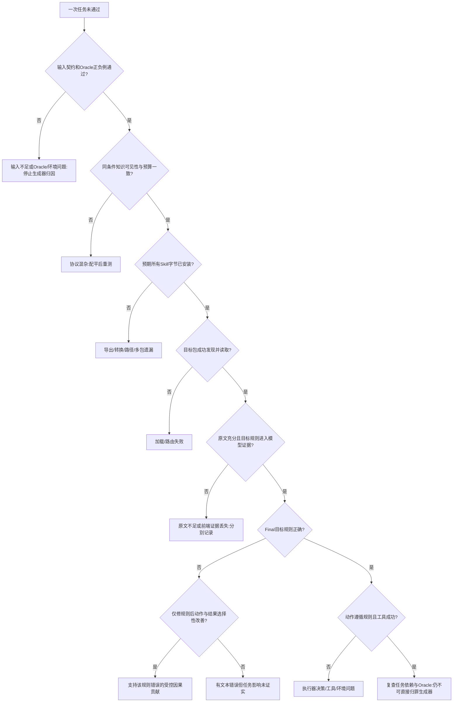

# Anything2Skill × SkillGenBench 可行性审计与退化文档研究方案裁决

审计日期：2026-10-15（Asia/Shanghai）。本轮是方法、数据、接口与测量有效性审计，不是实验实施。未调用付费模型，未运行下游 Agent，未启动或安装 Docker，未修改官方源码、任务、测试、五个历史 Clean run 或其 47 份 canonical SKILL.md。

**总决策：CONDITIONAL GO，仅继续建立一个通过验证的最小测量单元；当前“原样接入公开代码并开展完整退化实验”的方案为 NO-GO。** 不应立即开发新生成算法，也不应批量生成退化技能。方法适配性为 CONDITIONAL PASS；当前评测有效性为 FAIL；支撑完整研究问题的数据充分性为 FAIL；研究价值为 CONDITIONAL PASS。FAIL 指当前证据和交付状态，不是断言永远无法修复。

## 1. 研究问题、版本与证据边界

固定研究对象是：来源文档发生可恢复的结构、证据访问或上下文退化后，技能生成如何保留关键条件、例外和动作语义，并影响下游结果。主要问题不是谁在官方榜单上最高，也不是重新建设通用 Agent 框架。

建议收紧后的可证伪主张：在相同来源、任务、执行器与可用知识条件下，预先编译并冻结技能的工作流，是否与逐任务读取文档的工作流呈现不同的退化风险；差异是否与可定位的规则编译错误一致，并可通过局部修复、反向破坏和 sham 对照选择性影响依赖任务。不能预设 Skill 路径更好。

### 1.1 本轮实际访问的版本

| 对象 | 固定身份 | 核验范围 |
|---|---|---|
| Anything2Skill 论文 | [arXiv:2606.09316v3](https://arxiv.org/html/2606.09316v3)，2026-06-19 | 方法与实验设置全文 |
| 官方 AutoSkill 固定源码 | `94c47ca488d4ba4117d20272e66d49b9877e68cf`，提交时间2026-05-10T15:40:17+08:00 | 独立完整clone、checkout clean；164个历史指纹文件与本地逐字节相同，149个Python AST也一致 |
| 本地研究仓库 | `D:/AS/AutoSkill-main`，HEAD `ace65737e8d0be08eda1c47d5a8e62f119989ded`，2026-10-14T22:12:44+08:00 | remote 是 `lily400/AutoSkill-main`，不能冒充官方提交 |
| 本地官方实现副本 UP | `D:/AS/AutoSkill-main/AutoSkill-main` | 无独立 `.git`；五次run的164个指纹与当前及上述官方提交一致；两核心模块路径集合共66文件，无增减且全部包含于164清单 |
| 实验工程 LAB | `D:/AS/AutoSkill-main/degradation_failure_lab` | 两份指定报告、全部五个 run 的清单/阶段产物与47份 canonical |
| SkillGenBench 论文 | [arXiv:2605.18693v1](https://arxiv.org/html/2605.18693v1)，2026-05-18 | 方法、设置、实验和局限全文 |
| SkillGenBench 官方源码及附带数据 | `5a8bd61d8191e34fa1bbbffbff7f70db1d2a027d` | 独立目录完整 clone；全部187任务结构与64文档任务内容审计 |
| Hugging Face 数据集 | `4e23915c65f0f1e7c8bacea00feb33974d936ef9`，API lastModified 2026-05-06 | 全文件名元数据与具名样本核对；不是全库逐字节下载复验 |

SGB源码快照位于 `C:/Users/lily/Documents/ChatGPT/回归解决退化文档/audit_2026-10-15/SkillGenBench`，官方AutoSkill在同级`AutoSkill-official-94c47ca/`。下文 `SGB/` 指该固定提交；`UP/`、`LAB/` 指上述本地目录。164文件逐项证明见`official_autoskill_comparison.json`；这使所审核心代码结论适用于该官方提交，但不宣称未比较文件也完全相同。详细行号、永久 GitHub 链接和复核脚本见审计证据包。新增报告前，本地研究仓库无 tracked dirty，仅两份已有研究报告未跟踪；两个官方clone均未修改。

**必须分开两个公开数据版本。** GitHub 使用 `code_doc/domain_knowledge_doc/code_repo`；HF 固定快照使用 `doc2skill/cl_tasks/repo2skill`。已下载的 HF `scikitimage-task-002/task.json` 严格 JSON 解析通过，而 GitHub 对应文件失败；HF 另保留 release metadata。部分原文与测试经统一换行后相同。HF 任务 CSV 和若干样本遇 TLS EOF，未取得的文件标为未核验，不能声称两套发布字节相同，更不能把 GitHub 全量 JSON 错误推广为 HF 全量错误。详见 `hf_github_comparison.json`。

### 1.2 证据等级与覆盖率

- **OBSERVED_STATIC**：直接读取文件、解析格式、核对哈希、审阅代码和断言。可证明代码路径与数据现状，不能证明 Agent 真的执行过该分支。
- **OBSERVED_OFFLINE**：运行无模型的纯函数、输出布局夹具、官方比较函数和参考代码。路径重绑定、Python/库版本均记录；不是官方容器成绩。
- **INFERRED**：由机制提出适配性、潜在混杂或退化适用性判断。
- **UNVERIFIED**：真实技能加载、执行器表现、完整 Docker 重现、跨来源因果效果、统计功效等。

全量检查包括：187份生成任务描述、187份评价配置/目录结构；全部64文档任务的 instruction、docs、test.sh、eval.py及领域 testcases；36领域任务308个案例的参考实现与实际比较函数离线回归；两项 scikit-image 任务的正确/错误提交物探针，以及Scrapy024的单规则变异判分。没有对123个 Code Repo 做同等深度的语义 Oracle 审核；它们只作为结构性补充调查。没有把机器扫描字段当成人工证明每条规则均充分受支持。

## 2. Anything2Skill 的输入与方法适用边界

### 2.1 五个不同门槛

| 门槛 | 应检查的事实 | 不能推出什么 |
|---|---|---|
| 格式可读取 | loader输出非空文本、编码/布局转换无遗漏 | 不能推出存在可用操作知识 |
| 能提取 Skill | 有候选、Draft、Spec、canonical | 不能推出步骤受原文支持 |
| 来源充分支持 | 原子规则与实际模型可见证据逐条对应 | 不能推出规则与目标任务相关 |
| 与目标任务相关 | 任务动作确实需要这条规则 | 不能推出执行器发现或遵循规则 |
| 帮助完成任务 | 固定执行器、可信 Oracle、配对对照与行为证据 | 不能仅由文件存在、frontmatter合法或检索命中认定 |

论文的对象是含潜在程序性知识的异质知识记录；并非对任意文件、任意背景知识都保证产生有效能力。输入可包括手册、对话、日志等，但有效技能仍需可复用动作、约束或判断规则。论文包含 Base、RAG、Skill-only、Skill+RAG 设置，不能误称只评测了 RAG+Skill。[方法原文](https://arxiv.org/html/2606.09316v3#S3)

### 2.2 当前实现的格式、长度与结构限制

`UP/AutoSkill4Doc/document/file_loader.py:21–81,84–146,185–252`：文本/Markdown/JSON/JSONL可作为文本读入；目录递归排序、按文件形成单元。PDF、图片、音视频、压缩和二进制明确跳过，没有 OCR 或页面布局理解。DOC/DOCX依赖 textutil/antiword/catdoc，当前 Windows 不保证这些工具可用。HTML能作为字符串读入，不等于 DOM/链接/图表结构恢复。UTF-8正常读取没有统一8 MB上限，8,000,000字节限制只在解码失败的回退分支。

`windowing.py:143–157,270–284,633–706` 按空行分段，筛选过程信号/锚点段落及短普通段。长表格和纯说明段可能在模型前被丢弃。窗口目标默认2400字符、section上限10000；2400不是不可突破的硬上限，单段可更长。`ingest.py:1116–1121`没有把案例配置chunk=6000直接用作该窗口上限。应记录实际window payload，不能仅根据配置名推定输入长度。

因此对视觉布局退化，当前方法首先缺原生视觉输入；把PDF转Markdown可以作为独立前处理，但必须冻结转换器并记录页面—段落对应。研究纯文本标题、表格展平、跨段位置、相关干扰，才与当前接口直接相容。

### 2.3 内容类别裁决

| 文档内容 | 可否作为研究输入 | 限制 |
|---|---|---|
| CLI/API操作规则、参数条件、顺序、异常处理 | 优先 | 需证明关键信息实际进入window |
| 禁止事项、条件规则、领域判断 | 可以，条件适用 | 可编成safety_rule/knowledge_reference；不必有完整长流程，但应有可操作约束 |
| 概念、背景、结果叙述 | 仅部分 | `prompts.py:61–80,181–196`允许空规划/null；不能强迫编造步骤 |
| 只有任务目标/输出格式 | 不足以证明Doc-to-Skill能力 | 最多提取任务契约；完整操作来自模型先验时不是来源知识恢复 |
| 函数名称目录而无参数/语义 | 不足 | 名字可以触发先验，却没有可审的规则来源；NeuroKit2是实际例子 |
| 多文件交叉引用 | 可逐文件读入，条件适用 | 没有自动保证跨文件证据联合推理 |

理论方法的边界是“有可提取、可复用的程序性/约束知识”；实现额外受格式、窗口筛选、taxonomy、预算、解析回退等限制。即使成功生成，摘要式、与任务错位、依赖环境缺失、过度概括、缺关键例外或纯重复instruction的Skill，都不构成有效下游帮助。

### 2.4 真实多文件调用链与来源追踪

`file/data → text unit → DocumentRecord/section → window → Plan → Expand → SkillDraft+SupportRecord → compile → SkillSpec → registry reconciliation → canonical → visible tree`。

关键代码：`ingest.py:873–907,1057–1123`；`stages/extractor.py:756–795,857–928,1022,1099–1105`；`stages/compiler.py:185–204,244–341,498–514`；`store/versioning.py:2403–2453,2484,2602`。compile分组含doc_id；跨文件并非先合并成一个完整上下文，后续registry才可能检索、合并或更新。每个来源×条件应使用独立空SkillBank，冻结顺序和配置，否则旧Clean知识可污染Degraded。

SupportRecord含路径、span、excerpt、关系和confidence，是很好的追踪起点，但不是逐断言蕴含证明。实际窗口可能拼接非连续段落，span只是包围区间；53个support中21个excerpt为raw_text连续子串，17个与标注span文本在去首尾空白后吻合（不是逐字节相等）。其它记录不因此自动判伪造，但“规则位于span内”不足以证明它真的被模型看到。应加原子规则ID和实际曝光段映射，不改写历史产物。

### 2.5 五个 Clean run 的当前核验

| 来源案例 | run ID | Window | Draft/Spec | canonical |
|---|---|---:|---:|---:|
| qsv select | `raecd75e08b34` | 2 | 4/4 | 4 |
| qsv sort | `rd9ced750fa54` | 1 | 3/3 | 3 |
| Docker cp | `rab9a070dfa59` | 1 | 2/2 | 2 |
| git restore | `r18307cee4f4c` | 10 | 17/17 | 14 |
| ripgrep guide | `r64cee24fae18` | 12 | 27/27 | 24 |
| 合计 | 5 runs | 26 | 53/53 | 47 |

47份canonical均存在、官方loader可解析；1643条产物清单哈希全匹配。五案不是旧git reset/未完成ripgrep。它们是5篇文档、4个工具来源生态，尚无真实下游Agent试验。

已核实的Clean问题：qsv sort的关键参数规则在window前消失；select选择/排除与输出契约矛盾；Docker cp遗漏“源为文件”的错误分支前提；git restore混淆显式source与staged默认源；ripgrep把replace输出替换写成可能改文件。这些是规则文本/曝光错误，不是已证实的任务失败或负迁移。

另有确定性的注册回退问题：47个CREATE模型响应均截断且非完整JSON，官方解析器返回内部list，`versioning.py:1378–1384`缺合法action时默认create；6个DISCARD是完整JSON。不能把active状态当质量审核通过。修改该逻辑将构成新的生成方法变体，不能静默修B0后仍称原版。

**旧报告所述44个exports复制错配本轮未复现。** 当前五组身份正确，非Case001与Case001各11个同名JSON均不相同。Case002 export PARTIAL仅因model_stage_ingest标记，实际run完成且哈希通过。报告历史线索与当前观察必须分开。详细证据见 `anything_audit.md`、`clean5_inventory.json`、`clean5_register_response_audit.json`。

## 3. Anything2Skill 与 SkillGenBench 的系统比较

| 维度 | Anything2Skill本地受评实现 | SkillGenBench固定发布 |
|---|---|---|
| 研究问题 | 从既有知识编译可复用能力 | 比较不同技能生成管线的下游效果 |
| 方法/Benchmark | 生成与管理方法 | 数据、生成接口、执行器、验证协议；不是另一单一生成算法 |
| 输入 | 知识记录/多文件文本 | 仓库材料、API页面/片段、领域context及任务材料 |
| 生成时知道任务 | 不必知道；domain/taxonomy先验存在 | conditioned读instruction；agnostic设计上只读collection材料 |
| 划分/取证 | 章节与证据window、Plan-and-Expand | baseline自行读材料；naive按路径拼接、字符截断 |
| 生成方式 | Plan→Expand→Draft→compile→register | 可替换generator；公开快照实际仅naive实现及共享辅助 |
| 中间表示 | Draft/Spec/Support/registry决策 | 标准artifact及元数据；各baseline内部表示不同 |
| 粒度 | 一来源可产生多个技能 | 默认每task或shared映射一个package |
| 合并/版本 | 支持多种生命周期动作与持久SkillBank | 输出路径按method/model/run管理，不等于语义技能版本管理 |
| 输出 | frontmatter+Prompt+规则章节，可有文件资产 | 根SKILL.md及可选scripts/references；单子包兼容 |
| 加载 | 内置chat读Prompt并注入文本 | Claude Code原生目录发现+Skill调用；全文和资产可访问 |
| 下游评价 | 本地LAB尚无工具执行Oracle | task.toml→容器→agent_output→tests/test.sh→reward/CTRF |
| 退化研究价值 | 可追踪错误在哪一阶段发生 | 可复用任务与部分verifier，但须修测量协议 |

SkillGenBench论文区分task-conditioned和task-agnostic；公开代码两分支分别读任务材料与shared材料，但agnostic产物和eval查找路径未接通。输入端也有缺口：Code Doc的9组与Domain的36组，其`shared/materials/docs`和`shared/materials/tools`均无文件，而naive的agnostic函数只读这两处（`generate_skill.py:283–304`），文档与辅助材料实际均为`(none)`。因此单修路径仍不是有效的文档技能基线；须显式构建来源语料并披露适配。论文描述不是当前公开程序每一条路径均正确运行的证明。[设置原文](https://arxiv.org/html/2605.18693v1#S3.S2)

### 3.1 两种接入方式必须分名

**A：A2S-original-agnostic。** 先冻结来源白名单，只输入原始context/API材料，排除当前任务instruction、materials/docs/task.json、测试、参考答案和gold skill。每来源生成一次全部canonical；任务出现后只做冻结库检索/安装。task-local文档本身已由任务选择时，应标“task-curated corpus”，不能冒充完整原始手册的严格盲生成。按来源构建文档并集也是明确的数据协议适配，须在看测试结果前固定。

**B：A2S-task-conditioned。** 将instruction、任务导向证据选择或任务导向候选筛选加入生成阶段。它是派生变体，与原始A2S不是相同基线，必须和同样看到任务的naive等比较。不能把“B胜A”解释成退化鲁棒性改进；新增信息本身可能解释差异。推理时检索已有技能与生成时看任务是两个环节。

主研究采用A；B只作明确标注的任务条件化对照，不是理论性能上界。保留原47份文件，所有转换、修复和干预只放派生副本。

## 4. 为什么保留 Anything2Skill，比较基线怎么选

保留它作为主要受评生成器的理由是**机制可观察**：window、Plan、Expand、Spec、注册日志让结构扰动→证据缺失→规则错译有定位机会；条件、约束、禁忌和provenance便于原子规则审核。选择它作为起点不意味着它对所有文档最佳。

劣势是多轮成本、治疗领域模板偏置（39/47有Therapist标题）、窗口丢失、重复改写、注册回退、skill粒度/检索竞争及持久库污染。本批53个Spec各只引用一个draft，未实际覆盖多草稿合并行为；不能从本批声称合并机制已充分测试。

最低比较集建议：

1. 同源、同生成模型、同任务可见性、预先冻结的直接Doc-to-SKILL提示基线。预算同时报告真实成本与固定上限；不强迫不同算法消耗相同调用次数。
2. 原版A2S B0；身份/日志/路径修补记B0+infra，任何window/compile/register/候选选择改变另名方法。
3. 一个可复现的强Doc-to-Skill近邻，优先按材料选Ctx2Skill或SkillSeekers/SkillNet；必须先核其完整代码、成本和原始推理信息，而非只借方法名称。
4. NoSkill、DirectDoc用于归因，不取代生成方法比较；Corrected/Gold仅诊断，不作为可公平部署的自动生成算法。

SkillGenBench发布目录中仅有naive generator；SkillNet、SkillSeekers等名称出现在批脚本，并不代表其benchmark适配已公开。naive简单、成本低、易定位，但默认任务条件化、字符截断；A2S证据层更细，但不天然更准确。SkillNet官方支持文档创建和结构评价，SkillSeekers官方提供文档站点/仓库/PDF转换；这些说明它们值得比较，不是性能优越证明。[SkillNet官方](https://github.com/zjunlp/SkillNet)，[SkillSeekers官方](https://github.com/yusufkaraaslan/Skill_Seekers)

Ctx2Skill是更直接的上下文到技能近邻：用自对弈发现/修订技能，推理仍同时给原context；移到skill-only必须另报适配。Skill-α最新v3已有局部编辑与rollback对照，且讨论证据重排/分块敏感性。**局部改一条技能再测、或者添加Clean/Degraded，本身不够新。** 我们需证明可恢复退化下的规则保真机制、两工作流的风险交互及多任务选择性传播，并在独立来源上验证。[Ctx2Skill v4](https://arxiv.org/html/2604.27660v4)，[Skill-α v3](https://arxiv.org/html/2608.01678v3)

若A2S在合格Clean来源上系统性无目标规则，而直接提示/其它方法可保留，应把它降为失败诊断基线；不因已有投入坚持主方法。若研究核心转为原生PDF视觉布局恢复，则当前A2S接口不适合作为唯一主要基线。

## 5. 真实数据规模、来源与Oracle清单

### 5.1 计数定义与全量结果

以下为GitHub固定快照实测。document是task-local `materials/docs`的叙述文本文件，不含任务JSON描述；unique document按SHA-256内容去重，**不是独立出版物数**；document set是每任务的文档hash集合；source group是发布的collection_slug，还需查上游共同来源。字符数按扫描脚本口径统计，不能冒充token。

| 类别 | 任务 | 发布来源组 | 文本路径数 | 去重文本数 | 去重文档集合 | 单文件字符 min / median / max | 每任务文档集合字符 min / median / max |
|---|---:|---:|---:|---:|---:|---|---|
| Code Doc | 28 | 9 | 70 | 37 | 24 | 159 / 1423.5 / 67593 | 300 / 7020.5 / 136431 |
| Domain Knowledge Doc | 36 | 36 | 36 | 36 | 36 | 16323 / 61061 / 179801 | 同左 |
| 文档合计 | **64** | **45** | **106** | **73** | **60** | 逐文件见清单 | 不能按64当独立文档 |
| Code Repo补充 | 123 | 32 | 105 | 26 | 27 | 468 / 1746 / 26661 | 0 / 1685 / 26661 |
| 总任务 | **187** | **77** | — | — | — | — | — |

Code Repo文本只统计附带docs，未把完整仓库代码伪计成文档；其来源独立性也不能直接按32断言。文档部分主要为英文材料，领域context含少量多语言术语/内容；没有多语种平衡设计。全部是已经文本化的材料，不能外推到扫描件视觉退化。

领域文档36个不同context UUID，是36个上下文材料集合；包含System Context、User Questions、Artifact/chunk等拼接，不等于36篇完整独立原始出版文献。类别包括领域知识推理、规则系统、程序执行、经验发现/仿真。发布的每组只有一个任务。Code Doc九组为beautifulsoup4、librosa、moviepy、neurokit2、pillow、pydantic、scikitimage、scrapy、soundfile；逐组任务ID和文件数量列在附录与 `sgb_source_groups.json`。

### 5.2 输入材料到底是什么

Code Doc混合了完整API页面、源码导出的Markdown、函数索引和专为任务写的极短提示。例如scikit-image两篇只有391/300字符级提示，不能统称长文档；NeuroKit2的signal/stats文件主要是函数标题，缺少调用签名与返回语义。soundfile部分任务共享四篇真实API材料，较适合参数/文件状态规则。

Domain材料为一个较长context.md，另有 `materials/docs/task.json`，后者含当前任务question、expected_output schema、info_locations、reasoning_steps和domain_knowledge_needed。**盲递归导入docs目录会让原本任务无关A2S看到任务及规则定位提示。** 白名单只取冻结来源是必要的信息协议；若要与官方conditioned基线一致，则应明确允许同样任务信息。

输入图像/音频/CSV为任务fixtures，不应自动混作生成文档。source.toml可记录来源，但没有使全部摘录自动恢复为完整手册。不能把“能读取现有md”误写为“文档足以完成任务”。

### 5.3 格式与Oracle完整性

- GitHub 187/187生成侧task.json严格解析失败，均有对象末尾多余逗号；naive的discover_tasks/discover_collections直接json.loads，且先解析再筛source，所以单选任务也会先遭遇发现阶段错误。不是只修scikitimage两份即可。
- 451个TOML通过标准tomllib；不存在“JSON有错所以task.toml也有错”的推论。`run_eval.py:141–144`在有tomllib时用严格解析；旧Python缺tomli会用简化fallback，建议固定3.11+或显式tomli。
- 64/64文档任务有task.toml、instruction和test.sh及可解析eval.py；36领域任务共308个test case。**静态完整=64，官方容器中本轮验证可运行=0，完整语义正确Oracle数=未知。**
- 全库发现31个Code Repo `test_script.py`含NUL而不能按Python源码解析；它们仍以Python shebang/普通验证代码开头，不能默认为加密包。此数不属于64文档任务。
- 文档test.sh共同选择eval.py，产生reward/CTRF。脚本最终exit 0并不代表任务通过，必须读reward/断言。缺pytest时会尝试安装，安装失败被吞，后续失败应归环境/验证基础设施。
- 领域的 `original_eval.py`含旧模型客户端，但当前test.sh调用的是新eval.py；不能误称当前36领域Oracle必须付费LLM。当前实际比较是类型、键集合、列表及数值容差检查。

### 5.4 实际离线反例与未解决风险

| 任务/检查 | 本轮观察 | 可支持的结论 |
|---|---|---|
| scikitimage-task-001、002 | 原eval.py全部断言：正确实现通过；只在注释写API名、返回硬编码预期值也通过；空dict失败 | 不仅检查格式，但不能执行instruction明确的“不硬编码”约束；存在确定假阳性 |
| scikitimage-task-001 | 模板10×10全255、方差0；两个pad设置峰都是[0,0] | 该fixture对目标坐标解释变化不敏感；不能用它证明坐标规则被正确学习 |
| spectrum_concentration_estimator_008 | 第7case expected含NaN；官方assert_close(expected, expected)也报nan != nan | 确定比较器缺陷；常规数值实现不可能满足该分支，P3失败 |
| 全36领域参考实现 | 302/308 case通过；33/36任务全部通过 | 仅参考实现—expected自洽性，非Gold正确率、更非Agent成绩 |
| lockdate_compliance_gate_001 | 6/10参考case通过，日期解析异常与blocks差异 | 来源规则、参考代码、expected至少有未解决不一致；未判定谁是权威 |
| risk_interpretation_gatekeeper_002 | 6/7通过，第7 risk_score .491与.488不一致 | 需回到来源公式独立裁决，不能计为生成器错误 |
| scrapy-task-024 | 原eval.py正确提交19/19测试项通过；仅反转ftp默认值后18通过1失败 | 支持此目标规则的本机判分敏感性；非官方容器、非盲建Gold、非Agent成绩 |
| gatekeeper_minireport_003 | reference用Python hash(seed)生成token，测试approved_token均None | 未覆盖批准路径；跨进程可复现性风险，未证明当前全部任务必失败 |
| pydantic-task-005 | 存在已建stdlib dataclass实例的重验证预期 | 指令、Pydantic版本与revalidate设置须先核，不宜当默认Gold正控制 |

scikit探针仅重绑定文件路径到独立临时目录，保留官方assertions；环境为Python3.13.9、numpy2.3.5、Pillow12.3.0、scikit-image0.25.2。领域回归执行经静态检查的纯函数reference，未调用original_eval模型代码。均不等于官方Linux镜像P3全通过。详细文件为 `oracle_probe_results.json`、`oracle_numeric_probe_results.json`、`domain_reference_probe_results.json`。

每个领域tests/testcases.json还公开包含solution_code。公开给研究者并非自动泄漏给生成器，但默认Agent能读取tests挂载时就形成直接答案访问通道。必须通过真实权限隔离解决；只在prompt写“不要看测试”不够。

## 6. 逐层接入兼容性与最小适配

### 6.1 输入：选择来源，保持语义，冻结身份

可直接读大部分叙述md，但不能直接把每个task目录原封不动递归交入。需要：source manifest列出允许文档与hash；分离task instruction、元数据、fixtures、verifier/答案；保留文档边界和链接；文本转换单独记版本；生成用独立空SkillBank。对短提示/函数目录先审知识充分性。对多任务复用先冻结来源全集，不能见某任务失败后临时补文档再算同一条件。

### 6.2 输出：单包兼容，多技能库不直接兼容

`SGB/scripts/generated_skills_layout.py:134–177`接受leaf根SKILL.md，或唯一一个子目录package；无根文件且有两个子包就ValueError。加根导航SKILL虽能被选中，也不证明子技能作为独立能力被发现。`claude_runner.py:136–186`复制整个包；references/scripts确实保留，并非只接收单个Markdown文本。

首选适配是**明确的多包安装器**：把A2S全部canonical目录逐字节复制到独立staging，对每文件校验hash；记录原UUID、目录名、frontmatter与安装名映射，处理命名冲突时保留可逆映射；所有条件用同一发现/路由机制。此为有披露的评测协议扩展，当前尚未实现。若单源确实只产一个package，可用默认单包路径。

禁止透明化处理：按测试答案挑一个Skill、删除“无用”Skill、拼成长文、让LLM重写成一个Skill、裁掉规则章节。它们改变信息、粒度或路由，应成为独立实验因素。仅复制全部文件、路径映射、hash清单是无语义适配。标准name/description与Claude当前frontmatter实际接受范围须P2检查；A2S额外字段不能未经测试便删除。

AutoSkill官方loader只提取`## Prompt`作为instructions（`agent_skill.py:301–310,574–591`），全文后续结构章节不必进入文本chat；Claude原生读完整SKILL.md是另一加载协议。评测应固定全文目录协议，不能把Prompt截取导致的规则丢失归为生成原文遗漏。47份canonical与visible-tree副本/父节点不可重复安装计数。

### 6.3 Agent与执行权限

| 问题 | 当前代码答案与适配要求 |
|---|---|
| 执行器 | Docker中的Claude Code CLI，经Anthropic直连或CCR/代理后端；支持Bash/Edit/Write/Read/Glob/Grep，预装技能再加Skill工具 |
| Skill送达 | `/root/.claude/skills:ro`与`/workspace/skill:ro`；prompt要求调用选定技能并读取资产 |
| 会否自动读正文 | 目录存在不证明正文读取；实际发现/调用与返回要从轨迹核验 |
| 原文可见 | 默认`context/docs→/workspace/docs:ro`，提示明确列出；若生成侧退化而这里保留Clean，存在旁路 |
| 测试可见 | 同容器可读`/workspace/tests`，存在时还挂groundtruth；必须Agent结束后才由隔离verifier访问 |
| 确认加载 | 现有staging元数据+stream-json不足；需installed hash、成功tool result、读取目标正文/引用日志 |
| 区分未加载/内容错误 | 当前`skill_triggered`只看Skill tool_use，Unknown skill失败也算true；需配对工具返回与包身份 |
| 缺失技能 | 不fail closed，可能退化成无技能运行仍标该方法；必须在执行前明确拒绝并分类 |
| Windows | 官方流程依赖Linux容器/bash；需Docker Desktop/WSL2或远程Linux。当前只发现wsl命令，无Docker命令；未确认WSL发行版/daemon，未安装启动 |
| 后端冻结 | 可通过配置控制，但`--model-name`主要是artifact目录标签；真实模型由环境/代理配置决定，必须记录resolved model、路由及版本 |

原文/测试挂载的代码证据为 `claude_runner.py:332–399`；触发判定为`:592–633`；最终pass与skill_required为`:952–971`。[固定提交执行器](https://github.com/QuantaAlpha/SkillGenBench/blob/5a8bd61d8191e34fa1bbbffbff7f70db1d2a027d/scripts/claude_runner.py#L332)

默认`noskill`是host单次LLM生成代码、8000字符文档摘要、4096输出token，不是同一个工具Agent。`noskill_claude`才可用相同Claude runner去除预装技能；但其默认仍可读文档，所以研究中的“无知识NoSkill”和“DirectDoc”还须分别控制挂载。`skillsbench_generate`是任务时生成技能，不能混为NoSkill。

light镜像pin了CLI 2.1.85，heavy未全部pin；多个Python包、router、基础镜像digest未冻结。启动超时不等于token/tool/turn预算一致。网络访问、浏览器、参考repo也要按条件同权；既有文档不能通过在线补读Clean版本绕开退化。

### 6.4 接线、版本选择和指标缺陷

1. naive import指向不存在的`REPO_ROOT/eval`，共享模块实际在scripts；隔离`--help`即ModuleNotFoundError。即使解决import，task.json严格解析仍阻塞。
2. agnostic输出到`.../<collection>/agnostic/`，resolver只查shared或tasks/task_id；eval没有scope接线。pipeline agnostic还将单repo选择改为`--all`。此外45个文档collection的shared docs/tools为空，必须在排除任务描述和答案后显式构建来源语料；此为数据协议适配。不得直接运行该命令开展“小试点”。
3. 显式run_id缺失时仍可能fallback旧legacy产物。研究必须校验resolved路径/hash，禁止静默回退。
4. 脚本`_common.sh`把scripts当repo root，随后可能找scripts/scripts/pipeline.py。
5. summary名为pass_rate但实际是any trial pass。False/True/False被记1.0，关闭early-stop仍如此；应报告pass@1及明确定义success-within-k，保留全部试验数。

以上均有无模型契约检查，不是猜测。单包references保留也经夹具实证，见 `runtime_contract_checks.py/json`、`sgb_runtime_audit.md`。这些是基础设施缺陷，修补不能记成新生成算法贡献。

### 6.5 Oracle适配原则

保持原任务Oracle用于“官方任务兼容层”，另附测试完备性诊断。修NaN比较、增加隐藏fixture/防硬编码测试、补缺参数约定等都会改变测量契约，须另名`SkillGenBench-DegAudit extension`，发布patch和旧/新结果；本轮不做这些修改。隔离执行/验证进程、路径映射和日志加强不改变任务答案，但会改变原运行协议，应披露。不能因Oracle有缺陷偷偷排掉失败任务后宣称总体更高。

## 7. 低成功率的归因体系

### 7.1 十一种混杂的可观测检查

| 可能原因 | 必须记录的指标/证据 | 排查与归因边界 |
|---|---|---|
| 1 来源不充分 | 原子规则支持率、缺失前提、独立人工可解性 | Gold/正确动作可行仍不证明文档充分；缺源知识归输入 |
| 2 未提取目标规则 | 原文→实际window曝光→Draft→Spec→Final的presence | window没看见为前端；看见未写为提取/编译；不得只看span |
| 3 Skill语义错误 | 条件/否定/边界/单位逐命题标注 | 区分遗漏、反转、过概括、相互矛盾；双人独立复核 |
| 4 任务错配 | 预先标注rule-task依赖、检索候选/排序 | 正确但无关归映射/路由；不算规则真实性错误 |
| 5 多技能丢包 | expected/installed包数、逐文件hash、引用可达性 | 转换/安装失败；不能算生成能力低 |
| 6 未发现/加载 | Skill调用名、成功返回、正文读取、注入内容hash | missing、unknown skill、未读正文分别编码 |
| 7 加载未遵循 | 规则对应的可观察动作特征、命令参数/调用/输出状态 | 有正确文本但动作违背归决策；不要求披露内部思维链 |
| 8 执行器能力不足 | Gold/明确正确动作的同环境正控制 | Gold也失败需拆加载/工具/规划，不宣称A2S独有 |
| 9 环境/工具错误 | image digest、依赖版本、rc、stderr、超时/网络 | infrastructure_error独立于有效试验失败；同时报告可用率 |
| 10 Oracle/定义错误 | 正确/错误/边界提交物、变异敏感性、expected自洽性 | 正例不过或反例过则暂停该任务的生成器结论 |
| 11 条件信息不等 | generator/executor各阶段可见文件manifest、prompt/预算 | 指令/原文/测试/旧库泄漏归协议；重新配平后再比较 |

### 7.2 必要对照

| 条件 | 输入给同一执行器 | 用途 |
|---|---|---|
| NoSkill | instruction+任务fixture，无生成Skill、无来源正文 | 参数先验/工具能力基线；使用同一agent loop |
| OriginalSkill | 原版生成的完整冻结包，无旁路文档 | 受评工作流 |
| DirectDoc | 对应条件的同一来源正文，无生成Skill | 在线读取工作流；禁止固定Clean旁路 |
| CorrectedSkill | Original副本，仅修正文目标命题及正文中的重复表述 | 正文局部修复诊断；冻结其它规则、路由与元数据；元数据也含错误时另设干预 |
| Gold/ReferenceSkill | 独立审核的正确规则包 | 加载和执行正控制；隔离生成器，不能来自未经核验的solution_code自称Gold |

还需CleanSkill反向破坏目标规则、同长度/位置的sham改写，以及至少一个目标规则不相关任务。修复者看源文和预先定义规则，不看测试答案；Gold不进入生成提示、retrieval库或训练数据。若规则在多个技能出现，必须预先界定“同一语义命题的所有实例”，保持其它命题不变；只修一个实例而留冲突副本会使干预不确定。正文修复要求description、triggers等元数据不含待修错误；若错误也在元数据中，则本组不适合纯正文干预，应另设“正文与元数据共同修复”条件，并测量其发现/路由效应，不能继续声称只改变正文语义。

### 7.3 失败归因判定树



实际标注允许多标签，不强迫所有失败只有一个原因。先识别最早可证实缺口，再记录后续共同原因。低总体成功率只是入口。

同一错误规则影响最终动作至少要有：明确的原子规则与依赖映射；原技能已成功送达；动作特征按错误方向变化；局部修复恢复、反向破坏复现、sham不产生同量级效果；依赖任务变化而非依赖任务在预设等效界内稳定；多次配对重复。修复成功只证明artifact干预效应，不自动证明文档退化的自然中介效应，更不能据单次成功报因果比例。

若所有条件都失败，优先排查测量链、执行器和环境，同时检查任务难度、来源知识与Gold充分性；仅凭全失败不能完成归因，应停止A2S独有结论。若NoSkill成功而Original失败，只能先称候选负迁移；同Agent、同预算、可确认加载、错误动作、移除/修复恢复后，才支持错误Skill造成负迁移。若Original规则正确却引导过度复杂方案，应归技能使用/接口机制，仍需与单纯内容错误区分。

## 8. 文档退化适用性与共享规则覆盖

### 8.1 允许研究的退化与不可恢复缺失

| 类型 | 在当前材料中的可操作性 | 准入与观测 |
|---|---|---|
| 标题/段落结构破坏 | Markdown长文可做；函数索引/300字提示空间有限 | 保留规则字词，改层级/位置；测window曝光和条件关联 |
| 跨段、跨章节证据分离 | 长Domain、SoundFile API较合适 | 保留两个前提并审可恢复性；不是把其中一个彻底删除 |
| 表格展平/列表边界扰动 | 有真实表格/列表的文本可做 | 保留单元格值与可恢复关系；原文已缺表格语义则不能再称合格Clean |
| 链接/证据可访问性 | 存在引用目标且已冻结时可做 | 一个支持路径失效但另一路可恢复；所有唯一路径不可达属于信息缺失 |
| 相关干扰 | 可加入同主题但不同条件/版本的显式可辨材料 | 不能混入不可区分的相互矛盾真值；记录来源、适用范围和标签 |
| 无关干扰 | 可加入不涉及目标规则的材料 | 与相关干扰匹配长度、位置、格式和读取成本；不是任意“加一点噪声” |
| 原生页面布局/OCR | 当前文本集不能直接支持 | 需另补原始页面、可视对应与固定解析器，成为新的实验层 |
| 删除唯一阈值/唯一例外 | 可以作为不可恢复对照 | 单列knowledge unavailable，不作为生成器鲁棒性失败 |

每个扰动需保存operation manifest：目标段、字节diff、强度、所有保留支持路径、是否仍可恢复、独立标注者判定。Clean本身也要验真；部分领域context含literal `\n`、PDF控制字符或占位内容，不能仅凭目录叫Clean就认定未退化。

具体反例：`risk_interpretation_gatekeeper_002`的参考实现声称文档常数为`.521/.173/.241/.065/.447/.250`，对应context中没有这些常数，并有“完整风险评分规则定义在这里”的占位句而未展开。它须先归输入充分性未通过，不能用生成失败证明A2S不足。详见领域数据memo及任务清单。

### 8.2 真正共享规则的覆盖率

**官方发布的显式rule→task依赖映射为0；经本轮证据确认满足“同一规则、至少两个依赖任务、一个非依赖控制、且可验证选择性影响”的来源组为0/45。** 这是“尚无已证实覆盖”，不是证明所有来源在理论上都不可能扩展。

| 来源 | 真正的任务关系 | 当前结论 |
|---|---|---|
| 36个Domain context | 每UUID一个任务；每题若干case是同函数输入 | 官方数据直接不满足2+1，不得把case计为独立任务 |
| pydantic | 001 validator顺序；004 discriminator；005 config边界 | 同库不同机制，未找到同一目标规则依赖三联组 |
| scrapy | 024 feed overwrite；041 offsite；050 depth | 同库并非同规则；可作跨规则控制候选，尚无两个同规则依赖题 |
| neurokit2 | 七任务复用signal/stats等索引 | 名称共同出现不提供规则证据；Clean知识不充分 |
| soundfile | 010截断、023相对seek、007格式校验 | 有操作级候选，尚不满足正式证据门槛 |

SoundFile候选的真实ID及证据：`soundfile-task-010`的`materials/docs/_modules/soundfile.md:821–874`解释frame位置、seek/tell/truncate；`soundfile-task-023/materials/docs/seek_overlap.md:3–6`涉及相对seek后读取；`soundfile-task-007`处理format/subtype校验，可作不依赖cursor规则的控制候选。010和023可共享“cursor按frame定位、whence选择基准”规则，但010已在instruction直接要求seek(500)，023官方输入为另一短摘录且Oracle较弱。不能凭这些候选就声称共享传播已建立。应先固定同一源bundle、原子规则边界和敏感Oracle；必要时扩展新任务并单独命名。

合法的新变体可改变数据、位置、文件大小或条件组合，保持来源规则、输出契约和任务语义；它们增加规则覆盖，不增加来源独立性。根据待测模型失败、测试答案或修复技能反向定制有利题目，会污染测试独立性。新增功能/改变成功标准/换Oracle都属于扩展benchmark，不得并回官方成绩。

## 9. 数据规模与统计充分性

| 研究层级 | 当前裁决 | 理由/补充 |
|---|---|---|
| 一条完整链路试点 | CONDITIONAL PASS | 有可审的真实任务；先过P0–P3，不能靠规模替代有效性 |
| 多来源退化描述分析 | CONDITIONAL PASS | 可覆盖9库和36上下文，但筛选/父源相关性需披露 |
| 多退化类型比较 | CONDITIONAL PASS，部分材料 | 短片段不支撑长结构退化；每类须覆盖多来源和匹配强度 |
| 算法开发集/测试集 | 当前FAIL于可信盲评划分 | 按source/库/context家族留出，不能随机切同源tasks；公开答案接触需记账 |
| 跨来源泛化 | 尚未证明 | 9代码库规模小，36context共属CLBench；需留库/留父源验证 |
| 共享规则多任务传播 | FAIL | 无已证实2+1三联组，需任务扩展 |
| 最终论文统计结论 | 当前FAIL | 有效来源、Oracle准入、效应方差与功效均未建立；187不是有效N |

**统计单位**：来源家族是主要外推单位；来源内任务、同题变体、退化seed、生成bundle、执行seed嵌套。qsv select/sort属同工具生态；Code Doc同库各页面属同组；Domain按context UUID分组，另报告父CLBench/18主题的敏感性分层。不能把47 Skill、308测试case或Agent重复当独立文档。

主要分析来源等权，先计算每来源内配对差，再汇总；任务加权作为次要结果。报告每源六格水平、规则保留率、动作错误率、基础设施失败率和端到端覆盖率。按来源整组bootstrap获得95%CI，重采样保留六条件与任务的配对关系；或采用来源随机截距/随机斜率、任务嵌套的分层模型。仅9代码库时bootstrap区间本身不稳定，应同时列所有来源效果、留一库敏感性，不报虚假的窄二项区间。

样本规划先设实际关心的效应/精度，再用小试点估源间方差与源内相关性做功效模拟；不凭经验规定“64足够”或“扩到100就够”。同源任务很多但高度相关时有效N接近来源数。1–3题只能验证测量链，不能估总体论文效果。没有真实下游数据，本轮不制造置信区间数值。

所有预注册任务都保留在端到端分母；生成/加载/环境失败另分类。机制分析可按预先定义的来源充分性与Oracle门槛分层，但须报告被挡样本及原因，不得按某方法是否成功事后删例。低Clean基线导致退化损失小是地板效应，不是鲁棒性证据。

## 10. 扩展路线裁决

| 路线 | 适配度/工作量/Oracle成本 | 泄漏与共享规则 | 退化/复现/外部有效性 | 建议 |
|---|---|---|---|---|
| A 原任务+受控退化 | 单题配对高；成本最低，但仍需修准入 | 不新增2+1；不能从已知答案定制扰动 | 可复现；外推受短摘录/单题context限制 | 保留作官方任务子集轨，单独报告失效Oracle |
| B 原文内增任务变体 | 对共享规则最直接；中等工作量；人工Oracle主要成本 | 先由来源定义规则与任务，开发/测试隔离；同题变体不计新来源 | 可控结构/干扰；需版本与生成流程公开 | **首选扩展**：少量合格长文档先建2+1 |
| C 其它公开长文/CLI/程序说明 | 高适配；中等到高任务建设成本 | 禁止从生成技能倒推有利任务；可设计真正共享规则 | 版本可冻结、确定性终态Oracle较好，扩大外部效度 | 第二步跨父源补充；优先纯本地CLI/数据处理 |
| D 现有五Clean案例 | 生成产物现成；下游任务和Oracle仍需建设 | 47技能非47来源；错误定位已看过，用作开发/诊断 | 5文档/4工具组；不能充当盲测集 | 选择git restore显式source+staged等明确规则作独立补充 |
| E 组合多个公开来源 | 覆盖最广；工作量随准入上升 | 按父源去重和分组，禁止混报样本 | 异质Oracle需统一结果schema，而非强行同一种判分 | B验证后以C/D补足，分层汇总 |

推荐顺序：先A中的1题建立可信测量单元，再B建立一组共享规则2+1，最后C/D增加独立来源。不要先扩Code Repo以凑187之外的数量：其代码依赖、原仓库可见性与31个语法失效测试引入额外问题，并偏离固定课题。

无需新建完整Agent框架。可复用Claude runner的工具执行和独立verifier接口，新增的应限于来源manifest、多包无损安装、信息隔离、阶段日志和配对条件控制。官方模式、协议修复模式、扩展任务模式分别命名；扩展成绩绝不标成官方SkillGenBench原榜单分数。

## 11. 双路径2×3设计的重新裁决

### 11.1 六格定义

| 路径 | Clean | 相关退化R | 无关退化U |
|---|---|---|---|
| Skill | 从Clean源预生成并冻结完整bundle；任务时只给Skill | 从R源生成并冻结；任务时不给Clean源 | 从U源生成并冻结；其它条件相同 |
| DirectDoc | 任务时读Clean源 | 任务时读同一R源 | 任务时读同一U源 |

可复用官方instruction、输入fixture及**通过独立准入的**Oracle语义；官方默认挂载、noskill路由、multi-skill路径和统计汇总不能原样复用。若保留文档旁路，Skill格应叫Skill+Doc，回答的是另一个问题。

公平不是两路径看到相同字符串，而是同源语义信息与共同在线约束。冻结实际executor后端、镜像digest、工具/网络、工作区初态、在线token/工具调用/时限；任务顺序随机交错、无跨任务历史，只有指定冻结Skill可跨任务复用。DirectDoc用固定文件搜索/检索策略，记录实际读取内容与预算；不要为匹配Skill长度而强截长文丢失知识。Skill的离线生成成本单列并按复用任务数摊销；若声称总成本优势，另做总预算匹配。

该实验估计“预计算编译工作流”与“在线读文档工作流”的总差异，包括编译、压缩、读取时机和生成计算。它不单独识别纯文本表示形式的效果。原A2S与其它基线的生成预算、taxonomy和注册状态均要固定；生成随机性与执行随机性分层重复，不能只对同一已生成包重复Agent就说生成稳定。

### 11.2 预注册估计量

令 `mu[s,p,c]` 为来源s在路径p、条件c的逐trial成功率，先在来源内按预注册任务权重平均，再在来源间等权。p为Skill或DirectDoc，c为Clean、R、U。

```text
L_p(c) = mean_s( mu[s,p,Clean] - mu[s,p,c] )
Delta(c) = L_Skill(c) - L_DirectDoc(c)
Theta = Delta(R) - Delta(U)
```

Delta(R)>0表示Skill工作流损失更大，<0表示更小；两方向都可推翻先验。Theta用于检验相关性特异风险，前提是R/U的操作类型、幅度、位置和读取代价可比。六格原始水平必须同时报告，防地板/天花板误读。分布、数据依赖与不确定性按第9节处理。

机制层预注册规则准确率、证据曝光、关键动作与任务结果；选择性修复量为依赖任务的Repair–Sham差减去控制任务的同差。反向破坏类似。非依赖任务“p>0.05”不证明稳定，应给预设实质等效区间。不能将artifact干预的结果直接宣称自然中介比例。

### 11.3 能否成立、何时缩小或放弃

设计在逻辑上成立，**当前官方发布不能无改动实现**。共享规则部分必须扩展任务和规则映射。纯正文局部编辑需冻结名称、description、triggers、目录、排序与路由，只改目标语义；多处重复/互相矛盾时先审完整bundle，记录全部目标实例，独立确认其它规则未变。若元数据也含目标错误，按7.2另设干预，不混称正文修复。干预臂标签不能出现在Agent可见内容中。

若只找到单任务敏感性而建不出2+1，缩小为“可恢复退化下规则保留与单任务行为风险”，明确放弃共享传播结论；若长期只能在Oracle修补上投入且来源充分性差，应把SGB降为辅助集，转向版本固定CLI文档的独立补充，而不是继续修大而全benchmark。

## 12. 可证伪的最小技术验证与阶段门槛

### 12.1 只选1—3个真实候选

1. **首选 `scrapy-task-024`**：`default_feed_overwrite(uri)`；源文`feed-exports.md:438–449`给出本地文件/stdout默认False与ftp/s3/gs默认True；task instruction另要求未知scheme抛ValueError，不能把该异常契约算作文档知识。规则明确、纯函数、可构造只反转一个backend的错误。它是基础校准题，不保证有生成方法区分度；NoSkill已会时仍可用于检查错误Skill的负迁移。
2. **长文候选 `reviews_csv_conformance_validator_007`**：`clbench_Procedural_Task_Execution_Operational_Procedures`；SOP规定列、允许小写值、最小行数、错误优先级与输出模板。参考7/7通过，但还须独立确认源文与精确字符串契约一致，才可做正文退化。
3. **工具状态候选 `soundfile-task-010`**：seek(500)后无参truncate，关闭重开验证frame数；用于持久状态/工具链正控制。instruction已给主要操作，适合校准，不宜单独证明文档规则提取价值。

scikitimage001/002保留为Oracle反例；spectrum任务在修复比较契约前禁止进入P4。SoundFile010/023/007仅为共享规则扩展候选，不是已通过三联组。

**已补充的离线正反例**：Scrapy024使用未改动的官方`tests/eval.py`，仅通过其既有`TEST_ROOT_DIR`接口指定独立临时提交物。正确实现19/19测试项通过；只把ftp默认值True改成False后，18通过、目标backend测试1项失败。Oracle前后SHA256相同；Python3.13.9、pytest8.4.2，本机Windows，无模型/Agent/Docker。该结果支持一个规则的判分敏感性，不证明全部合法实现均被接受、所有错误可检出，也不构成P0–P3整体放行。审计者已看测试，不能将此实现冒充盲建Gold；详见`scrapy_oracle_probe_results.json`。

### 12.2 P0—P5验收表

| 阶段 | 输入、所需代码与环境 | 产出 | 验收标准 | 失败解释/进入下一阶段 |
|---|---|---|---|---|
| P0 数据完整性 | 固定GH/HF版本、task/docs/test清单；标准JSON/TOML解析与hash扫描；Python，无模型 | parse_errors、版本差异、白名单、缺文件表 | 被选任务所有实际consumer可解析；source/instruction/test边界明确；记录失败全量分母 | GitHub JSON当前FAIL；只有在独立适配副本中修正并有manifest后可进P1；不能归生成差 |
| P1 官方baseline接线 | naive入口、pipeline dry-run、resolver纯函数；Python；不运行生成 | 单任务精确命令、预期输出路径、scope/预算/模型配置清单 | 不丢selector、不扫描意外任务；import通过；产物可被唯一解析；无旧run fallback | 当前import/agnostic路径FAIL。修基础设施并保留patch；否则不进P2 |
| P2 A2S输入输出契约 | 上述白名单源文、冻结A2S配置；离线loader/window检查、47既有产物结构检查、人工fixture多包安装；无真实生成 | 读取/曝光清单，expected/installed文件hash，前后规则保真清单 | 不读instruction/答案；原始文件和引用全保留；多包无损、命名可发现；源规则充分 | 本轮只完成静态/既有产物核验，尚未实现多包adapter；不声称新文档已成功生成。规则缺失分输入/生成/转换 |
| P3 Oracle正反例 | 人工正确提交/动作、单规则反转、边界/无关变体；pytest/必要本地库；最终还需固定Linux镜像 | 逐断言结果、正确状态hash、变异敏感性和依赖说明 | 正确通过；目标语义错误失败；合法等价输出不误拒；对目标规则有区分力；环境重跑一致 | Scrapy024一个规则的本机正反例通过；scikit有假阳、spectrum自比失败，后两者不放行。参考自洽仅部分证据；未完成官方容器P3 |
| P4 Clean真实下游 | 通过P0–P3的一题，A2S原版Clean产物、同Agent NoSkill/DirectDoc/Gold；真实后端且少量预定重复 | 生成/安装/成功读取/动作/Oracle完整trace | 确定是目标包；Gold链通过；无旁路/答案访问；失败能逐层定位 | **本轮不执行。** Gold/全部条件失败则停。NoSkill成功保留作能力正控制；只有相关臂与目标动作均无区分且无法检验预定效应时，才按预注册规则判该候选无区分度 |
| P5 配对退化与反事实 | 一来源Clean/R/U×Skill/DirectDoc；Original/Repair/Damage/Sham诊断；独立空Bank与fresh任务工作区 | 六格逐trial、规则/动作变化、源级配对差及成本 | 退化可恢复；R/U强度匹配；关键规则/动作受控；无关控制稳定在预设界内；重复不择优 | **本轮不执行。** 无变化不支持当前任务上的机制；仅在预注册等效/精度门槛满足后，才排除规定大小效应。未建2+1不能宣称共享传播；不凭低分开发算法 |

P0—P3离线检查可以部分并行以尽早暴露失败；阶段放行仍串行，不能因为做了某个后段纯函数探针就宣称所有前段已通过。本轮保留所有原文件，不修官方测试。未来修复要在独立版本中可审查，达到门槛后才进入下一阶段。

**首先应验证的唯一关键假设**：存在一条来源充分支持的目标规则，使固定接口、固定环境中的正确与最小错误动作/提交物，能被可信Oracle稳定区分。先用确定性提交物验证，不用模型。通过后再验证同一加载路径下Original/Corrected能否改变动作；前者若不成立，后续低成功率和修复实验都没有解释基础。

## 13. 四项独立裁决

| 裁决 | 判断 | 已有证据 | 未验证假设与失败风险 | 最小补救 | 停止规则 |
|---|---|---|---|---|---|
| A 方法适配性 | **CONDITIONAL PASS** | 文本规则/流程可读、结构化Draft/Support；64文档有叙述文本，47已有canonical可解析 | 输入可能仅索引/短提示；长文已抽取缺失；跨文件条件丢失；任务元数据泄漏 | 来源白名单、规则充分性/实际window曝光审查、单源冻结库；条件化另名 | 目标规则源中不可恢复，或核心需原生视觉而接口跳过，则该来源/路线FAIL |
| B 评测有效性 | **FAIL（当前公开默认流程）** | JSON/import/agnostic/多包断线；docs/tests旁路；Unknown skill计触发；Oracle正反例失败 | 多包发现、真实加载、模型/环境锁定均未完成；低分不可归因 | 明确协议扩展、隔离verifier、完整包hash、fail-closed、同Agent对照、P3准入 | 正例不过/错误过、加载身份不明、不同任务信息或旁路无法隔离，就不报生成器比较 |
| C 数据充分性 | **FAIL（包含共享传播与最终论文的完整要求）** | 64任务但45来源簇/60集合；Domain单题；已证实2+1为0 | 原始独立文献数未知；库/CL父源相关；大量短提示或缺规则；无统计功效 | A作子集，优先B建规则三联组，再C/D补独立来源；来源级分割与CI | 建不出规则敏感2+1或来源过少时，放弃共享/泛化主张；不得凑任务数 |
| D 研究价值 | **CONDITIONAL PASS** | 可定位Clean规则错误；两工作流退化风险和选择性共享影响有可证伪定义 | 与SGB、Ctx2Skill、Skill-α接近；局部编辑/证据重排并非新概念；机制可能不存在 | 收紧为可恢复退化的规则保真/持久共享风险，完成双向+sham+跨源证据；同信息基线 | 只剩Clean/Degraded分数表、事后修例，或无法排近邻与混杂，则研究价值FAIL，不开发包装性方法 |

工程可修并不使科研有效性自动PASS；出现Oracle问题也不否定文档退化问题本身。四项判断不能互相替代。

## 14. 最终决策与Q1—Q7

**CONDITIONAL GO：保留课题、保留A2S为受评基线，继续到一个可审的规则—任务—Oracle测量单元；当前直接完整实施方案NO-GO。** 最合理路径是先以Scrapy024等校准测量链，再在合格长来源内建立扩展2+1任务，随后用独立CLI来源补充。SGB作为主要评测底座的地位应由P0—P3和数据准入决定，不能预先锁死。

**Q1：能直接把SGB文档交给A2S吗？** 部分md可以读，但不能把整个任务目录盲交。必须分离原文、任务描述和答案；确认知识充分、文本完整。短提示、函数索引、占位context不能因生成成功就视为适配成功。

**Q2：Skill能直接进官方执行评价吗？** 单个完整package有基本路径，多Skill库不能默认直接进。还需显式源→任务映射、无损多包安装、解析/路径修补、原文和测试隔离、成功加载证据、环境/模型冻结。未有真实端到端成功证据。

**Q3：低成功率能归因A2S不足吗？** 不能单靠低分。先排输入、接口、加载、Agent、工具和Oracle；用同Agent NoSkill/DirectDoc/Gold正控制及目标规则Corrected/Damage/Sham，观察规则对应动作和结果是否选择性改变。

**Q4：现有数量与共享规则足够吗？** 足以挑条件合格的单链路试点，不能直接支撑全部目标。64文档任务不是64独立长文；实际45来源簇、73不同文本文件、60集合，原始独立出版物未知，已证实2+1来源为0。

**Q5：为什么选A2S，保留还是更换？** 保留，因为多阶段与provenance方便解释退化错误；同时加入简单同条件Doc-to-SKILL和一个可复现近邻。它不是Gold或已知最优；对信息缺失/视觉文档或持续Clean不合格的材料降为诊断基线。

**Q6：不够时怎样扩展？** 首选在原合格来源中新增预注册的同规则两依赖任务与无关控制，标明SGB扩展集；再用固定CLI手册和现有Clean5补跨来源证据。无需新建完整Agent框架，也不优先用CodeRepo凑数。

**Q7：是否值得继续，第一假设是什么？** 值得有限继续，尚不值得启动完整算法与大规模评测。唯一首要假设是“来源支持的规则错误可被正确Oracle稳定识别”；先做正确/最小错误提交物对照，失败就停止该任务的能力评价。当前所有真实Agent试点均留到后续，报告完成即停止。

## 15. 交付清单、复现与引用

本报告旁的 `ANYTHING2SKILL_SKILLGENBENCH_AUDIT_2026-10-15/` 为机器清单和证据包；下载的原始SGB完整快照留在聊天工作区，不拷入Anything2Skill源码。

- [187任务JSONL清单](ANYTHING2SKILL_SKILLGENBENCH_AUDIT_2026-10-15/sgb_task_inventory.jsonl)、[CSV清单](ANYTHING2SKILL_SKILLGENBENCH_AUDIT_2026-10-15/sgb_task_inventory.csv)、[64文档任务详细记录](ANYTHING2SKILL_SKILLGENBENCH_AUDIT_2026-10-15/sgb_document_tasks_only.json)。含 `task_id, source_type, source_group, input_paths, document_count, document_lengths, instruction_visibility, skill_scope, oracle_type, oracle_files, shared_rule_candidate, rule_dependency_tasks, degradation_suitability, compatibility_risks, verification_status`，并补路径/hash、解析结果、规则定位、case一致性和证据等级。
- `sgb_source_groups.json`、`sgb_document_files.json`、`sgb_data_summary.json`：完整来源组、逐文档长度与hash、解析错误清单。
- `clean5_inventory.json`、`clean5_register_response_audit.json`：本地五案和注册回退的直接证据；`official_autoskill_comparison.json`核验受评核心代码与官方固定提交一致。
- `runtime_contract_checks.json`、`oracle_probe_results.json`、`oracle_numeric_probe_results.json`、`domain_reference_probe_results.json`、`scrapy_oracle_probe_results.json`：离线检查结果，均不冒充Agent成绩；`agnostic_shared_materials_audit.json`记录任务无关生成的空输入材料。
- `hf_dataset_info.json`、`hf_github_comparison.json`与具名HF样本：双发布版本证据及获取失败说明。
- `anything_audit.md`、`sgb_runtime_audit.md`、`SGB_DATA_ORACLE_AUDIT_MEMO_ZH.md`、`research_design_review.md`：分项证据与审稿备忘录；报告结论以上述实际观察为准。
- 各`*.py`只为审计扫描/纯函数检查，不是新的技能生成算法。重跑前阅读脚本，确保路径仍指固定只读快照；不得运行原始`original_eval.py`冒充离线检查。

研究方法使用本地 [scientific-critical-thinking技能](C:/Users/lily/.codex/skills/scientific-critical-thinking/SKILL.md) 辅助区分观察、推断和因果主张。按其软件引用要求列：Kassis, T., Agarwal, V., He, Y., Patel, D., & Brueckner, A. M. (2026). [Scientific Agent Skills: A Library of Procedural Knowledge for Research Agents](https://doi.org/10.48550/arXiv.2609.00065)，本轮核验为v2；这不是被评生成方法的有效性证据。

近邻检索覆盖官方SGB/A2S论文、Ctx2Skill v4、Skill-α v3、SkillNet和SkillSeekers官方项目，并核对[RobustVisRAG的视觉退化研究](https://openaccess.thecvf.com/content/CVPR2026/papers/Chen_RobustVisRAG_Causality-Aware_Vision-Based_Retrieval-Augmented_Generation_under_Visual_Degradations_CVPR_2026_paper.pdf)。后者研究视觉RAG退化，不能直接替代技能编译机制论证。本轮是可行性近邻筛查，未宣称完成穷尽性新颖性证明。

## 附录A：64个文档任务与来源清单

统计快照：GitHub `5a8bd61d8191e34fa1bbbffbff7f70db1d2a027d`。本表由已有机器清单生成；字符数为任务叙述性文档之和，保留工作树 CRLF，不计 Domain 的 `task.json` 描述符。

“静态齐全”仅表示有效 Oracle 文件存在且 Python 语法通过；“离线参考 x/y”是公开参考函数与原比较函数的一致性，不代表官方 Docker/Agent 执行。所有187个生成任务外层 `task.json` 均有严格JSON解析失败，属共同风险，此表不逐行重复。

|task_id|source_type|source_group|文档数|总字符数|Oracle静态/参考结果或关键风险|
|---|---|---|---:|---:|---|
|beautifulsoup4-task-037|code_doc|beautifulsoup4|4|3,485|静态齐全；行为/调用或多输入检查；容器未验|
|librosa-task-001|code_doc|librosa|1|329|静态齐全；固定fixture/API字面量弱约束；容器未验|
|moviepy-task-001|code_doc|moviepy|1|306|静态齐全；固定fixture/API字面量弱约束；容器未验|
|neurokit2-task-012|code_doc|neurokit2|2|8,134|静态齐全；来源API仅标题骨架；容器未验|
|neurokit2-task-014|code_doc|neurokit2|4|4,083|静态齐全；来源API仅标题骨架；容器未验|
|neurokit2-task-017|code_doc|neurokit2|3|4,449|静态齐全；来源API仅标题骨架；容器未验|
|neurokit2-task-024|code_doc|neurokit2|4|10,707|静态齐全；来源API仅标题骨架；容器未验|
|neurokit2-task-038|code_doc|neurokit2|4|11,274|静态齐全；来源API仅标题骨架；容器未验|
|neurokit2-task-044|code_doc|neurokit2|5|7,540|静态齐全；来源API仅标题骨架；容器未验|
|neurokit2-task-046|code_doc|neurokit2|4|6,325|静态齐全；来源API仅标题骨架；容器未验|
|pillow-task-001|code_doc|pillow|1|342|静态齐全；固定fixture/API字面量弱约束；容器未验|
|pillow-task-002|code_doc|pillow|1|385|静态齐全；固定fixture/API字面量弱约束；容器未验|
|pydantic-task-001|code_doc|pydantic|1|28,491|静态齐全；行为/调用或多输入检查；容器未验|
|pydantic-task-004|code_doc|pydantic|2|75,572|静态齐全；行为/调用或多输入检查；容器未验|
|pydantic-task-005|code_doc|pydantic|1|6,501|静态齐全；预建实例重验契约待核|
|scikitimage-task-001|code_doc|scikitimage|1|391|静态齐全；硬编码离线通过；常数模板峰无区分|
|scikitimage-task-002|code_doc|scikitimage|1|300|静态齐全；硬编码离线通过；隐含参数风险|
|scrapy-task-024|code_doc|scrapy|1|25,315|离线正确19/19；单规则错误18/19；非Docker/Agent|
|scrapy-task-041|code_doc|scrapy|4|136,431|静态齐全；行为/调用或多输入检查；容器未验|
|scrapy-task-050|code_doc|scrapy|2|71,057|静态齐全；依赖localhost爬取与子进程；容器未验|
|soundfile-task-007|code_doc|soundfile|4|71,267|静态齐全；行为/调用或多输入检查；容器未验|
|soundfile-task-010|code_doc|soundfile|4|71,267|静态齐全；行为/调用或多输入检查；容器未验|
|soundfile-task-012|code_doc|soundfile|4|71,267|静态齐全；行为/调用或多输入检查；容器未验|
|soundfile-task-015|code_doc|soundfile|4|71,267|静态齐全；行为/调用或多输入检查；容器未验|
|soundfile-task-020|code_doc|soundfile|4|71,267|静态齐全；绑定安装库源码字符串；容器未验|
|soundfile-task-021|code_doc|soundfile|1|303|静态齐全；固定fixture/API字面量弱约束；容器未验|
|soundfile-task-022|code_doc|soundfile|1|335|静态齐全；固定fixture/API字面量弱约束；容器未验|
|soundfile-task-023|code_doc|soundfile|1|325|静态齐全；固定fixture/API字面量弱约束；容器未验|
|lockdate_compliance_gate_001|domain_knowledge_doc|clbench_Domain_Knowledge_Reasoning_Finance|1|16,323|静态齐全；离线参考 6/10；日期异常/blocks不一致|
|currency_budget_normalizer_001|domain_knowledge_doc|clbench_Domain_Knowledge_Reasoning_Finance_2|1|56,437|静态齐全；离线参考 8/8|
|ethics_gate_triage_003|domain_knowledge_doc|clbench_Domain_Knowledge_Reasoning_Healthcare|1|36,360|静态齐全；离线参考 9/9|
|technique_adjusted_micronutrient_sodium_003|domain_knowledge_doc|clbench_Domain_Knowledge_Reasoning_Healthcare_2|1|60,951|静态齐全；离线参考 9/9|
|yoruba_milestone_timeline_builder_007|domain_knowledge_doc|clbench_Domain_Knowledge_Reasoning_Humanities|1|30,147|静态齐全；离线参考 8/8|
|aesthetic_judgment_validator_001|domain_knowledge_doc|clbench_Domain_Knowledge_Reasoning_Humanities_2|1|18,133|静态齐全；离线参考 10/10|
|venue_uncertainty_clarifier_007|domain_knowledge_doc|clbench_Domain_Knowledge_Reasoning_Legal_Advisory|1|65,250|静态齐全；离线参考 6/6|
|settlement_payout_timeline_estimator_008|domain_knowledge_doc|clbench_Domain_Knowledge_Reasoning_Legal_Advisory_2|1|179,801|静态齐全；离线参考 8/8|
|recipe_rewrite_validator_001|domain_knowledge_doc|clbench_Domain_Knowledge_Reasoning_Lifestyle|1|28,552|静态齐全；离线参考 10/10|
|playoff_micro_usage_extractor_001|domain_knowledge_doc|clbench_Domain_Knowledge_Reasoning_Lifestyle_2|1|25,492|静态齐全；离线参考 9/9|
|proactive_delay_notice_scheduler_002|domain_knowledge_doc|clbench_Domain_Knowledge_Reasoning_Management|1|54,390|静态齐全；离线参考 9/9|
|prematch_safety_gate_risk_matrix_004|domain_knowledge_doc|clbench_Domain_Knowledge_Reasoning_Management_2|1|61,171|静态齐全；离线参考 9/9|
|monitoring_gap_brief_classifier_001|domain_knowledge_doc|clbench_Domain_Knowledge_Reasoning_Science|1|18,153|静态齐全；离线参考 10/10|
|risk_interpretation_gatekeeper_002|domain_knowledge_doc|clbench_Domain_Knowledge_Reasoning_Science_2|1|42,236|静态齐全；离线参考 6/7；源评分常数缺失/期望不一致|
|governed_learning_update_decider_001|domain_knowledge_doc|clbench_Empirical_Discovery_Simulation_Experimental_Data|1|97,848|静态齐全；离线参考 10/10|
|precision_consistency_checker_007|domain_knowledge_doc|clbench_Empirical_Discovery_Simulation_Experimental_Data_2|1|115,131|静态齐全；离线参考 8/8|
|fla_packet_cadence_scope_validator_002|domain_knowledge_doc|clbench_Empirical_Discovery_Simulation_Observational_Data|1|76,349|静态齐全；离线参考 9/9|
|spectrum_concentration_estimator_008|domain_knowledge_doc|clbench_Empirical_Discovery_Simulation_Observational_Data_2|1|24,788|静态齐全；离线参考 6/7；NaN不自等|
|sanctuary_endgame_scheduler_002|domain_knowledge_doc|clbench_Empirical_Discovery_Simulation_Simulation_Environment|1|108,488|静态齐全；离线参考 8/8|
|capacity_aware_edge_admission_controller_006|domain_knowledge_doc|clbench_Empirical_Discovery_Simulation_Simulation_Environment_2|1|69,913|静态齐全；离线参考 8/8|
|shark_warranty_safety_gate_001|domain_knowledge_doc|clbench_Procedural_Task_Execution_Instructional_Procedures|1|82,054|静态齐全；离线参考 10/10|
|begging_provocation_brief_validator_001|domain_knowledge_doc|clbench_Procedural_Task_Execution_Instructional_Procedures_2|1|71,823|静态齐全；离线参考 10/10|
|reviews_csv_conformance_validator_007|domain_knowledge_doc|clbench_Procedural_Task_Execution_Operational_Procedures|1|98,869|静态齐全；离线参考 7/7|
|archivist_commit_decider_007|domain_knowledge_doc|clbench_Procedural_Task_Execution_Operational_Procedures_2|1|75,861|静态齐全；离线参考 9/9|
|acquisition_request_generator_004|domain_knowledge_doc|clbench_Procedural_Task_Execution_Workflow_Orchestration|1|90,480|静态齐全；离线参考 8/8|
|cutoff_compliant_placement_decider_002|domain_knowledge_doc|clbench_Procedural_Task_Execution_Workflow_Orchestration_2|1|52,942|静态齐全；离线参考 9/9|
|center_authority_lift_adjudicator_001|domain_knowledge_doc|clbench_Rule_System_Application_Game_Mechanics|1|59,846|静态齐全；离线参考 7/7|
|referee_attempt_decision_router_009|domain_knowledge_doc|clbench_Rule_System_Application_Game_Mechanics_2|1|28,392|静态齐全；离线参考 8/8|
|final_reviewer_decision_console_009|domain_knowledge_doc|clbench_Rule_System_Application_Legal_Regulatory|1|48,079|静态齐全；离线参考 7/7|
|ops_pack_gate_a_egress_veto_002|domain_knowledge_doc|clbench_Rule_System_Application_Legal_Regulatory_2|1|88,634|静态齐全；离线参考 10/10|
|wall_setting_scheduler_002|domain_knowledge_doc|clbench_Rule_System_Application_Mathematical_Formalism|1|59,308|静态齐全；离线参考 8/8|
|balanced_ternary_mux_sim_and_structure_check_007|domain_knowledge_doc|clbench_Rule_System_Application_Mathematical_Formalism_2|1|135,816|静态齐全；离线参考 8/8|
|polyddb_driver_registry_harness_008|domain_knowledge_doc|clbench_Rule_System_Application_Programming_Syntax|1|116,876|静态齐全；离线参考 8/8|
|yule_triage_autofix_002|domain_knowledge_doc|clbench_Rule_System_Application_Programming_Syntax_2|1|74,073|静态齐全；离线参考 10/10|
|roof_beam_count_and_order_validator_007|domain_knowledge_doc|clbench_Rule_System_Application_Technical_Standards|1|71,743|静态齐全；离线参考 8/8|
|gatekeeper_minireport_003|domain_knowledge_doc|clbench_Rule_System_Application_Technical_Standards_2|1|35,729|静态齐全；离线参考 9/9；批准token分支未覆盖|

**合计：64任务；45个库/上下文簇；106个文档路径实例；73个字节不同页面/context文件；60个文档集合。独立原始出版物数仍未知。**
