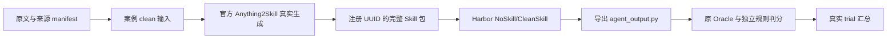

# 新增一份源文档及对应任务：Pydantic001 实例

研究根目录：`D:/AS/AutoSkill-main/degradation_failure_lab`。

这次选用此前尚未建立生成案例的 `pydantic-task-001`。它来自已冻结的 SkillGenBench Code Doc 分区，源文为 `validators.md`，目标是 Annotated 验证器的执行顺序。源文明确：Before/Wrap 从右向左，After 从左向右；原任务还要求数值变换 `2*x+10` 和结构化日志。

**本次实际完成的是源文—案例—原任务—原 Oracle 正反例的工程接入，真实模型生成及 Agent 对照尚未运行。** 正例是研究者编写的测试夹具，不能当作生成的 Skill 或 Agent 成功结果。

## 1. 哪些地方需要增加文件

下列路径均相对于研究根目录。已有 187 题的原始来源和任务身份已经导入，接入其中一道题时不要重复登记、复制原文或另造 task_id。

| 作用 | 本例的文件 | 要做什么 |
| --- | --- | --- |
| 不可变原始发布 | `.external/skillgenbench/5a8bd61d/` | 已有，读取原任务和文档，不修改 |
| 源文原字节 | `data/raw_sources/sgb/5a8bd61d/46a8a05c8a6e74d7/validators.md` | 已有，复用；不是手写代码 |
| 来源身份 | `data/manifests/sgb/sources/sgb-8cc5d9de352332cd.json` | 已有，记录 URL、固定 commit、hash、原路径 |
| 数据集归属 | `data/catalog.json` | 已在 skillgenbench 的 source_manifests 中，不重复添加 |
| 全局任务身份及连接 | `data/manifests/sgb/tasks.jsonl` | 只更新 pydantic-task-001 一行的 generation_case_id 和工程证据；保留 task_key |
| 上游案例 | `cases/sgb/case001_pyd/case.json` | 新增；连接来源 ID、共用生成配置和领域参数 |
| 条件列表 | `cases/sgb/case001_pyd/conditions.json` | 新增；本次只登记 clean，不虚构退化条件 |
| 输入清单 | `cases/sgb/case001_pyd/inputs/clean.json` | 新增；只指向 validators.md 原文，不含题目、测试、正解或规则清单 |
| 研究规则 | `cases/sgb/case001_pyd/rules.json` | 新增；规则指向原文 652–673 行，标记为 analyst_checklist；不作为生成提示输入 |
| 执行门禁 | `data/manifests/sgb/gates/t-83713dafe254.json` | 新增；本次保持 BLOCKED，避免将工程演示直接变成付费批次 |
| 实验配置 | `configs/experiments/sgb/pydantic001_demo.json` | 新增；记录案例、条件和待绑定的 run_id；模型/预算未冻结，不可运行付费实验 |
| 下游任务 | `downstream_eval/tasks/sgb/code_doc/pydantic-task-001/` | 补齐原任务、环境、Oracle 和本地适配，详见下表 |
| 正反例 | `tests/fixtures/sgb/pydantic-task-001/{correct,swapped_order}/agent_output.py` | 新增；只用于评分器验收 |
| 接入回归 | `tests/test_sgb_pydantic001.py` | 新增；核对源文隔离、案例绑定、门禁和证据目录保护 |

如果是真正未登记的新来源，还需要写入原字节缓存、来源 manifest 和 catalog，再建立案例。不要直接修改冻结的 187 题清单或把别的数据集塞入这个固定 revision；新的 SGB 发布应另设快照和导入审计，其他来源应使用自己的数据集分区。

## 2. 这道题的下游目录

```text
downstream_eval/tasks/sgb/code_doc/pydantic-task-001/
├── adapter.json                    # 连接 task_key、案例和 scorer
├── instruction.md                  # SGB 原指令，字节不变
├── task.original.toml              # SGB 原 task.toml，字节不变
├── task.toml                       # 本地 Harbor 格式的环境/产物适配
├── asset_manifest.json             # 本地任务资产 SHA-256
├── runtime.lock.json               # 实测镜像 ID、Python/Pydantic/pytest 版本
├── environment/
│   └── Dockerfile                  # 复用固定基础镜像及共享离线依赖
└── scorer/oracle/
    ├── eval.py                     # SGB 原评分代码，字节不变
    └── test.original.sh            # 原 runner，留存对照
```

本例增加的 Python 运行代码只有：

- `downstream_eval/sgb/pydantic001.py`：核对源文—案例—任务连接，将提交放入禁网 Docker 运行原 Oracle，读取 JUnit 得到 16 项断言结果。
- `scripts/sgb/pydantic001.py`：设置项目导入路径并调用上面的无模型演示入口。

原 task.toml 是 SGB 自己的协议，不是 Harbor TrialConfig，必须保存原件并另写本地适配。目录中存在本地 task.toml 不代表该题的原生 Harbor Agent 链路已经验收。

依赖放在共享缓存 `.external/sgb_runtime/pydantic001-demo-v1/` 并构建本地镜像，没有再把数百个依赖文件塞进任务目录。这个环境使用 Python 3.13.9、Pydantic 2.13.5、pytest 8.4.2；它是本地工程环境，不冒称 SGB 的官方 `light` 镜像。此示范的离线依赖来自机器已有的固定运行环境；可按 runtime.lock 中记录的缓存构建：

```powershell
docker build --network=none --pull=false `
  -f downstream_eval/tasks/sgb/code_doc/pydantic-task-001/environment/Dockerfile `
  -t sgb-pydantic001:demo-v1 .external/sgb_runtime/pydantic001-demo-v1
```

重建镜像可能得到新身份，需要新审计和 runtime.lock，不应把哈希漂移直接当作通过。

## 3. 复用哪些公共代码

新增文档不需要复制生成器或写第二套 Agent 循环。

| 公共部分 | 现有位置 | 本例如何使用 |
| --- | --- | --- |
| 来源与案例校验 | `src/degradation_lab/catalog.py` | 检查来源归属、原文 hash、规则行号、输入条件 |
| 上游生成与快照 | `src/degradation_lab/runner.py` | 通过 case001_pyd 复用官方 Anything2Skill 生成流程，本次只运行 plan |
| 上游参数 | `configs/generation/deepseek_flash.json` | 共用模型与管线参数；case 仅指定 pydantic 领域 |
| Skill 包规范化与安装 | `downstream_eval/integration/skill_install.py` | 真实生成完成后按注册 UUID 冻结、安装完整包；本次未伪造包 |
| 原生 Agent/观察 | `downstream_eval/integration/terminus_compat.py`、`p1_observer.py` | 未来真实 Agent 阶段复用，不能因“已安装”便宣称正文被模型使用 |
| 持久预算 | `downstream_eval/integration/request_budget.py` | 真实付费批次必须绑定；本次无模型入口不需要创建预算数据库 |
| 结果归一化 | `downstream_eval/scoring/results.py` | 真实 trial 需明确 task_success、infra_ok，并将不可判分单列；工程夹具不送入真实 trial 汇总 |

只有提交格式、运行环境、产物导出或评分协议不同时，才新增这道题需要的适配代码。源文换了一份、协议相同，不是复制整套 runner 的理由。

## 4. 现在可以亲自执行的命令

在 PowerShell 中运行；以下均不调用模型：

```powershell
cd D:\AS\AutoSkill-main\degradation_failure_lab
python -B scripts/lab.py validate
python -B scripts/lab.py plan --case case001_pyd --condition clean
python -B scripts/lab.py sgb list --task pydantic-task-001
python -B scripts/lab.py sgb audit
python -B scripts/sgb/pydantic001.py --audit-id pydantic001-demo-002
```

最后一条要求 Docker 运行且本地镜像仍匹配 runtime.lock；每次 audit-id 必须全新。它核对案例输入，然后分别对正例和错误顺序例运行原 Oracle，结果写入 `results/sgb/audits/<audit-id>/demonstration.json`，不会创建真实生成 run 或 Agent trial。

本次实测：正确例 16/16；只交换 Before/Wrap 元数据顺序的错误例 14/16，失败于原始输入可见性和执行顺序。两例数值变换相同，因此反例不是靠改错算式来制造失败。

原 Oracle 使用提交自报的日志，对 after/wrap 相对顺序的检查较宽松；这次验证说明它能拒绝此反例，不证明它排除了所有伪造日志或语义错误。原版保留；更强的规则评分需要另存独立版本。

## 5. 真正完成“源文 → Skill → Agent → 评分”还要做什么



1. 冻结并通过这次实验的模型、预算、环境、评分和案例门禁，再通过现有公共凭据入口调用官方上游生成。不能用测试夹具替代 Skill。
2. 验证生成运行 completed、输入 hash、注册 UUID 和完整 Skill 包，在实验配置中绑定实际 generator_run_id；新上游输出自动落到 `runs/gen/sgb/case001_pyd/clean/<run_id>/`。
3. 为本题补齐并验收真实 Harbor 调度、Skill 安装、受控无模型探针、持久 HTTP 预算和一次性批次保护。复用公共模块，不照搬 Scrapy 的布尔响应桥和写死的预算 scope。
4. 在相同指令、工具、环境与预算下运行 NoSkill/CleanSkill，导出提交后调用本例的 `score()`；记录实际读取、成功模型请求中是否包含完整 Skill 正文，分别报告任务成功与规则保存。
5. 新下游输出使用 `runs/eval/sgb/pydantic-task-001/<experiment>/`，冻结运行证据，再登记真实观测用于统一汇总。实验产物和 analysis 都由运行代码产生，不手写“成功”。

目前 `scripts/lab.py sgb prepare` 仍是登记/完整性准备，`sgb aggregate` 读取已登记的历史结果；它们没有通用的任意新题付费执行接口。Task-024 的真实付费校准是专用适配。本例没有把静态准备误报成全流程真实闭环，也没有新增未验收的付费启动命令。

## 6. 哪些目录是运行后自动产生的

| 自动输出 | 内容 |
| --- | --- |
| `runs/gen/sgb/case001_pyd/clean/<run_id>/` | 官方生成快照、请求/响应、SkillBank、trace、冻结清单 |
| `runs/eval/sgb/pydantic-task-001/<experiment>/` | 未来真实 Agent trial、观察和持久预算，当前尚无 |
| `results/sgb/audits/pydantic001-demo-20261024-001/` | 本次实际正反例评分和工程演示结果 |
| `results/sgb/audits/pydantic001-onboarding-20261024-001/` | 安装前备份、环境构建、回归、登记变更和最终验收 |
| `results/sgb/analyses/<analysis-id>/` | 基于已登记真实结果的统计；本次夹具不计作 Agent 观测 |

本次新增文件的机器可读索引为 `docs/sgb/pydantic001_files.json`。完整示范不需要改动数据集之外的旧任务和旧实验记录。
