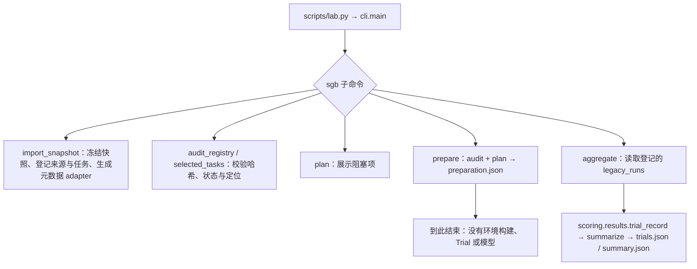
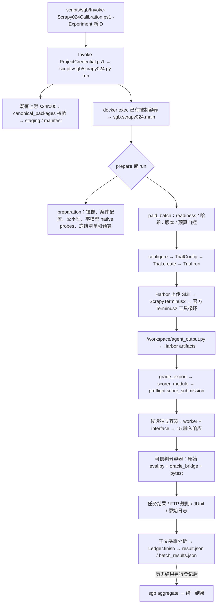

# SkillGenBench 下游执行框架公共性审计与最小重构方案

审计日期：2026-10-24（Asia/Shanghai）。性质：只读代码审计与方案设计；本轮未实施重构。

审计根目录：`D:\AS\AutoSkill-main\degradation_failure_lab`。下文项目相对路径均相对于该目录；`H/` 代表 `.external/harbor-full/src/harbor/`，`S/` 代表 `.external/skillgenbench/5a8bd61d/`，`T024/` 代表 `downstream_eval/tasks/sgb/code_doc/scrapy-task-024/`。`[R]` 表示远程固定提交，`[W]` 表示当前本地工作树，`[F]` 表示本地冻结的外部依赖，`[建议]` 表示未实施方案。路径后 `:行号` 是证据定位，不表示已执行相应入口。

`docs/sgb/` 已存在且含历史报告，本轮使用新日期文件名 `downstream_architecture_audit_20261024.md`，不覆盖既有内容。

## 1. 执行摘要与版本边界

**结论：已经存在一个 Scrapy Task-024 专用的完整实验闭环，但尚不存在能从统一 SGB 登记入口执行任意任务的公共闭环。应共享执行生命周期、Skill 资产校验、预算传输和判分运行基础设施；环境、提交协议与业务断言按实际需求绑定。三类数据来源不等于三套 Runner。**

### 1.1 先远程、后本地的检查结果

首先通过 GitHub 接口检查默认分支与递归树，再读取远程重点文件，随后对照本地补充未提交实现。

| 对象 | 本次核实结果 | 边界 |
|---|---|---|
| 项目远程 | [lily400/AutoSkill-main](https://github.com/lily400/AutoSkill-main)，默认分支 `master` | 实时读取 |
| 远程固定提交 | [3073a1a1a7119603ccb2ac738fae269a8223c0d9](https://github.com/lily400/AutoSkill-main/commit/3073a1a1a7119603ccb2ac738fae269a8223c0d9)，提交时间 `2026-10-24T06:06:24Z` | 后文远程结论均基于该提交；递归树 2,533 项，未截断 |
| 本地 | `master` 的 HEAD 与远程相同，但工作树有大量修改、删除及未跟踪文件 | 只读清点得到 16 个已跟踪修改、880 个已跟踪删除、2,404 个未跟踪文件；这些包括本轮之前的归档迁移，不是本轮造成 |
| SGB 快照 | [QuantaAlpha/SkillGenBench](https://github.com/QuantaAlpha/SkillGenBench/tree/5a8bd61d8191e34fa1bbbffbff7f70db1d2a027d)，revision `5a8bd61d8191e34fa1bbbffbff7f70db1d2a027d` | 本地冻结清单 2,602 文件；本轮重新校验通过 |
| Harbor | [固定提交 2de4605b9404eada7d341388291e6e469c90330b](https://github.com/harbor-framework/harbor/tree/2de4605b9404eada7d341388291e6e469c90330b)，版本 `0.24.0` | `downstream_eval/configs/runner.lock.json:2–5`；本轮校验锁定的 12 个源文件，并在已有控制容器读取安装版本 |

重要位置差异：

- `[R] downstream_eval/sgb.py` 存在；`[W]` 已将它转换为 `downstream_eval/sgb/__init__.py` 包入口，后者尚未提交。
- `[R]` 完整 Scrapy 包仍在 `downstream_eval/tasks/scrapy_task024_v1/`；远程 `tasks/sgb/code_doc/scrapy-task-024/` **仅有 METADATA_ONLY 的 adapter.json**。
- `[W]` 完整包已归档至 `T024/`，共 465 文件；`downstream_eval/sgb/scrapy024.py`、`sgb/scrapy_agent.py`、`scripts/sgb/` 的运行入口是本地未提交实现。远程对应旧入口为 `downstream_eval/scrapy024.py`、`integration/scrapy_agent.py`、`scripts/scrapy024.py`。
- `[W]` Pydantic001 演示、任务资产及部分归档说明也是本地新增。其判分演示不能当作远程已有的通用 Agent 执行能力。
- `.external/` 的完整快照在本地，项目远程树不提供这些依赖文件；“项目提交相同”不足以保证换一台机器可执行。

远程入口证据：[CLI](https://github.com/lily400/AutoSkill-main/blob/3073a1a1a7119603ccb2ac738fae269a8223c0d9/degradation_failure_lab/src/degradation_lab/cli.py#L38)、[SGB 公共入口](https://github.com/lily400/AutoSkill-main/blob/3073a1a1a7119603ccb2ac738fae269a8223c0d9/degradation_failure_lab/downstream_eval/sgb.py#L10)、[Scrapy 专用执行器](https://github.com/lily400/AutoSkill-main/blob/3073a1a1a7119603ccb2ac738fae269a8223c0d9/degradation_failure_lab/downstream_eval/scrapy024.py#L42)、[P1 Git 入口](https://github.com/lily400/AutoSkill-main/blob/3073a1a1a7119603ccb2ac738fae269a8223c0d9/degradation_failure_lab/downstream_eval/p1.py#L126)。

### 1.2 当前能力不能相互替代

| 能力 | 结论 | 证据与置信度 |
|---|---|---|
| SGB 三类共 187 任务登记、来源冻结、静态资产检查 | 已实现 | `src/degradation_lab/sgb.py:120–241,286–336`；本轮 `sgb audit` PASS；高 |
| 统一 SGB plan / prepare | 已实现元数据准备，未实现通用运行准备 | `downstream_eval/sgb/__init__.py:10–34`；明确 `METADATA_AND_INTEGRITY_ONLY`；高 |
| 任意 SGB 任务 → native Agent Trial → 独立判分 → 自动登记结果 | 未实现 | CLI 不提供 `sgb run`；adapter 无统一运行分发调用者；高 |
| Scrapy024 专用真实 Agent + 原始断言判分 | 已实现，存在历史运行证据 | `sgb/scrapy024.py:224–270` 与历史 `s24d001/batch_results.json`；本轮未重跑；高 |
| BeautifulSoup037 可执行适配 | 未实现 | adapter `METADATA_ONLY`，运行环境未建立，原始 TOML 不兼容；高 |
| P1 是所有 SGB 的公共执行器 | 否 | `p1.prepare`、`gold_check`、`zero_probe` 均绑定 Git 恢复试点；高 |

本轮静态审计读到：123 Code Repo、28 Code Doc、36 Domain Knowledge Doc；211 个来源清单对应 99 种来源字节内容；31 个任务记录 Oracle 语法错误，67 个任务存在描述元数据冲突；统一登记的 `execution_status=READY` 为 **0**。这不否定历史 Scrapy 六次实验，说明历史专用闭环尚未转换为统一登记下的可运行能力。

历史 `runs/eval/sgb/scrapy-task-024/s24d001/batch_results.json` 的六条结果为 NoSkill 0/3、CleanSkill 2/3，`infra_ok` 均为 true，累计 27 次 HTTP 尝试。成功的两条 CleanSkill 记录分别标出 2、1 个 Skill 正文暴露 ID，第三条为 0。它支持“该专用实验发生过执行和正文暴露”，不证明所有生成 Skill 均被使用、被遵循，也不支持把六次校准外推为稳定效果或全数据集可用。

### 1.3 优先处理的问题（本轮仅记录）

1. **统一入口与专用运行链脱节。** 登记、准备、实际执行、历史汇总分成两条链；不能仅把目录归档称为通用框架完成。见第 2、8 节。
2. **Scrapy 的布尔响应桥不是通用函数协议。** 它每次新进程导入候选，只接受 bool，锁定 15 输入、19 断言及 FTP 规则，不能承载 BeautifulSoup 的对象身份。见第 3、5、6 节。
3. **名为公共的 Agent/预算模块仍含 P1 政策。** 固定数据库路径、六请求、九条 Git 断言不能直接移植。见第 4 节。
4. **归档后的 Git 属性未同步。** 新 Oracle 路径命中 LF 规则，实际冻结脚本含 46 处 CRLF；未来暂存/检出可能改变冻结字节。见第 9 节。
5. **“原始 Oracle 未修改”不等于执行协议相同。** Task024 保留原始文件，但用隔离响应桥替换加载；SGB 官方基线又与本项目的上下文、Agent 和统计口径不同。应逐项记录方法差异。见第 5 节。
6. **任务准入必须独立于工程启动。** BeautifulSoup 源码正则断言、Code Repo 无法解析的 checker、Domain 的规则裁决均需审核；不能批量标成 READY。见第 5、6 节。

## 2. 当前代码实际调用链

### 2.1 统一 SGB 入口：到登记、静态准备和历史汇总为止

`[R/W] scripts/lab.py:1–14` 加载 `src/` 并调用 `degradation_lab.cli.main`。`src/degradation_lab/cli.py:38–70` 的 SGB 子命令只有 `import/audit/list/plan/prepare/aggregate`。



资产链为 `configs/datasets/sgb.json` → `data/manifests/sgb/tasks.jsonl` → `official_task/official_assets/sources/downstream_task_path` → `S/skill_evaluation/...`、`data/raw_sources/sgb/...`。`src/degradation_lab/sgb.py:85–104` 登记叙述文档；`import_snapshot:120–241` 只纳入允许的文档后缀，不把 task.json、测试、答案作为生成输入；`_bind_scrapy:244–283` 是硬编码的历史任务绑定。

`prepare:22–34` 写 `results/sgb/audits/<preparation_id>/preparation.json`，即使有 BLOCKED 任务也可以 `PREPARATION_COMPLETE`。它没有把 SGB TOML 转成 Harbor TOML，没有构建镜像，没有安装 Skill，更没有试跑任意 SGB 任务。

`aggregate:37–57` 只遍历已登记的 `legacy_runs`，验证结果文件哈希，读取其中的 `results`。它不是扫描所有新运行目录的通用收集器，也没有自动把新任务执行结果回写登记的机制。

### 2.2 实际完整闭环：Scrapy 专用入口

`[W]` 使用已归档的路径，`[R]` 同类逻辑位于第 1.1 节列出的旧路径。下面是实际链，不是拟议统一接口。



| 生命周期阶段 | 实际入口、调用与资产 | 状态及模型边界 |
|---|---|---|
| 1 命令分发 | `scripts/sgb/scrapy024.py:88–106`；`sgb/scrapy024.main:273–278` | 专用 CLI；不是 `lab.py sgb run` |
| 2 任务登记读取 | 通用 SGB 命令通过 `selected_tasks`；Scrapy 实际启动直接用模块级 `TASK` 和固定生成 run | 登记链与执行链没有通用分发连接；adapter 字段本身不驱动这里的执行 |
| 3 原始任务定位 | 登记行 `official_task` 指向冻结快照；当前运行使用 `T024` 的派生包 | 原始 instruction、Oracle、shell 字节已逐项比较相同；派生 Harbor TOML 另论 |
| 4 任务资产准备 | 主机 `prepare_files:24–85` → `load_run/canonical_packages/copy_packages`，固定 `runs/gen/sgb/case024_scrapy/clean/s24r005`；另引用 C 盘旧 preflight | 校验上游已有完整生成产物，不重新生成 Skill；存在绝对路径和固定 ID |
| 5 环境构建 | `preparation:116–131` 验证 Harbor，offline Docker build，记录镜像 ID，并从派生模板重写 `T024/task.toml` | 真正会构建环境、写文件；本轮没有执行 |
| 6 条件 | `ORDER:22`、`configure:42–64`、`preparation:132–162`；NoSkill 空包，CleanSkill 全部已登记 canonical 包，交替各 3 次 | Scrapy 只有两臂，没有参考 Skill/Gold 臂；P1 的 A0/A1/Gold 是另一试点 |
| 7 Skill 查找与 staging | `integration/skill_install.canonical_packages:17–54` 校验 case/condition/run/包完整性；`copy_packages:57–64` 按字节复制 | 可复用的资产环节；冻结 15 个包不等于 15 个都被模型读取 |
| 8 Skill 实际安装 | `H/trial/trial.py:534–545,1694–1719`：`_upload_injected_skills → environment.upload_dir` | paid Trial 走 Harbor 原生上传；`install_remote` 只在 `check_container_skills:144` 的探针链调用，不能误写成 paid 安装入口 |
| 9 Trial/Agent | `native_trial:83–98` → `Trial.create/run`；`ScrapyTerminus2` → `CompatibleTerminus2(P1ObservationMixin, Terminus2)` | `probe` 在模型调用前停止；`paid` 才允许官方工具循环向模型发请求 |
| 10 指令与 Skill | `H/trial/single_step.py:74–82` 传 `task.instruction`；`H/agents/terminus_2/terminus_2.py:_build_skills_section` 加索引；observer 校验并记录读取 | “索引可发现”“文件被读取”“正文进入成功请求”“被正确遵循”是不同证据 |
| 11 提交收集 | `SingleStepTrial._run:37–54` → `_collect_artifacts`；`H/trial/trial.py:1499–1531`；`task.toml:2` 导出 workspace | `grade_export:67–80` 要求恰有一个 `agent_output.py`；缺失/多份单列 |
| 12 独立判分 | `configure:62` 关闭原生 Verifier；`grade_export → preflight.score_submission:266–320` | 真判分在两个独立 Docker 容器，不是 Harbor 内置 `Verifier.verify`；保留原始断言，加载协议有桥接 |
| 13 原始/统一结果 | `paid_batch:242–264` 写 native、Oracle、exposure、usage、预算和 batch；`scoring/results.py:4–28` 规范化与按实际 trial 均值汇总 | 格式化已实现；从所有新运行自动注册到统一汇总未实现 |

Harbor 细节也已继续追踪：`Trial.create:362–417` 在无 steps 时选 `SingleStepTrial`；`Trial.run:494–524` 调 `_prepare/_run/_finalize`；`SingleStepTrial._run_verifier:88–90` 在 `disable=True` 时直接返回。因此 `task.toml` 写 `environment_mode="separate"` 并不意味着当前 paid 链实际调用了 Harbor 原生独立 Verifier。

### 2.3 preflight、smoke、真实实验的区别

- `lab.py downstream-prepare` 实际导入 `downstream_eval.p1.prepare`（`cli.py:71–77`），准备 Git 恢复试点；`downstream-check` 调 Git smoke 检查。二者都不是 SGB 通用执行器。
- Scrapy `preparation` 会创建**零模型 native Trial 探针**，在 pre-model-stop 后注入可信 correct / ftp_mutant，再独立判分；期望 19/19 与 18/19。这能检验安装、导出、判分通路，不能证明 Agent 自主解题。
- `paid_batch` 才执行真实模型 Agent 并记录真实提交。它需要 readiness、冻结依赖、预算 lease、明确的运行环境门控。这里说明现有行为，本轮没有触发。
- 本轮仅做静态读取、哈希、AST、纯内存结果转换和 Task/TOML 解析；连零模型 native Trial 都没有启动。

### 2.4 未接入及历史分支

`T024/scorer/harbor_entry.py:19–28` 定义 `score_harbor_submission`，但在检查的 `downstream_eval/scripts/src/tests` 活跃代码中未发现调用者；真正导出走 Harbor artifacts + `grade_export`。它仍被主机准备代码复制、被清单冻结，故不是可以顺手删掉的无关文件。

`preflight.py` 同时含仍在用的 `verify/Docker/oracle_inputs/score_submission`，以及旧审计工作区的 `prepare/read_stage/policy_check/loading_check/run_linux`。后者依赖本包不存在的 `access_policy.json/reuse.py/loading_contract.py/test_preflight.py/stages/generation/stages/agent`。没有外部旧工作区时，不能将整份 CLI 当作自包含入口，也不能把整份文件判为废弃。

## 3. Scrapy Task-024 逐文件职责审计

### 3.1 审计清点与分类约定

`T024` 实有 **465 文件**：449 个 vendored 依赖文件、16 个其他文件。`source_manifest.json` 的 `frozen_inventory` 列出 459 个 scorer 文件；本轮逐个哈希一致。全部 453 个 Python 文件完成 AST 检查，无语法错误。第三方依赖按包与逐文件清单覆盖，未将它们逐份当作项目业务逻辑重审；完整文件名和冻结哈希见 `T024/scorer/source_manifest.json:5–465`。

分类表示**当前职责**，不表示已经做成可复用模块。`G候选` 表示有公共职责但仍需去掉任务耦合；混合文件按函数拆分，不强行给整文件单一标签。

### 3.2 全部非第三方文件与依赖目录

| 文件/子目录 | 解决的问题、实际调用者与依赖 | 专属内容、复用判断与分类 | 置信度 |
|---|---|---|---|
| `environment/Dockerfile:1–3` | `preparation` 构建 Agent 环境，继承本地 P1 基础镜像，清空旧 workspace 并建空目录 | 不安装 Scrapy；绑定既有镜像标签和 Task024 隔离假设。每题需环境绑定，不能原样充当通用库环境。**P**；环境构建调度可 G | 高 |
| `instruction.md` | Harbor `Task.__init__` 读入，Agent 收到任务要求；与 SGB 原始字节相同 | 本题接口、后端默认覆盖行为；每题独立。**P** | 高 |
| `task.original.toml:1–24` | `preparation:129–131` 的派生 Harbor 配置模板 | **它不是官方 SGB 原始 TOML**：已有 `schema_version/environment/artifacts` 等 Harbor 字段。命名易误导，需在新协议中区分官方配置与派生模板。**P/L**，当前仍活跃使用 | 高 |
| `task.toml:1–25` | `configure` 指向任务目录，Harbor 解析环境和导出；运行时文件 | 在派生模板上加入 `scrapy024-agent:s24r005`；仅适配该任务。**P**。本轮 schema PASS；原生 verifier 目录缺失，依赖关闭原生验证 | 高 |
| `adapter.json:1–12` | 记录 registry、官方配置、runner、Agent、launcher | 本地 `HISTORICAL_CALIBRATION_ADAPTER`；远程同位置还是 `METADATA_ONLY`。普通 import/audit 会读身份；运行器没有按此分发。数据结构可 **S**，每题绑定值 **P**，可执行分发未实现 | 高 |
| `scorer/fixtures/submissions/correct/agent_output.py` | `preparation:164–179` 注入可信候选验证完整判分链 | 本题 bool 语义和异常；不是生成 Skill、不是模型表现。每题都需要适当正例，但不能复制答案。**P** | 高 |
| `scorer/fixtures/submissions/ftp_mutant/agent_output.py` | 同上，确认 FTP 专属错误可被查出 | 仅改 FTP 默认值，对应目标规则；每题需自己的敏感负例。**P** | 高 |
| `scorer/runtime/interface.py:3–29` | `worker.py:16–17` 寻找候选函数 | 优先四个本题函数名，或单个 public function；与原 Oracle `get_target_function` 职责重复以保证隔离两侧契约一致。不能推断任意函数签名。**P** | 高 |
| `scorer/runtime/worker.py:9–32` | `score_submission:284–288` 逐次 docker exec；仅候选、输入和 runtime 可见，返回 JSON | 每次重导入模块、一个入参、只保真 bool、编码异常基类；不保留跨调用对象状态。不是通用 Python worker。**P**；进程调用与超时捕获有 G候选职责 | 高 |
| `scorer/runtime/oracle_bridge.py:8–44` | pytest `-p oracle_bridge`；校验候选与 Oracle 哈希，并将 `load_agent_module` 替换为响应代理 | 暴露固定 `default_feed_overwrite`；bool/异常恢复及特定 collection hook。原始断言未改，但执行不再直接导入候选。**P**；不能供 BS4 原样使用 | 高 |
| `scorer/runtime/policy_probe.py:10–37` | 活跃 `score_submission:276` 直接以 `python -c` 执行文本；旧 `policy_check` 也调用 | 文件读写、UID、网络探针有公共性；`scrapy_installed` 与固定资源契约属本题。**G候选 + P**；不存在通用已验收 policy 服务 | 高 |
| `scorer/stages/scorer/oracle/eval.py` | `score_submission:297–298` 运行原始 pytest | 19 条展开断言、函数名、支持的 URI 后端、异常、源代码检查等本题语义。与快照字节相同。**P**；绝不能搬进公共规则层 | 高 |
| `scorer/stages/scorer/oracle/test.original.sh` | 冻结官方测试启动脚本，活跃判分绕过它，直接用 pytest+桥+JUnit | 作为原始证据保留，不应称为当前实际入口。字节与 SGB 同，含 CRLF。**P** 资产 / **L** 运行入口 | 高 |
| `scorer/stages/scorer/deps/**`（449 文件） | 可信 grader 挂载 `/deps`，`PYTHONPATH=/deps:/bridge`；pytest、_pytest、pluggy、iniconfig、packaging、py.py、pygments 等 | 大量文件来自依赖冻结，不是每题要写 449 文件。依赖运行基础可 **G**，此份冻结副本是 **P/L** 资产；将来按锁/镜像复用，冻结历史副本先保留 | 高（用途/哈希）；非第三方源码完整语义审计 |
| `scorer/harbor_entry.py:8–28` | 提供环境下载+线程化 score hook；仅发现复制/清单引用，无生产调用者 | 限输出在本包内且固定 agent_output；当前非实际桥。**L/P**，不因“harbor”命名升为 G；可能移到历史兼容区域，须先做清单影响分析 | 中高（静态调用搜索不能排除外部手动调用） |
| `scorer/preflight.py:1–395` | 专用 runner 动态导入并调用 `verify/score_submission`；还提供旧审计 CLI | 真实混合文件；分类见 3.3，不能整体照搬/删除 | 高 |
| `scorer/source_manifest.json:1–470` | `verify`、准备和运行前冻结检查读它 | Task024/rule ID、459 个文件哈希、旧 C 盘 reuse 来源、`protected_audit_hashes={}`。清单机制 **G/S**，值和历史证据 **P/L**；空 protected 不能宣称检查了所有外部旧审计文件 | 高 |

### 3.3 preflight.py 内部边界

| 范围 | 活跃关系 | 分类与处理建议 |
|---|---|---|
| `digest/read/write:29–39` | 活跃函数的基础操作 | **G候选**；项目已有 `degradation_lab.io`，不要新造一套公共 I/O。冻结代码仍保留原样 |
| `freeze/prepare:42–164` | 旧完整审计准备，包含外部历史工作区、额外文件、历史候选和依赖打包 | **L/P**；与现运行器 `preparation` 不同，依赖不在 portable 子集 |
| `verify:167–175` | `scorer_module` 及 `score_submission` 活跃调用 | 哈希核验机制 **G候选**，Task024 清单根路径 **P**；优先使用现有 inventory/sha256 能力 |
| `read_stage:178–186` | 旧 CLI/审计分支，缺 access_policy | **L/P**，不是现行所有阶段共用的访问控制入口 |
| `Docker:189–221` | 当前独立候选和 grader 都使用 | 容器生命周期、记录、挂载校验、资源约束有 **G候选**；BASE_IMAGE、256M、45 秒、本题路径需外提参数/策略。现有项目 Pydantic score 和 GitChameleon trial 证明共性，但尚未有公共 API |
| `policy_check:224–249` | 旧全流程审计分支 | **L/P**；generation/agent/scorer 路径及“没有 scrapy”不可作为通用规则 |
| `oracle_inputs:252–263` | `score_submission` 活跃调用 | **P**；解析特定 AST 写法并锁定 15 输入，不支持动态 fixture/复杂参数 |
| `score_submission:266–320` | `grade_export` 真正调用 | 挂载/执行/日志/JUnit 解析是 **G候选**；响应桥、19 断言、FTP 名称匹配、结果规则属 **P**。先拆职责再评估抽取，不将整个函数移到 public |
| `loading_check:323–357` | 旧 reuse/loading_contract 的安装可见性探针 | **L**；不能与 paid 模型实际读 Skill 的证据等同 |
| `run_linux/main:360–395` | 自身 CLI 引用旧阶段与历史 variants | **L/P**；缺少旧工作区资产，本次不运行、不删除 |

## 4. G/S/T/P/L 公共性分类与可抽取证据

| 当前模块/函数 | 当前分类 | 公共性证据、限制与目标 |
|---|---|---|
| `src/degradation_lab/cli.main`、`scripts/lab.py` | G 入口 + S 命令 | 已共用入口；保留一个 CLI，后续加实际 SGB 生命周期分发，不新造三套 CLI |
| `src/degradation_lab/sgb.load_registry/audit_registry/selected_tasks` | S | 真正处理 SGB revision/登记/原始资产；保留为唯一注册实现，`downstream_eval/sgb` 调用它，避免双重真源 |
| `sgb.import_snapshot/descriptor/_source` | S；`_bind_scrapy` 为 P/L | 187 题跨三类共用元数据导入已有证据；历史绑定不属于通用原始解析 |
| `downstream_eval/sgb.plan/prepare/aggregate` | S + G 结果调用 | 元数据编排和 SGB 观察结果视图；尚无运行调度，不能直接升格 core runner |
| `integration/skill_install.canonical_packages/copy_packages/remote_hashes` | G，带项目生成包契约 | P1、Scrapy 使用同一包校验与 staging；沿用现有实现。探针 `check_skills/check_container_skills` 不冒充执行链 |
| `integration/harbor_adapter.verify_sources/crlf_compat` | G：Harbor 集成 | 固定依赖核验、内存换行兼容已有多处调用；官方源文件不改。`official_probe_class` 是零模型方法探针 |
| `integration/terminus_compat.CompatibleTerminus2` | G 候选 + P1 耦合 | 官方 Terminus 子类复用成立；组合的 observer 仍要求 P1 profile/manifest，不能标为任意 Agent 无条件通用 |
| `integration/p1_observer.py` | G候选 + P/L 政策 | `_build_skills_section:204–228`、命令/读取观测与正文证据可共享；`_budget_ledger:274–275`、镜像/隔离假设等仍绑定 P1；先拆政策入口，保留行为 |
| `integration/request_budget.Ledger:26–208 / MeteredTransport:211–237` | G 候选，已跨试点调用 | Scrapy 直接用 Ledger 并覆写预算取得方式，证明事务化 HTTP 计数和传输可公共；不是任意重试/费用都已覆盖的通用计费器 |
| `request_budget.ledger_for_profile:240–252 / trial_evidence:264–287` | P/L：Git P1 | 固定 DATABASE/RECOVERY_DATABASE、六请求和九断言；保留 Git 策略，不把它们带进 core |
| `downstream_eval/p1.fairness_identity:23–29` | G候选 | Scrapy 已真实调用 P1 中的比较函数；可先单独抽出，避免导入整个 P1 |
| `p1.gold_check/zero_probe/prepare`、`checks.py` | P/L：Git 恢复试点 | Git fixture、gold shell、9 断言、固定预算和三臂；原位保持兼容，不作为 SGB 运行入口 |
| `sgb/scrapy024.configure/native_trial/paid_batch` | P/L 中含 G候选骨架 | GitChameleon 与 P1 也创建 native Trial；共同点只有创建/运行/结果收集。条件、导出选择、停止政策、判分回调不能整份推广 |
| `sgb/scrapy_agent.ScrapyTerminus2` | P | scope 精确锁到 `scrapy-task-024/s24r005/initial-calibration`，禁止安装 scrapy，空 docs、deny-all；BS4/联网任务不能直接继承这份政策 |
| `scoring/results.trial_record/summarize` | G | 已与 SGB 历史聚合连接；显式 infra 与 task success，按实际 trial 均值；复用，补全通用证据字段即可 |
| `sgb/pydantic001.score:37–74` | P/L 中含 G候选判分基础 | 与 Task024 都用 Docker 资源约束、pytest/JUnit、哈希和 infra 分离，公共执行基础有第二个调用实现证据；它是候选+Oracle 同容器，并不证明可直接复用 Task024 强隔离桥 |
| `T024`、BS4/Domain 专属 Oracle、fixtures | P | 原始业务断言与正确/错误样例按任务保留 |
| Domain `tests/eval.py` 的 bundle 调用/递归比较 | T候选（按协议），业务数据 P | 本轮发现 36 个 Domain eval.py 字节完全相同；这是明确多任务共性。先引用冻结共用实现并验证第二题，暂不新增复杂继承层 |
| Code Repo 环境/输入输出映射 | S 配置；T候选 | 类内存在 JSON、图像、light/heavy 等差异；123 checker 各自不同，不能以目录名推断统一业务判分 |

分类 T 代表“经验证的同类职责”，不要求必须叫 `code_repo.py/code_doc.py/domain_knowledge_doc.py`。运行适配优先依据 `submission.kind`、调用协议、输入输出资源与 checker 产物。当前没有证据支持创建三套完整 Runner；也没有证据支持所有函数调用都共用一个 bool worker。

## 5. 三类 SGB 任务：共有运行机制与真实差异

### 5.1 抽查样本及实际配置

下表原始资产均来自 `S/skill_evaluation/`。同一任务的生成文档来自 `S/data_source/<type>/<collection>/tasks/<id>/materials/docs/`，不是测试目录。环境与提交路径取自实际 TOML、instruction 和测试入口，未实际运行这些样本 Oracle。

| 项目 | Code Repo：Scrapy_gtb01 | Code Doc：scrapy-task-024 | Code Doc：beautifulsoup4-task-037 | Domain：lockdate_compliance_gate_001 | Code Repo 补充：AnimeGANv3_gen01 |
|---|---|---|---|---|---|
| 原始评测目录 | `code_repo/scrapy/Scrapy_gtb01` | `code_doc/scrapy/scrapy-task-024` | `code_doc/beautifulsoup4/beautifulsoup4-task-037` | `domain_knowledge_doc/clbench_Domain_Knowledge_Reasoning_Finance/lockdate_compliance_gate_001` | `code_repo/animeganv3/AnimeGANv3_gen01` |
| 环境标签 / 引用仓库 | light / false | light / false | light / false | light / false | heavy / false |
| 输入与起始文件 | `context/input/Scrapy_gtb01_input.txt` 是网页 URL；`context/groundtruth/Scrapy_01/gt.json` 是参考答案 | URI 等参数由 Oracle 构造；项目派生 Agent 工作区为空输入/文档目录 | Oracle 构造 BeautifulSoup/Tag；不需要网页抓取输入 | bundle 里 10 个结构化输入；上下文提供治理规则 | landscape 输入图与 groundtruth PNG |
| 文档 | `context/docs/README.rst`，来源为任务 materials/docs | feed-exports 文档；原 SGB 有 docs，本项目 Task024 不把原文暴露给 Agent | 4 个 Markdown，见第 6 节 | `context/docs/context.md`；`task.json` 不作为生成文档 | `context/docs/README.md` |
| 提交 | `submission.kind=script`；Agent 运行代码产出 `/workspace/output/humor_quotes.json` | `agent_output.py` 中单参后端默认 overwrite 函数，返回 bool/异常 | `agent_output.py`：`rename_tag_preserving_contents(tag,new_name) -> Tag` | `agent_output.py`：`solve(input_data)` 返回字典、列表等 | `submission.kind=script`；`/workspace/output/anime_landscape.png` |
| 判分入口 | `tests/test.sh → test_script.py`，读取输出与 groundtruth，写 JSONL/CTRF/reward | 原始 `tests/test.sh → eval.py`；项目实际走隔离桥+pytest/JUnit，19 断言 | `tests/test.sh → eval.py`；15 个测试方法，依赖 bs4/pytest | `tests/test.sh → eval.py`，加载 `testcases.json`，parametrize 10 例 | `tests/test.sh → test_outputs.py`，numpy/Pillow、尺寸/通道/输入与参考比较，JSONL/CTRF/reward |
| 业务评价 | 抓取指定 humor 页面前三条 quote/author，并比较参考 JSON | 后端默认 bool、异常及源码断言；目标 FTP 默认 True | 改名同时保留内容、属性、父子/兄弟位置、同一对象；另有源码正则 | PASS/HOLD/BLOCK 决策与稳定列表等；递归比较、浮点容差 | 图像结果校验；不能用简单文本/pytest 函数 bool 协议替代 |
| 外部资源 | URL 为 `https://quotes.toscrape.com/tag/humor/`，联网或可信冻结回放需明确 | 项目环境禁止 scrapy，候选/判分均无网络 | 必须安装与锁定 bs4（及 soupsieve 等依赖）；无需外网抓取 | 此样本 checker 用标准库+pytest；仍需逐题检查 setup_code | 原始 heavy 环境，模型权重/工具资源是否已冻结待验证，不能仅凭标签认定可离线 |
| 当前准入 | `SYNTAX_ERROR/BLOCKED` | 静态状态 BLOCKED，另有六次历史专用实验 | `REVISION_REQUIRED/BLOCKED`，adapter METADATA_ONLY | `STATIC_ONLY/BLOCKED`，research_fit 为 `DEFER_ORACLE_ARBITRATION` | `STATIC_ONLY/BLOCKED`，descriptor 与 TOML 输出名冲突 |

TOML 证据均为各任务 `task.toml:1–42`；原始验证入口为各任务 `tests/test.sh`。`Scrapy_gtb01/tests/test.sh:8–16,20–53` 明确解析 JSONL 最后记录的 `Result/Process` 并始终 `exit 0`，所以公共运行器不能把进程退出 0 直接等同于通过。

### 5.2 不能按来源类型推断协议

- **Code Repo 不必然要求挂载一个待修改的 Git 仓库。** 本次两个 Code Repo 样本 `needs_reference_repo=false`，分别生成 JSON 和图像产物。是否挂载仓库由任务声明和实际代码决定。
- **Code Doc 不必然返回标量。** Task024 是单参 bool；BS037 是双参可变对象，断言含 `id/is`、父节点和兄弟位置。二者都叫 `agent_output`，也不能共用现有 worker。
- **Domain 有真正的 checker 共性。** 36 个 `tests/eval.py` 分别计算 SHA256 后只有一种字节内容；36 个 `original_eval.py` 也只有一种内容。活跃 `eval.py:102–121` 用每题 `testcases.json` 的 `setup_code/function_name/test_cases` 执行候选并比较。可以共享 bundle 运行协议；`solution_code/expected_output` 和治理业务规则必须作为受保护任务资产。
- Domain 的 `original_eval.py` 不是此样本 `test.sh` 的实际入口；保留历史资产，不因为有两个名称就执行两个 Oracle 或混合分数。
- Code Repo 的 123 个 checker 中，78 名为 `test_outputs.py`、45 名为 `test_script.py`，123 份字节哈希各不同。文件名相同不能证明断言相同。

### 5.3 判分框架可以共享；业务判分逻辑不可以一概共享

**可共享的运行基础：** 独立环境启动与清理、只读挂载清单、资源/网络政策落实、超时和异常捕获、候选与 Oracle 哈希记录、原始 stdout/stderr/退出码收集、JUnit/CTRF/reward/JSONL 等结果解析，以及统一 infra/task/rule 结果格式。输入协议应显式绑定，不用按目录名猜测。

**需按任务绑定的内容：** 测试文件、边界输入、隐藏期望、输出路径、预期测试数、函数选择及调用协议、业务规则映射、精度容差、网络/仓库/模型资源、允许的运行方式。Domain 的通用递归比较可以作为已验证的协议组件，不能把其中每题业务期望上移为全局规则。

要区分两个隔离层次：

1. **Agent 与评测资产隔离。** Agent 完成后才导出提交，在另一环境运行 Verifier；原始文档、答案、测试不进入 Agent 视野。
2. **候选代码与可信断言隔离。** 候选运行时也不能读取测试/期望；Task024 额外用候选 worker 容器和响应桥实现这一层。

把候选直接导入独立 grader 可保持 BS4 原始对象语义，但候选与 Oracle 在同一 Python 进程时可以访问评测资源，不能声称也满足第二层。Domain `exec(candidate_code,namespace)` 和本地 Pydantic 的直接 pytest 方案有相同边界。不能把“独立 Verifier 容器”与“候选看不到答案”混为同一保证。

### 5.4 原始 SGB 基线与本项目研究协议存在差异

`S/scripts/run_eval.py:204–256` 读取统一 task 配置；`_dispatch_trial:394–429` 按 `skill_method` 选择 NoSkill / Claude runner，并非按三类数据来源拆三套 runner。`S/scripts/claude_runner.py:start_eval_container:309–406` 已共用容器与上下文准备。

但不能原样复用其研究设计：

- `claude_runner.py:339–355` 将 docs、tests、存在时的 groundtruth 挂到执行容器。本项目 Task024 明确不把原文和测试给 Agent，并另做可信判分。这是**方法差异**，需要独立描述。
- `S/scripts/noskill_runner.py:_build_noskill_prompt:79–113,_call_llm:128–180,_exec_generated_script:183–199` 是一次代码生成/执行路径，并含文档摘要；Claude runner 则启动 Claude Agent 工具循环。若研究 NoSkill 与生成 Skill 的因果差异，应使用同一 Agent、同预算与输入，仅改变 Skill 处理，不能让 runner 或原文上下文也随条件改变。
- `S/scripts/run_eval.py:440,522–534` 默认通过后早停，`pass_rate` 实际取“任一次通过则 1”。本项目 `scoring/results.py:19–28` 是按实际可评分 trial 的均值；这两个数不能混称同一成功率。
- `S/docker/Dockerfile.claude:3,35–59,72–100` 有 Python3.10、bs4 4.12.3、scrapy2.12.0、pytest 等安装及外部下载；light/heavy 是标签，不是本项目已验收的不可变镜像。新任务必须记录派生环境和环境差异，不能把 Task024 的“无 scrapy”约束推广到需要库的题。

### 5.5 数据集审核对研究主线的实际要求

本轮静态结果支持“可以按共同资产协议接入”，不支持“187 题全部适合文档退化研究”。

- `Scrapy_gtb01/tests/test_script.py` 实有 4 个 NUL 字节，本轮 `ast.parse` 得 `SyntaxError: source code string cannot contain null bytes`。它不能作为首个运行验收样本；不静默清洗后仍称原版 Oracle。可先保持 BLOCKED，并选择语法有效、资源可冻结的另一题。
- BS037 instruction 只要求行为与树结构；`eval.py:165–175` 额外要求源码匹配 `\.name\s*=`。语义正确的 `setattr(tag,"name",new_name)` 可能被拒绝，注释中的文本又可能满足正则。应以正负与反例验证、裁定后再准入，而非把所有失败解释为 Skill 退化。
- AnimeGANv3 的 task TOML 输出名 `anime_landscape.png` 与 descriptor 的 `shinkai_candidate_002.png` 冲突已登记；checker 实际实现包含图像启发规则，不能只信 `evaluation.type="reference"`。
- Domain 样本虽 checker 可静态解析，规则—任务—测试仍有待裁决状态。`testcases.json` 含 `solution_code` 与期望值，只能进入可信评测层。
- 211 个来源清单只有 99 种来源内容，任务与来源之间有依赖；大规模划分应按原文/仓库/来源家族成组，避免同内容跨组造成重复计权。
- 上游 clean/degraded 只改文档处理；下游 instruction、输入、测试、依赖、预算和可用外部资料保持条件一致。若原始 docs 仍完整提供，可能补偿被退化 Skill，应将 docs 可见性作为冻结研究协议，而非临时操作。
- 每题需可追踪 `来源段落 → 规则 → 生成 Skill → 可区分的任务断言`。任务能运行只是工程准入，仍需防止 instruction 泄露规则、测试过弱、原文不足、任务无须 Skill 即可完成等研究混淆。

## 6. BeautifulSoup037 接入模拟：只设计，不创建文件

### 6.1 现有状态

当前 `downstream_eval/tasks/sgb/code_doc/beautifulsoup4-task-037/adapter.json:1–9`（远程和本地相同）只有：

- `task_key=t-7f902c444353`；
- registry 与官方 `task.toml` 的定位；
- `submission_kind=agent_output`；
- `status=METADATA_ONLY`；
- 明确没有 materialize 可执行任务、Agent-facing tests/answers/docs。

登记行 `generation_case_id=null`、`runtime_status=NOT_RUN`、`oracle_status=REVISION_REQUIRED`、`execution_status=BLOCKED`；`sgb plan --task beautifulsoup4-task-037` 本轮读取到这些状态。**目录存在不表示已适配或已验证。**

### 6.2 固定 Harbor 版本的真实兼容检查

本轮只在已经运行的 `harbor-p0-control-20261018` 容器中调用纯解析/读取 API，禁止 socket 网络，使用 `python -B`，没有创建 Trial：

| 输入/API | 实测结果 | 含义 |
|---|---|---|
| 原始 BS037 TOML → `TaskConfig.model_validate` | ValidationError：`task.name Field required` | SGB 的 `[task].task_id` 不是 Harbor 的 package `task.name` |
| 原始 BS037 目录 → `Task.is_valid_dir`，包括 `disable_verification=True` | false | schema 已不兼容，且缺 Harbor environment 目录 |
| 原始 BS037 → `Task(...,disable_verification=True)` | ValidationError | 关闭原生验证也不会修复 schema |
| 本地 Task024 TOML → `TaskConfig.model_validate` | PASS | 它已经是派生 Harbor 格式 |
| 本地 Task024 → 默认 `Task.is_valid_dir` | false | 没有 Harbor 原生 tests 入口 |
| 本地 Task024 → `Task.is_valid_dir(...,disable_verification=True)` 及同参数 `Task` 构造 | true / PASS | 与专用 runner 关闭原生 Verifier 的真实做法一致；不证明 Agent 或判分此次运行过 |

代码依据：`H/models/task/config.py:838–863`，`H/models/task/task.py:49–86,95–158`。

BS037 原始 `task.toml:10–40` 的 `[runtime]/[context]/[submission]/[validation]/[evaluation]/[skill]` 不能只改 `task.name` 就假定 Harbor 会执行这些语义。Harbor 需要自己的 `[environment]`、指令、artifact 导出和明确 Verifier 配置；未知 SGB 字段不会自动实现 context 挂载、light 标签解析和 `tests/test.sh` 执行。原始测试使用 `/workspace` 路径，Harbor 习惯上传至 `/tests`，也必须明确映射与 `TEST_ROOT_DIR`。

### 6.3 来源已存在，不需要重新拷一份原始数据

现有四个 sources 均已有 source manifest 和 `data/raw_sources/sgb/5a8bd61d/<sha16>/` 原文：

| 官方文档名 | 当前 source_id | 与任务关系 |
|---|---|---|
| `09_making_the_soup.md` | `sgb-223868bcb5d3c547` | 构建 soup |
| `11_kinds_of_objects.md` | `sgb-b6459be8532c970b` | Tag 等对象语义 |
| `135_modifying_the_tree.md` | `sgb-0856e8f7690b7cd0` | 改名与属性规则；原文第 7–20 行，示例第 17 行 |
| `70_searching_the_tree.md` | `sgb-2ebe1839aa7015ec` | 树查找 |

登记证据：`data/manifests/sgb/tasks.jsonl` 的 `t-7f902c444353.sources`；每个清单在 `data/manifests/sgb/sources/<source_id>.json`。本轮静态审计重新验证了这些 manifest 和原文字节。

### 6.4 接入文件清单（全部为未实施建议）

示例新 case ID 暂用 `case037_bs4`；实施前检查唯一性。它不改变官方任务 ID。

| 文件/资产 | 处理方式 | 必要性与理由 |
|---|---|---|
| `S/data_source/code_doc/beautifulsoup4/tasks/beautifulsoup4-task-037/materials/docs/*.md` | **直接引用已登记原文** | 上游生成输入，只选文档；不加入 instruction/测试/答案 |
| `S/skill_evaluation/code_doc/beautifulsoup4/beautifulsoup4-task-037/instruction.md` | 引用，或 byte-copy 到任务包并记录哈希 | 保留原始任务要求；不悄悄添加解法 |
| 同目录 `task.toml` | **原始资产引用**，保留不动 | SGB 配置真源；如要副本必须字节相同并明确“官方原配置”，不要延续 Task024 的误导命名 |
| 同目录 `tests/eval.py/tests/test.sh` | 绑定**原始专属 Verifier**，保存精确哈希 | 15 测试方法；路径/启动适配在外部 wrapper，不能修改原 Oracle 后仍报原版分数 |
| `cases/sgb/case037_bs4/case.json` | **必须新建** | 指定 dataset、4 个 source_id、生成配置、gate；复用已有 case schema |
| `cases/sgb/case037_bs4/conditions.json` | **必须新建** | 列 clean 与正式批准的退化条件；本轮最小验证可先只规划 clean |
| `cases/sgb/case037_bs4/inputs/clean.json` | **必须新建** | 固定实际选用文档、原始 SHA、input ID；不使用文档目录通配当作运行时输入 |
| `cases/sgb/case037_bs4/rules.json` | **必须新建** | 注明规则来源行号、语义与待裁决源码限制；不能把原 Oracle 的源码偏好直接当作自然规则 |
| `data/manifests/sgb/gates/t-7f902c444353.json` | **必须新建/登记** | 区分上游生成许可、环境/Oracle/研究准入；没有证据的阶段保留 BLOCKED |
| `configs/experiments/sgb/bs037_calibration.json` | **必须新建配置** | 模型/预算/条件/重复次序/文档可见性/停止规则；只创建配置不等于获准付费或执行 |
| `.../beautifulsoup4-task-037/adapter.json` | **更新已有绑定** | 指明官方资产、derived native task、submission 和 scorer 协议；实现并验收分发后再改变能力状态 |
| `.../beautifulsoup4-task-037/environment/Dockerfile`、`runtime.lock.json` | **必须新增环境声明/锁，或引用已验证共享镜像** | 明确 Python、bs4、soupsieve、pytest 的实际版本与镜像 ID/digest。官方基线 bs4 为 4.12.3，可作为兼容起点；最终版本须经原测试验证 |
| `.../beautifulsoup4-task-037/task.toml` | **必须新增派生 Harbor 配置** | 显式 workspace、输入、artifacts、network 与 verifier 模式；官方 SGB TOML 保留独立引用 |
| `.../beautifulsoup4-task-037/scorer/binding.json`（名称建议） | **必须新增绑定数据** | 原始 Oracle 路径与哈希、入口、工作目录、预期测试/结果协议、输出解析；优先引用快照，不再复制一套 runner |
| `.../beautifulsoup4-task-037/scorer/fixtures/submissions/{correct,wrong_identity}/agent_output.py` | **必须新增任务正负例** | 正例用原对象 `tag.name=...;return tag`；负例创建新 Tag 或破坏 children/属性，验证 identity/结构断言有效 |
| 单独语义反例 `setattr`、仅注释含 `.name =` 的候选 | **审核 fixture，不能当参考答案直接计正式分** | 裁定源码正则是否误拒/误收；原版分数与另行修订版分数严格区分 |
| `tests/test_sgb_bs037.py`（名称建议） | **新增必要的接入验证** | 仅测配置转换、资产不变、正负样例、结果与隔离协议；不写镜像重复实现的形式化单测 |
| `asset_manifest.json` / 准备产物清单 | **由公共清单能力生成** | 记录文件与运行协议版本；不能手填 READY 或重算哈希掩盖原文件变化 |
| `runs/gen/sgb/...`、`runs/eval/sgb/...`、`results/sgb/...` | **运行时生成，不手工造成功日志** | 未来执行产物；准备阶段原始文件、冻结定义与本次输出分离 |

**不需要逐题重写：** CLI、SGB import/来源清单、case 读取、Anything2Skill 官方生成入口、canonical 包校验、Skill staging、Harbor Trial 创建、预算 Ledger/传输、日志收集、基础容器执行、JUnit/CTRF 解析、统一结果与统计。它们有些已经公共、有些需先完成 R2 抽取；不能声称全部现已可调用。

**必须验证才可复用：** observer 在新环境的读取证据、BS4 运行依赖、文件导出规则、原测试启动 wrapper、TaskConfig 转换、独立 grader 对 identity 语义的保真程度、同一候选多次/有状态调用。**完全不能直接复用：** Task024 的四个函数名、bool worker、15 输入提取、FTP 规则、19 断言阈值、禁止安装 scrapy 的政策。

### 6.5 最小验证顺序与隔离决策

1. 先只读确认四份原文—规则—任务要求—15 测试方法的对应，运行语义反例审查。源码偏好未裁决时停止研究准入。
2. 建立锁定 BS4 环境，离线运行原始正例与结构/identity 负例。此时不需要 Skill，不需要模型。
3. 先验证“Agent 不见测试，导出后独立 grader 执行原测试”的方案；**它只满足第 5.3 节第一层隔离**。候选导入原测试进程，不能伪称达到 Task024 候选隔离。
4. 如果项目要求所有任务都满足第二层，必须先设计能够保留树状态、变更与别名/identity 语义的协议并验证；现有 bool JSON 响应桥不成立。不能为了凑公共 API 序列化丢掉对象身份，也不能修改原断言再宣称保真。未通过时 R3 停止，记录“不支持该协议”，不要降级安全声明。
5. 使用同一公共 Trial/Skill 安装链做零模型安装与提交导出探针，再测 independent score 和统一结果；这属于未来实施验收，本轮未执行。
6. 上述通过后才准备上游生成/下游正式实验的配置和独立授权；R0–R5 工程验收均不需要付费模型。没有现成生成 Skill 时，工程探针使用明确标识的测试 Skill，不伪造正式生成结果。

## 7. 建议目标目录与当前文件映射

### 7.1 最小结构（建议，不是当前文件树）

保留已有 `data/raw_sources/sgb` 等来源命名空间，不为整齐再次移动内容寻址原文。`data` 放来源与清单；任务目录放任务定义；公共代码放公共层；运行产物统一进入 `runs`，分析进入 `results`。

```text
degradation_failure_lab/
├─ data/
│  ├─ raw_sources/sgb/<revision>/<content_sha16>/...
│  ├─ condition_inputs/sgb/...           # 沿用现有 case/输入映射能力
│  └─ manifests/sgb/{tasks.jsonl,sources/,gates/,provenance/,relocations.json}
├─ cases/sgb/<case_id>/{case.json,conditions.json,rules.json,inputs/}
├─ configs/
│  ├─ datasets/sgb.json
│  └─ experiments/sgb/<experiment>.json
├─ src/degradation_lab/sgb.py            # 唯一的 SGB 注册/冻结实现，先不搬
├─ downstream_eval/
│  ├─ core/
│  │  └─ lifecycle.py                   # 最小运行顺序与公平性校验；无业务断言
│  ├─ integration/
│  │  ├─ harbor_adapter.py              # 现有依赖核验 + 必要的 native Trial 薄适配
│  │  ├─ skill_install.py               # 继续复用
│  │  ├─ terminus_compat.py
│  │  ├─ p1_observer.py                 # 先原名兼容；拆出政策后再评估命名
│  │  └─ request_budget.py              # 公共 Ledger/transport；P1政策暂留兼容入口
│  ├─ sgb/
│  │  ├─ __init__.py                    # 对外命令门面
│  │  ├─ tasks.py                      # 读取注册行/绑定、转换 SGB 配置；不是第二套注册表
│  │  ├─ scrapy024.py / scrapy_agent.py # 旧实验兼容入口，后续缩薄；不再新增同类专用完整 runner
│  │  └─ adapters/                     # 仅第二任务/跨类验证确有需要时创建
│  │     └─ domain_bundle.py            # 候选：已有36份相同协议；先验证第二题
│  ├─ scoring/
│  │  ├─ runner.py                     # 公共独立环境/日志/超时/结果解析；无FTP/15/19常量
│  │  └─ results.py                    # 复用现有结果规范与统计
│  └─ tasks/sgb/<source_type>/<task_id>/
│     ├─ adapter.json
│     ├─ instruction.md                # 引用或字节副本
│     ├─ task.toml                     # 明确的派生 native 配置
│     ├─ environment/ + runtime.lock.json
│     └─ scorer/{binding.json,fixtures/,oracle/或官方冻结引用}
├─ scripts/
│  ├─ lab.py                           # 统一用户入口
│  └─ sgb/...                          # 现有专用 launcher 兼容，逐步薄化
├─ runs/{gen,eval}/sgb/...              # 清单、staging、prepared-task、原始日志/结果/预算
├─ results/sgb/{audits,analyses}/...
└─ docs/sgb/...
```

`adapters/` 是条件性结构，R2 不要求创建；`domain_bundle.py` 是唯一目前有多题相同协议证据的类型候选。BS4 与 Task024 的区别首先是提交/调用协议，不能机械地增加两个 `code_doc_runner`。

`core/lifecycle.py` 只组合已经明确的步骤：校验准备 → 固定条件/预算 → 调 external Trial → 固定导出 → 调 scorer → 形成结果。不重新实现 Harbor 工具循环，不另造 Agent、调度 DSL、插件注册平台或通用远程 Python 对象协议。使用简单显式调用与最小参数即可。

### 7.2 当前到目标映射

| 当前位置 | 建议去向/动作 | 何时、限制 |
|---|---|---|
| `src/degradation_lab/sgb.py` | 保留真源；`sgb/tasks.py` 只调用现有注册读取，增加必要格式转换 | R2；不重复造 registry |
| 远程 `downstream_eval/sgb.py` / 本地 `sgb/__init__.py` | 对外 API 保持兼容，门面分派到 tasks/core/scoring | R0 先定基线，R2 再改；remote/local 包形态冲突要先解决 |
| `p1.fairness_identity` | `core/lifecycle.py` 或已有可共享位置 | R2 首批小抽取；两个真实调用者已存在 |
| Scrapy/GitChameleon 的 native Trial 创建/运行片段 | `integration/harbor_adapter.py` 薄调用 + core 组合 | R2；保留各自导出和判分差异，避免误改实验 |
| `skill_install.py` | 原位复用 | 无需为了树形结构移动一次 |
| `Ledger/MeteredTransport` | 原位公共部分，先让政策调用者显式区分 | R2；P1 固定 DB、历史 scope 不自动改成新实验 |
| `p1_observer.py` | 观察机制留 integration；P1 与 Scrapy 政策留对应兼容策略 | R2–R3 分离；不批量重命名 frozen import |
| `T024/scorer/preflight.Docker` 与 Pydantic `score` 的容器/结果基础 | `scoring/runner.py` | R2 可抽明确重合，R3 验第二任务；不能同时推广 bool bridge |
| `T024/runtime/interface/worker/oracle_bridge` | 仍归 Task024 scorer 私有 | 不上移；对象协议未证实共享 |
| Task024 的 Oracle、正负例、规则/环境绑定 | 保留 `tasks/sgb/code_doc/scrapy-task-024` | 所有版本持续可溯源 |
| `preflight` 中旧分支、未接入 `harbor_entry` | 保留冻结旧实现；未来新版本可只暴露活跃 scorer endpoint | R1 标记，R5 确认外部调用和清单依赖后再决定归档；不直接删 |
| `stages/scorer/deps/**` | 新实验使用已锁的共享镜像/依赖层；旧副本保留 | 不将旧冻结清单改指新缓存以伪装同版 |
| `p1.py/checks.py/gold/` | Git 试点兼容区原位保留 | 本次不连带搬迁非 SGB 任务 |
| 旧脚本路径及 s24d001 历史路径 | 用已有 relocation/provenance 映射定位；新入口保持兼容读取 | 历史配置/账本/日志不原地替换绝对路径；新运行新 ID |
| `docs/architecture.md` | 保留为 P0/Git 历史说明；新文档明确当前 SGB 运行边界 | 文档不是执行能力证据 |

新增普通任务时，理想增量是“来源/规则/case/experiment 配置 + native 环境绑定 + 原始 Verifier 绑定 + 任务正负样例”。若公共框架已支持其提交与判分协议，不需要再写 `scrapy024.py/preflight.py/worker.py` 全套。新协议确有差异时，才增加最小适配代码，并注明证据。

## 8. 功能实现状态清单

| 功能 | 状态 | 当前证据/缺失证据 |
|---|---|---|
| 三类来源归档与登记 | 已实现；部分归档尚未提交 | `configs/datasets/sgb.json`、`tasks.jsonl`、`relocations.json`；本轮 audit PASS |
| 原始文档到 case、上游包检查 | 部分实现 | Scrapy 历史 case/run、Pydantic 本地 demo；BS037 无 generation_case_id；未实现全任务自动准入 |
| SGB 原配置解析与冲突记录 | 已实现静态部分 | `src/degradation_lab/sgb.descriptor/import_snapshot`；结构性逗号只在内存处理，未改原文 |
| SGB→Harbor 通用格式转换 | 未实现 | 原始 BS037 model_validate 失败；当前仅任务专属派生配置 |
| 统一命令创建并执行 SGB Trial | 未实现 | 无 `sgb run`；专用脚本绕过 registry 分发 |
| NoSkill / generated / reference 条件 | 部分实现 | P1 有三臂，Scrapy 两臂；无可跨任务解释的统一 reference-Skill 来源契约 |
| Skill staging/安装基础 | 已实现，跨框架适用性待验证 | 公共 staging + 原生 Harbor 上传；BS037 未做实际安装探针 |
| 模型预算与读取观测 | 部分公共 | Ledger/transport 可复用；P1/Scrapy 政策硬编码，观察到读取不等于遵循 |
| 独立判分基础设施 | 已实现特定任务，未公共化 | Task024 双容器；Pydantic 本地 demo 单 grader；不同信任边界需标明 |
| 业务 Oracle 共用 | 不应全局实现 | 每题业务断言独立；Domain bundle 协议有共用证据 |
| 自动收集所有新任务结果 | 未实现 | 当前 aggregate 仅 `legacy_runs` |
| 统一结果/实际 trial 成功率 | 已实现有限格式 | `scoring/results.py`；缺少跨新协议的退出码/缺报/异常映射验收 |
| BS037 正负例、源码规则裁决、环境与对象协议 | 待验证/未实现 | 本轮只解析与读码，没有执行 Oracle |
| Code Repo 的仓库、网络、图像/其他文件输出 | 待验证 | 本轮抽样揭示差异，未构建对应环境 |
| 大规模任务研究适合性 | 待逐题或分组审核 | 31 语法问题、67 元数据冲突、来源重复及规则链阻塞；不能从 import PASS 推 READY |
| 全新机器复现迁移 | 待验证 | .external、已有镜像和 C/D 盘绝对路径依赖；冻结 shell 的 Git 属性风险未修 |

状态建议分轴记录“资产可验证/环境可运行/Oracle可信/研究规则链成立/实验已冻结”，而不是用一个 `prepared` 掩盖未执行环节。新增字段或改变状态机要在实施阶段保持旧 schema 可读，本轮不改登记或 gate。

## 9. 最小重构实施计划与验收标准（R0–R5）

以下是未来工作安排，本轮只形成方案。工程验证均可用固定候选/测试 Skill、已有运行记录和离线环境完成，**不需要模型 API**。日后正式生成或 Agent 研究实验单列运行，不混入本计划的工程验收。

### R0：现状确认与可复现基线

- **目标/文件：** 明确远程 `3073a1a...` 与当前未提交归档的边界；清点 `src/degradation_lab/sgb.py`、`downstream_eval/sgb.py → sgb/__init__.py`、新旧 Task024/脚本路径、`configs/datasets/sgb.json`、`relocations.json`、`.gitattributes`、原运行冻结清单和账本。
- **前置：** 保存用户当前变更的精确清单，确定未来实施基线；不把未经确认的旧路径重建为可执行新副本。
- **验收：** 每个新旧路径都有来源映射、字节身份与使用状态；快照/源文档/历史运行哈希可验证；在干净 checkout 只读验证冻结资产与换行保护；能明确指出哪些依赖仅在本地镜像或 C 盘旧目录中。
- **停止条件：** 冻结身份失配、未解释的文件缺失、用户变更归属不清、旧清单被覆盖；保留现场，不自动 reset/rebaseline。
- **模型/API：** 不需要。本轮已完成现状审计，但未替用户选择提交/重构基线。

**已观察到的具体阻塞：** `.gitattributes:9–16` 对旧路径 `/downstream_eval/tasks/scrapy_task024_v1/** -text`、`/runs/downstream/scrapy-task-024/s24d001/** -text` 的例外未随 SGB 归档迁移。新 `T024/scorer/stages/scorer/oracle/test.original.sh` 的 `git check-attr` 为 `text=set,eol=lf`，而文件实际 1,197 字节、46 个 CRLF。原始 SHA256 为：

`2ad84cb7df6840331626a506a5e106ddb79de898da1737bf21471f1d3b8d472a`

若规范化 LF，则变为：

`edbd363d21952b33fd8a40ca8c1efc76c518b99e2296ec8f36d21a30a36e8c36`

这不是本轮发现文件已经改坏——当前清单校验通过；风险是未来 add/checkout/reclone 改变冻结字节。新 `runs/gen/sgb/...` 和 `runs/eval/sgb/...` 也未命中旧运行字节保护规则，实际转换还取决于 Git 配置。未来实施应补齐准确的字节保护与全新检出验证，而不是修改原 manifest 去适应意外换行。旧绝对路径、历史 profile/账本不原地替换，用 relocation 与新的 provenance 关联。

### R1：公共性审计落成可执行边界

- **目标/文件：** 以第 3–4 节为基线，确认 `preflight` 活跃子集、`harbor_entry` 外部调用可能性、`p1` 政策、Skill 安装实际入口；将需要维持兼容的公共函数签名/产物字段写入实施清单。
- **前置：** R0 基线可复现；源 snapshot 与 Oracle 不变。
- **验收：** G/S/T/P/L 分类有调用者、资产、测试与信任边界证据；旧分支均能说明保留原因；明确什么是原始测试、什么是派生运行协议。
- **停止条件：** 公共模块抽象只能用文件名或单一实现自证；无法区分历史探针与实际模型证据。
- **模型/API：** 不需要。本报告完成了只读分类；是否存在仓库外手动调用仍须在真正删旧入口前验证。

### R2：最小公共模块抽取

- **目标/文件：** 在 `core/lifecycle.py` 提取公平性与执行顺序；沿用 `integration/harbor_adapter.py/skill_install.py/request_budget.py`；在 `scoring/runner.py` 抽 Docker 执行/日志/有限结果解析；`sgb/tasks.py` 只负责登记读取与格式转换。`p1.fairness_identity` 保留兼容导出，旧 runner 暂不删除。
- **前置：** R1 边界确认；确定最小无模型回归样例和原版结果快照。公共函数有两个现存使用点，或经第二题验证后再提取。
- **验收：** Scrapy 与另一个实际实现可调用同一容器/结果基础；旧输入经新旧纯转换得到相同公平性标识、任务/rule/infra 解释；不将 FTP、15/19、9 条 Git 断言和固定 scope 放进 core；新任务不复制整个专用 runner。
- **停止条件：** 需要大改官方 Harbor/Anything2Skill、丢失原始日志、改历史预算或为兼容编造原版哈希；迁移使 Task024 判分协议发生未解释变化。
- **模型/API：** 不需要。单测只围绕错误/缺报/协议差异与兼容性；离线集成使用可信固定候选，不重跑真实模型。

可立即进入实施的候选只有已证实的共享职责：公平性函数、包 staging/核验的复用、native Trial 薄调用、Docker/日志/结果解析。**尚不应抽取** bool worker、通用 Python 对象桥、完整 NoSkill/Gold 政策、按三类复制的 runner。R2 不要求一次移动全部文件；以兼容薄层减小变化面。

### R3：第二任务验证——BeautifulSoup037

- **目标/文件：** 第 6 节列出的 case/experiment/gate、`adapter.json`、派生 native TOML、锁定环境、Verifier binding、正负/反例 fixtures，以及必要的协议适配测试。
- **前置：** 源码限制裁决可追踪；bs4 环境锁定；选定并说明第 5.3 节哪一层隔离作为验收要求；不默认继承 Task024 私有政策。
- **验收：** 原始 instruction/Oracle 不变；正确改名满足全部行为断言，错误 identity/内容样例失败；源码反例结果与裁决一致；公共 staging/Trial 导出/score/result 链可用零模型探针打通；新 case/generation/task/condition/evidence ID 一一对应；结果记录声明具体协议与隔离级别。
- **停止条件：** 为适配 bool 桥丢失对象身份、源码约束尚有争议、候选可读测试却宣称不可读、正例不通过或负例不能稳定失败；任务保持 BLOCKED。
- **模型/API：** 不需要。零模型 native probe 是未来验收项，本轮没有启动；无需先生成真实 Skill 才能测试安装与导出。

### R4：三类任务扩展评估

- **目标/文件：** 至少一个语法有效且资源可冻结的 Code Repo；至少一个 Domain bundle（并取第二个 Domain 验证协议共性）；对应 `tasks/sgb/<type>/<id>/adapter/environment/scorer` 与审核记录。必要时才新增 `sgb/adapters/domain_bundle.py` 或产物映射函数。
- **前置：** R3 的公共链已可验证；逐题研究规则链/资源策略明确。`Scrapy_gtb01` 原版存在 NUL，不能用来做“预期成功”的环境验收。
- **验收：** Code Repo 真实输入输出/参考资源、联网或回放政策可复现；JSON/图像等结果按 checker 协议解释；Domain 10 例结构化比较与 setup_code/timeout 正确执行；两种 checker 产物均进入相同结果 schema，但业务规则不共享；不把 light/heavy 标签当成已验证环境。
- **停止条件：** 需要实时未冻结资源但研究协议禁止、候选/期望泄露边界不满足、Oracle 语法/规则冲突未裁决、来源与断言链缺失；按题停，不批量默认准入。
- **模型/API：** 不需要。图像/外部资源可用固定可信输出验证 checker；不能因此声称 Agent 已会生成这些输出。

### R5：回归与验收

- **目标/文件：** 对 R2–R4 修改及 `tests` 做必要回归；增加 clean checkout 的路径/换行/哈希检查；验证 `scoring/results.py` 与 `sgb aggregate` 的新结果登记能力；保留历史配置、原 Oracle、原 manifest/预算不变。
- **前置：** 各协议有正例、业务负例和环境失败样例；旧证据可读；所有改动都有原版/派生版身份。
- **验收清单：**
  1. 必要的 pure 单元验证：未知/缺失配置、混淆 submission、哈希漂移、缺失/损坏结果、不合法布尔字段；不增加只复述实现的测试。
  2. 离线集成：native Task/条件配置、Skill 安装和导出、独立 Verifier、规范化结果整链；模型入口在 probe 中硬禁止。
  3. Oracle 正负样例：Task024 19/19 与 FTP mutant18/19；BS4 正确与 identity/内容错误；Code Repo 可信产物与缺失/错误产物；Domain 正确与目标规则错误。计数和业务通过条件由各 task binding 指明，公共 runner 不写死。
  4. 结果准确：任务失败保留为 failed，环境/模型/缺报按协议标识 unscorable 或具体原因；不因 shell `exit 0`、出现 reward、存在一份文件就判通过；skipped/收集数变化显式报告。
  5. 统计准确：记录计划数、执行数、可评分数；trial 成功率和 any-pass 指标分名；同来源任务依赖可追踪；未运行任务不能补成功/失败。
  6. 可追踪：`source → condition → generation_run → skill_package_hash → task/version → trial → submission_hash → oracle/runtime/protocol → verdict → aggregate` 连续；历史别名经映射可读。
  7. 可复现：全新检出冻结 shell/原始资产哈希相同；本地快照与镜像的获取/校验步骤明确；无需 C 盘旧临时审计目录才能准备新题。
  8. 旧资产保护：历史 Skill、Oracle、heldout/develop、profile、冻结清单、账本与结果均无字节变化；复用旧产物只读，不重新启动已结束实验 ID。
- **停止条件：** 任一历史身份变化、统计口径变动未版本化、证据链断裂、未审核的任务标 READY、任何测试意外进入付费调用。
- **模型/API：** 不需要。已有六次真实结果用于只读比较；不要求再次花费请求复现随机模型输出。

**最小阶段完成标准：** 至少两道不同调用协议的任务共用生命周期/判分基础；Code Repo 与 Domain 的真实差异已用配置或最小协议适配解释；所有未准入任务继续阻塞；统一入口能解释每一步证据。不能把“所有目录都搬到 sgb”当作验收目标，也不要求把全部 187 题一次性改成 READY。

## 10. 重要结论证据索引

该索引便于从报告回到具体调用点。`[R]` 的行号以固定远程内容为准；`[W/F]` 以本轮读取的本地文件为准。新旧命名对应关系见第 1.1 节。

| 编号 | 文件/符号/行号 | 支持的结论与实现状态 |
|---|---|---|
| E01 | `[R/W] scripts/lab.py:1–14`；`src/degradation_lab/cli.py:38–82` | 统一 SGB 子命令只到 import/audit/plan/prepare/aggregate；P1 另有入口；已实现 |
| E02 | `[W] src/degradation_lab/sgb.py:28–50,85–104,120–241`：`descriptor/_source/import_snapshot` | 187 题原始资产解析、文档来源登记、内存修整与冲突记录；静态导入已实现 |
| E03 | 同文件 `_bind_scrapy:244–283,load_registry:286–293,audit_registry:296–336` | 只有 Scrapy 历史硬绑定；registry/快照/源文档/历史证据身份检查；已实现但非运行器 |
| E04 | `[R] downstream_eval/sgb.py:10–57`；`[W] sgb/__init__.py:10–57` | plan/prepare 只元数据；aggregate 只读已登记 legacy_runs；通用执行未实现 |
| E05 | `[W] scripts/sgb/scrapy024.py:18–30,24–85,88–106`；`scripts/sgb/Invoke-Scrapy024Calibration.ps1` | 主机准备、固定 case/run、旧 C 盘 preflight 与控制容器路径；专用启动已实现 |
| E06 | `[W] downstream_eval/sgb/scrapy024.py:42–98`：`configure/grade_export/native_trial` | native Trial、关闭原生验证、artifact 导出后自定义判分；已实现 |
| E07 | 同文件 `preparation:107–203,paid_batch:224–270` | 无模型探针与 paid 分界、镜像、条件、公平性、冻结和预算；已实现特定实验 |
| E08 | 同文件 `body_exposure:206–221`；`integration/p1_observer.py:204–272,277–319` | 读取/正文可见/成功请求暴露等证据，不能证明正确遵循；部分公共 |
| E09 | `integration/skill_install.py:17–64,115–198`；`H/trial/trial.py:1694–1719` | 包核验/staging 可复用；probe tar installer 与 paid 原生上传不同；已实现 |
| E10 | `integration/harbor_adapter.py:19–64,67–80,121–168`；`downstream_eval/configs/runner.lock.json` | 源身份核验、内存兼容和静态/network/preflight 检查，不代表任意任务可跑 |
| E11 | `integration/terminus_compat.py:8–24`；`integration/p1_observer.py:56–161,172–202,274–275` | 官方 Agent 包装仍有 P1 profile、预算和隔离政策；部分公共 |
| E12 | `integration/request_budget.py:26–237,240–287` | Ledger/transport 公共职责与 P1 固定 DB/九断言的分界 |
| E13 | `downstream_eval/p1.py:23–47,50–123,126–241` | fairness 可抽；gold/probe/prepare 为 Git 专属；非 SGB 通用运行器 |
| E14 | `downstream_eval/gitchameleon_pilot.py:11–24,59–80` | 第二处 native Trial/自定义评分闭环；支持抽取生命周期薄层而非业务合并 |
| E15 | `[W] downstream_eval/sgb/pydantic001.py:18–74` | 第二处资产核验、Docker pytest/JUnit；支持共享执行基础，候选隔离边界与 Task024 不同 |
| E16 | `T024/scorer/preflight.py:167–175,189–221,252–320` | 真正活跃的核验、双容器、15 输入/19 断言/FTP 规则；混合 G候选/P |
| E17 | 同文件 `prepare:51–164,read_stage:178–186,policy_check:224–249,loading_check:323–357,run_linux:360–386` | 旧工作区依赖缺失；不能把整份 preflight 当自包含通用入口 |
| E18 | `T024/scorer/harbor_entry.py:8–28`；主机 `prepare_files:65`；代码全文调用搜索 | hook 被冻结/复制但未发现活跃调用者；中高置信 L，不立即删 |
| E19 | `T024/scorer/runtime/worker.py:13–30,interface.py:8–29,oracle_bridge.py:8–44` | bool/异常、函数名和代理加载；不可直接承担可变对象协议 |
| E20 | `T024/task.original.toml:1–24,task.toml:1–25,environment/Dockerfile:1–3` | 派生模板并非官方 SGB 原配置；现 native 环境本题专属 |
| E21 | `S/skill_evaluation/code_repo/scrapy/Scrapy_gtb01/{task.toml,instruction.md,tests/test.sh}`；`test_script.py` 字节/AST | URL→JSON 文件、JSONL 判分、NUL 导致语法错误；当前阻塞 |
| E22 | `S/skill_evaluation/code_doc/beautifulsoup4/beautifulsoup4-task-037/task.toml:10–40,instruction.md:5–25,tests/eval.py:165–175,177–230` | 库对象变更/identity 与源码偏好；环境未建立、Oracle 待裁决 |
| E23 | `S/data_source/code_doc/beautifulsoup4/tasks/beautifulsoup4-task-037/materials/docs/135_modifying_the_tree.md:7–20` | 自然规则的来源段落；不等于 Oracle 源码正则已获研究准入 |
| E24 | `S/skill_evaluation/domain_knowledge_doc/clbench_Domain_Knowledge_Reasoning_Finance/lockdate_compliance_gate_001/tests/eval.py:12–14,53–121` 与 `testcases.json` | bundle、exec、递归比较与本题 10 例；36 份相同哈希证明协议共性 |
| E25 | `S/skill_evaluation/code_repo/animeganv3/AnimeGANv3_gen01/task.toml:10–37,tests/test_outputs.py:14–20,70–178` | heavy 图像产物与实际图像校验差异；不等于统一文本判分 |
| E26 | `S/scripts/run_eval.py:394–429,440,522–534`；`claude_runner.py:309–406`；`noskill_runner.py:79–199` | 官方不是三类三 runner；Agent/上下文/统计协议与本项目有差异 |
| E27 | `scoring/results.py:4–28`；`runs/eval/sgb/scrapy-task-024/s24d001/batch_results.json` | 六条观察结果与统一 trial 均值；历史证据，本轮只读 |
| E28 | `.gitattributes:9–16`；`T024/scorer/source_manifest.json`；正确根目录下 `git check-attr text eol` | 归档后的 LF 规则与冻结 CRLF 冲突风险；当前哈希仍通过，未来迁移验收阻塞 |

原始 `tests/test.sh` 还有运行时依赖回退：BS037/Domain 脚本第 8–9 行在 pytest 不存在时尝试 pip install；第 46 行始终 exit 0。离线新环境应预先锁定所需依赖和结果插件，并用显式产物判断失败，不能允许缺库时临时联网补装后宣称环境冻结，也不能直接用 shell 退出码作为任务通过。此问题通过环境和 wrapper 映射处理，原脚本保留不动。

## 11. 本轮实际执行的检查、结果与未验证事项

### 11.1 已执行

| 检查 | 实际结果 | 解释 |
|---|---|---|
| GitHub 仓库/默认分支/固定提交/完整递归树/重点文件读取 | master、`3073a1a...`；2,533 树项，未截断 | 已按远程优先；本地补查未提交/迁移内容 |
| 本地只读 Git 状态与优先文件存在性 | HEAD 同远程；16 M / 880 D / 2,404 untracked 文件 | 这些为审计开始前既有状态；没有暂存、commit、push、reset |
| `python -B scripts/lab.py sgb audit` | PASS；187 任务、2,602 快照文件、211 来源 manifest /99 内容、31 Oracle 语法问题、67 元数据冲突、READY=0 | 输出明确 `STATIC_IMPORT_AND_INTEGRITY_ONLY`；不执行 Oracle，不启动 Agent |
| `python -B scripts/lab.py sgb plan --task beautifulsoup4-task-037 Scrapy_gtb01 scrapy-task-024 lockdate_compliance_gate_001` | 四题均 BLOCKED；BS037 原配置状态与历史 Scrapy 证据单列 | 只返回计划与阻塞项；没有使用会写 preparation 的命令 |
| `harbor_adapter.verify_sources` | 锁定 12 个官方文件 git-blob/SHA256 一致 | 不是对所有 Python 依赖环境做全量重装或可信性证明 |
| Task024 `frozen_inventory` 逐文件哈希 | 459/459 一致 | 确认本地 portable scorer 身份 |
| Task024 全部 Python AST | 453 文件，无语法错误 | 包括 vendored Python；未执行候选/Oracle/测试 |
| 原始对照 | 本地 instruction、Oracle eval.py、test.original.sh 均与 SGB 快照对应文件逐字节相同 | 派生 TOML 不属于该原始字节声明 |
| 遗留依赖存在性与调用搜索 | access_policy/reuse/loading_contract/test_preflight/generation/agent stages 均不在 portable 包；未发现 active score_harbor_submission 调用 | 确认旧 CLI 非自包含；不证明仓库外无人手动使用 |
| Domain/Code Repo checker 哈希清点 | Domain 36 eval 只有 1 内容，36 original_eval 只有 1 内容；Code Repo 123 checker 有 123 内容 | 共性证据是代码与协议，不只是来源类型 |
| Scrapy_gtb01 checker 字节/AST | 4 NUL；SyntaxError | 本次重新核实真实原始缺陷，无清洗修改 |
| 已有 Harbor 控制容器版本及 Task/TOML 纯解析 | 安装版本0.24.0；BS037 validation error；派生 Scrapy schema PASS，仅关闭原生验证时 Task 检查 PASS | 没有新容器、镜像构建、Trial 或判分；socket 网络被禁止 |
| 历史六条结果只读转换 | NoSkill observed3/pass0；CleanSkill observed3/pass2；不可评分0；27 HTTP；15 个 canonical 包 | 只在内存调用 trial_record/summarize，不写新分析结果、不重新请求模型 |
| 结果协议负例 | 缺 task_success 布尔字段被 ValueError 拒绝 | 纯内存验证，不创建测试文件/目录 |
| 新路径 Git 属性与冻结 EOL | Oracle 新路径 text=set/eol=lf；1197 bytes/46 CRLF，LF 后 SHA 不同 | 未来发布/检出风险已具体复现为字节计算，没有实际转换文件 |
| 审计前后项目文件身份 | 除本报告外，实验室非 .external/.git 的 11,262 文件、106,632,898 字节保持相同树摘要 | 比较方法与限制见11.2；不将既有用户改动说成本轮改动 |

`sgb audit` 的完整关键状态：`source_status` 为 FILES_VERIFIED169、NO_TASK_LOCAL_DOCUMENTS18；`oracle_status` 为 STATIC_ONLY150、SYNTAX_ERROR31、REVISION_REQUIRED5、ORIGINAL_POSITIVE_NEGATIVE_VERIFIED1；`runtime_status` 有 186 NOT_RUN、1 ORACLE_CONTAINER_VERIFIED_AGENT_NOT_RUN；`calibration_status` 有 186 NOT_RUN、1 HISTORICAL_SIX_TRIALS_COMPLETED。各状态是登记证据的不同轴，不应互相覆盖。

### 11.2 写入边界与完整性方法

审计开始先对 `degradation_failure_lab` 进行稳定排序遍历，排除 `.external` 与 `.git`；每文件将“相对路径 UTF8 + NUL + 文件 SHA256 二进制摘要”按顺序加入树摘要。基线：

- 文件数：`11262`；
- 字节数：`106632898`；
- tree SHA256：`3d6619575284e5345233207d732ef9515f5db1e6ecd7e3f06a03ea1b1898d089`。

结束时排除本报告重新计算并比较。外部目录不计入该全树摘要：最初尝试遍历所有外部依赖时，遇到 Windows 长路径限制，未将不完整扫描当作完整基线；改为分别核验冻结 SGB 全清单和 Harbor 锁定源文件。未声称检查所有外部缓存、Docker 卷或其他进程的文件。

允许的新项目文件只有本报告。报告采用新文件创建方式，不覆盖；没有修改/移动/删除任务、源快照、Oracle、生成器、配置、哈希、预算、历史结果或版本历史。

只读工具过程中也纠正了定位问题：最初 Docker socket 默认权限不足，随后经只读命令权限审查读取已有容器；首次尝试的 venv 路径不存在，改为锁文件指定的 `/opt/harbor-venv/bin/python`；任务配置初始校验未关闭原生验证返回 false，随后显式对照 `disable_verification=True`。这些不是任务执行失败，也没有重试模型。个别文件路径/终端编码读取问题以正确路径/UTF8 重读解决；没有据此修改数据文件。

### 11.3 没有执行，仍需后续证据

- 没有执行 unittest/pytest 套件，没有运行 Scrapy/BS4/Code Repo/Domain Oracle；报告中的正负例预期属于现存代码或未来验收设计。
- 没有执行 `sgb import/prepare/aggregate` 等会写项目产物的命令，没有启动 `downstream-prepare`、Docker build 或零模型 native Trial。
- 没有读取凭据、发起付费模型请求或启动真实 Agent。本轮模型 API 调用数 **0**，Trial 创建数 **0**。
- 没有验证 BS4 对象协议、Domain 规则裁决、Code Repo 外部资源回放、所有镜像依赖与整机干净重建；对应任务保持待验证。
- 没有把历史测试报告中的通过数量当作本轮测试结果，也没有用本轮静态 PASS 替代历史真实 Agent 运行证据。
- 不删除未用旧入口，不统一重写冻结文件，不新增适配器/公共模块。报告完成后停止。
