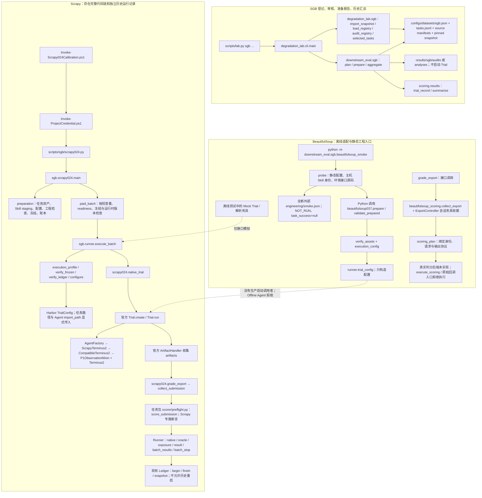

# SkillGenBench 下游目录结构审计与最小整理方案

日期：2026-10-24。工作树：D:\AS\AutoSkill-main；下文相对路径均以 degradation_failure_lab/ 为根。

**本轮结论：优先归组任务专属源码，保留已有公共工具、入口和冻结资产；不建立三套类型 Runner，不把当前 Runner 宣称为覆盖 187 项任务的通用执行框架。**

用户已暂停 S0.3。本报告不继续首个真实任务选型、不研究新的判分隔离路线、不增加判分功能。唯一允许的新项目文件是本报告；其余代码、配置、历史资产保持只读。分类、目标位置和迁移步骤均为建议，不表示已经实施。

## 1. 当前基线与审计方法

- 分支 master，HEAD 3073a1a1a7119603ccb2ac738fae269a8223c0d9。开始时有 18 项 tracked 修改、880 项 tracked 删除、2,419 个未跟踪文件；暂存区为空。全部为既有工作，不归因于本轮。
- index SHA256：2454cc749f587b0fee24774c9da654cd6ab0219b121b13a4ee457ee5e32acf33。
- 本轮以本地文件、AST 导入/函数定义/调用、字符串入口、任务 TOML/JSON、测试夹具和历史 manifest 为证据；没有 fetch/pull，也没有使用远程版本覆盖本地。
- 登记表 187 项：Code Repo 123、Code Doc 28、Domain Knowledge Doc 36；execution_status 全为 BLOCKED。任务目录有 187 份 adapter.json，其中 METADATA_ONLY 185、ENGINEERING_DEMONSTRATION 1、HISTORICAL_CALIBRATION_ADAPTER 1。状态不是统一的执行就绪证明。
- 静态盘点了 37 个重点 Python 模块，并追踪其相关脚本、schema、测试、任务包、配置与原生 Harbor 调用。对同构登记文件和冻结依赖按角色分组；没有逐个分析 449 份第三方源码或原始文档内容。
- 本轮不导入 Agent、调用 prepare/score/probe/execute_batch，也不运行任何测试、Docker、模型、判分进程或账本操作。以下“测试证据”是当前测试代码的覆盖范围，不是本轮新跑结果。

现存文档中部分 README 将初期 Git/P0 记录与 SGB 介绍放在一起；不能用其中“唯一任务”“准备通过”等文字替代当前代码和资产状态。

## 2. 已实现的真实调用关系

### 2.1 调用链图

实线表示现有代码调用关系；虚线明确表示测试替身或尚未接入的生产阶段。图不表示本轮执行过任何节点。



### 2.2 入口不是同一个流程

| 入口 | 现有实际行为 | 当前能力边界 |
|---|---|---|
| scripts/lab.py sgb import/audit/list | CLI → src/degradation_lab/sgb.py → 登记与静态身份检查 | 不选择或启动某个 Agent adapter |
| scripts/lab.py sgb plan/prepare | CLI → downstream_eval/sgb/__init__.py 的 plan/prepare | prepare 写准备报告；没有调用 runner.execute_batch |
| scripts/lab.py sgb aggregate | 读取登记行的 legacy_runs → trial_record/summarize | 不是扫描所有 runs 后自动认定完成；无登记的未来结果不会自动入统计 |
| scripts/sgb/Invoke-Scrapy024Calibration.ps1 | 凭据包装 → 主机脚本 → 固定控制端 → scrapy024.main run | 是 Scrapy 专用付费执行入口，不是所有 SGB 任务的 launcher |
| scripts/sgb/scrapy024.py prepare | 复制既有 canonical Skill/冻结 scorer；随后进入任务 preparation | 会写文件并可能 build/启动运行时；本轮只读源码，不运行 |
| python -m downstream_eval.sgb.beautifulsoup_smoke | 静态工程 probe → 全新外部记录 | 不是无模型 Harbor Trial；runtime=True 拒绝，不初始化模型 |
| Python 调用 beautifulsoup037.prepare | 外部新目录派生任务配置、按条件复制 Skill、校验资产 | 非命令行通用任务工厂；没有正式账本或生产 Trial 入口 |
| scripts/sgb/pydantic001.py | demonstrate → 上游 ExperimentRunner.plan + 专属 score | 是工程正负例演示；不是接入公共 Runner 的真实 Agent 任务 |
| scripts/lab.py downstream-check / downstream-prepare | checks.run_checks / p1.prepare | Git/P0/P1 试点链，仍有调用者，不能当成无人使用的遗留文件删除 |
| Invoke-GitChameleonPilot.ps1 / run_gitchameleon_pilot.py | 独立 GitChameleon 生成与下游试点 | 不属于 SGB Code Repo 类型执行器；不可因同为代码任务就归进 SGB |

Scrapy 的六条历史结果可以读取，但历史执行代码身份与当前 R1/S0.2 工作树不同。图中“有完整代码链”不等于当前候选版本已经重新通过实机运行。

### 2.3 公共 Runner 的真实边界

runner.py 已实现：显式 ExecutionConfig；task/experiment/generator/scope/条件校验；历史目录与 batch.started 拒绝；staged Skill 哈希检查；执行 manifest 校验；只读账本 policy 核对；Trial 回调协调；grade/exposure 回调；异常阶段、原始结果与预算记录。

它仍依赖：

1. 固定 Harbor TrialConfig、Docker environment 和 p1_mode/p1_profile/p1_manifest 约定；configure 延迟导入 SDK。
2. request_budget.Ledger；账本创建、任务资产准备、真实生成来源证明和外层准入由调用者承担。
3. 调用方提供 run_trial、grade、exposure、task_success。它不实现任务 Oracle，也不准备每个任务的镜像。
4. execute_batch 固定 paid，写 model_api_results=True；试点观测目录为 p1-observer，统计字段和暴露回调也沿用现有约定。
5. experiment_output 使用 runs/eval/sgb，因此整个文件当前分类为 S，部分机制是未来 G 候选，不能直接把整个文件移到“所有基准通用 core”。
6. 唯一非测试的 execute_batch 调用者是 scrapy024.paid_batch。BeautifulSoup 仅复用配置构造并用 Mock 验证协调接口；Pydantic demo 没走这个 Runner。Code Repo 与 Domain Knowledge Doc 尚无该 Runner 的真实接入证据。

原生 Skill 注入由 Harbor Trial 完成；host prepare 使用 copy_packages。skill_install.install_remote 是已有独立容器检查路径的工具，不能画成每次 SGB Trial 必经步骤。task.toml 的 separate verifier 声明也不能替代真实调用：Runner 当前设置 verifier.disable=True，实际评分走 grade 回调。

## 3. G/S/T/P/L 分类规则

- **G**：与基准/任务无关、已有明确复用的机制；G-H 表示其中与 Harbor 绑定的外部框架工具。
- **S**：SGB 登记、来源、报告或当前 SGB 执行公共机制。
- **T**：需要真实协议差异证明的类型适配；当前没有经过三类实跑验证的类型 Runner。
- **P**：任务身份、环境、提交协议、Oracle、业务规则。
- **L**：历史试点、兼容入口、工程探针、夹具或未实现能力。L 不等于应删除。
- 一个文件可以是混合归属。必须先按函数确认，不把混合文件整体搬进公共层。表内“目标”是建议；“原位”是有意保留，不是遗漏。无法确认一律保留待验证。

## 4. 逐文件职责、调用者与迁移映射

### 4.1 执行、框架与任务源码

| 当前路径 | 职责 | 分类 | 实际调用者 | 建议目标位置 | 建议操作 | 风险 |
|---|---|---|---|---|---|---|
| `downstream_eval/sgb/runner.py` | ExecutionConfig、配置构造、冻结/账本校验、批次协调和记录 | S；部分 G 候选，带 L 约定 | scrapy024.paid_batch；BS prepare/validate 仅调用 trial_config；test_sgb_runner/BS Mock | 原位 | 不晋升跨基准 core；先确认 P1/paid/Harbor 边界 | 搬目录会影响冻结身份；没有三类运行证据 |
| `downstream_eval/sgb/__init__.py` | plan/prepare/aggregate，登记准备与历史观察汇总 | S | degradation_lab.cli.main；test_sgb.py | sgb/management.py；原 __init__.py 保留薄导出 | 首批候选：原函数平移，保持三个公开名字 | 不可顺手增加真实执行分发；禁止 eager import Agent |
| `downstream_eval/sgb/scrapy024.py` | 专属身份、preparation、native_trial、grade_export、paid_batch | P+L；少量可复用函数 | 主机 launcher、模块 CLI、Runner/布局测试 | sgb/task_adapters/scrapy024/adapter.py；当前路径为兼容入口 | 非首批；先记录代码身份与路径依赖，再保留入口迁移 | s24r005、s24dNNN、19 断言、预算 scope 和历史冻结均绑定 |
| `downstream_eval/sgb/scrapy_agent.py` | Scrapy ledger 覆盖、环境检查、试后 Skill 身份核验 | P+L | execution_config.agent_import_path → Harbor AgentFactory | sgb/task_adapters/scrapy024/agent.py；旧 import_path 兼容 | 暂不动；与专属入口作为同一后续批次审查 | 不是通用 SGB Agent；scope、deny-all 检查与 Scrapy 环境特定 |
| `downstream_eval/sgb/beautifulsoup037.py` | verify_assets、独立配置、外部准备、判分计划、原证据解析 | P+L | beautifulsoup_smoke；scoring/exports 的延迟导入；相关测试 | sgb/task_adapters/beautifulsoup037/adapter.py；当前路径兼容 | 首批任务归组候选，必须与下三文件原子迁移 | 相对导入环、代码哈希、资产映射、LAB/路径含义须保留 |
| `downstream_eval/sgb/beautifulsoup_scoring.py` | 精确提交验证、夹具证据解析、阻断执行入口、行为方案描述 | P+L | BS grade_export/scoring_plan；离线证据测试 | sgb/task_adapters/beautifulsoup037/scoring.py | 随 BS 归组；只改导入/身份定位，不新增功能 | 不是已验证的独立评分后端；execute_scoring 必须继续拒绝 |
| `downstream_eval/sgb/beautifulsoup_exports.py` | fixture 控制器、收据/输出认证与身份关联 | P+L；认证原语是 G 候选而非整个文件 | BS collector/plan；测试 fixture 签发 | sgb/task_adapters/beautifulsoup037/exports.py | 随 BS 归组；保留原模块导出兼容 | 绑定 TASK_ID、路径、代码文件及 fixture-only；不能当通用真实导出服务 |
| `downstream_eval/sgb/beautifulsoup_smoke.py` | 静态 probe、环境接口源码检查、独立工程记录、CLI | P+L | 自身模块 CLI；21 项 smoke 测试中的调用 | sgb/task_adapters/beautifulsoup037/smoke.py；旧 -m 入口保留 | 随 BS 归组，保持原 CLI main 行为 | 会读取硬编码的源码身份列表；不能只哈希兼容壳而漏实现 |
| `downstream_eval/sgb/beautifulsoup_agent.py` | OfflineBeautifulSoupTerminus2 构造时拒绝 | P+L | BS execution_config 的字符串入口；AST 安全测试 | 最终可归组到 beautifulsoup037/agent.py；当前原位 | 首批明确不移动；先证明旧字符串入口和新旧构造都拒绝 | 重导出可能破坏 AST 保护测试；不能因整理而删除 raise |
| `downstream_eval/sgb/pydantic001.py` | CASE_ID/资产校验、专属 score、零模型 demonstrate | P+L | scripts/sgb/pydantic001.py；4 项 Pydantic 测试 | sgb/task_adapters/pydantic001/demo.py；旧 CLI 兼容 | 独立后续批次；不当成第二套公共 Code Doc Runner | 含 Docker 实际评分和 __file__ 根定位；本轮绝不执行 |
| `downstream_eval/scoring/results.py` | trial_record、summarize；拒绝 smoke/非真实观察 | G | SGB aggregate、Runner/BS/登记测试 | 原位 | 保留为公共结果协议；不把各任务判定写进来 | 输入仍需任务 adapter 正确区分 infra 和 answer；不自动接纳任意新目录 |
| `downstream_eval/scoring/__init__.py` | 评分包标记 | G | 包导入 | 原位 | 保留 | 无须仅为样式增加层级 |
| `downstream_eval/integration/harbor_adapter.py` | 固定来源核验、官方方法 AST 探针、网络 schema 检查、preflight | G-H+L | skill_install、checks、p1、Scrapy/BS、ExportController | 原位；以后确需拆分再进入 integration/harbor/ | 不整体搬/合并；verify_sources/枚举检查与环境探针分清 | preflight 含 git/docker/harbor 命令；并非可无副作用调用的纯配置函数 |
| `downstream_eval/integration/skill_install.py` | canonical 来源核验、copy_packages；host/容器检查及 remote install/hash | G+G-H+L | P1/GitChameleon/Scrapy；BS 只复用 copy_packages | 原位；函数职责先标注 | 不因文件混合就拆三份；后续凭调用证据抽函数 | check_container_skills 复制 fixture.py，带 Git/P0 模板约定；不是所有任务通用 |
| `downstream_eval/integration/request_budget.py` | Ledger/MeteredTransport；同时有固定 P1 ledger 选择和 CLI | G+L | 公共 Runner、Scrapy Agent、P1 observer、预算测试 | 原位；Ledger 机制与 ledger_for_profile 的 L 边界待分离 | 首批不动；不复制预算实现 | DATABASE/RECOVERY_DATABASE、六请求、ORDER 的历史策略不能泛化 |
| `downstream_eval/integration/p1_observer.py` | 访问/正文观测、model/HTTP 记录、P1 mode 和预算协调 | L；body_visible 等是 G 候选 | CompatibleTerminus2、Scrapy body_exposure、GitChameleon、P1 测试 | 原位 | 保留依赖；仅标出可复用小函数 | /harbor/skills、p1-observer、profile 字段及默认 ledger 均有约定 |
| `downstream_eval/integration/terminus_compat.py` | 官方 Terminus 兼容选项、内存换行兼容及 P1 mixin | G-H+L | ScrapyTerminus2、Offline BS 类、P1、锁文件 agent_import_path | 原位 | 先保持工厂字符串入口；不把整个类宣称为通用 SGB Agent | 选项 p1_mode/profile/manifest 和默认预算耦合；不等于无模型入口 |
| `downstream_eval/integration/model_connectivity.py` | settings/OneRequest、一次请求和响应记录、CLI | L | GitChameleon Agent、连通性入口和测试；observer 存在导入 | 原位 | 保留；用实际调用区别于仅 import | 含供应商/旧准备策略；不随目录整理测试网络 |
| `downstream_eval/integration/gitchameleon_agent.py` | GitChameleon 专属 Terminus 扩展与约束 | P+L（非 SGB） | gitchameleon_pilot.configure 的字符串 Agent 路径 | 原位；独立基准后续治理 | 不可迁入 SGB Code Repo 类型层 | 不同数据集、特定任务/条件；不能直接复用为 SGB 工厂 |
| `downstream_eval/checks.py` | Git/P0 fixture、Oracle 正负探针、Harbor 检查 | P+L | cli downstream-check；p1.materialize_task；test_downstream | 原位 | 保留现有入口与实现，不以名称 checks 判为 G | 顶层导入 Git restore fixture/oracle；可触发运行时 |
| `downstream_eval/p1.py` | Git/P1 prepare、zero_probe、Gold 检查；包含共享 fairness_identity | P+L；fairness_identity 为窄 G 候选 | cli downstream-prepare；Scrapy 只导入 fairness_identity；test_p1 | 原位；公平性函数未来可单独迁到 integration/fairness.py | 先确认函数边界，首批不搬整个文件 | Git fixture、旧 profile、模型初始化与运行时探针不能跟着小函数进入 G |
| `downstream_eval/gitchameleon_pilot.py` | 独立试点 configure/native_trial/probe/arm/finish | P+L（非 SGB） | scripts/run_gitchameleon_pilot.py 经模块 CLI 调用 | 原位 | 保留；不与 SGB Runner 强制合并 | 不同实验准入、任务环境和判分命令 |
| `downstream_eval/__init__.py` | 包说明 | G | 包导入 | 原位 | 保留 | 不得添加 eager import 让静态命令加载 SDK |
| `scripts/lab.py` | 设置 src 搜索路径、禁 bytecode、调用 cli.main | G（全研究入口） | 用户命令、文档 | 原位 | 保持入口名称 | 不是下游 Runner 本体 |
| `scripts/sgb/scrapy024.py` | canonical Skill 导出与校验、冻结任务复制、控制容器 launcher | P+L | Invoke-Scrapy024Calibration.ps1 或主机 CLI | 原位 | 作为兼容 launcher 保留；暂不迁入公共命令 | PREFLIGHT 的 C 盘绝对路径、CONTROL、LINUX_ROOT、s24r005 固定 |
| `scripts/sgb/pydantic001.py` | 设置路径并调用专属 demo.main | P+L | 用户 CLI；相关文档 | 原位 | 将来只调整内部目标 import，保留 CLI | 名字不代表已通用化 Agent 启动 |
| `scripts/gitchameleon_prepare.py` | GitChameleon 文档转换/条件输入与来源证据准备 | P+L（非 SGB） | 自身命令行；本次范围未发现其他生产 Python caller | 原位 | 保留待验证，不因 caller 少而删 | 会写独立数据与清单；不属于本轮下游公共逻辑 |
| `scripts/run_gitchameleon_pilot.py` | 生成、各 arm 调用及批次控制 | P+L（非 SGB） | Invoke-GitChameleonPilot.ps1 | 原位 | 保留 | 包含上游真实生成与付费执行；不能作为零模型测试运行 |
| `src/degradation_lab/cli.py` | SGB/上游/旧下游多命令分派 | G+S+L | scripts/lab.py | 原位 | 保持公开命令；SGB facade 兼容后无需为归组改 CLI | 与命令同名的 prepare/plan 并非同一生命周期 |
| `src/degradation_lab/sgb.py` | 导入、source 登记、快照/registry 校验、选取；_bind_scrapy 绑定历史 | S+P/L | cli、sgb management、BS/Pydantic verify、登记测试 | 原位，保留单一登记来源 | 不新建第二份 catalog；_bind_scrapy 单独标注 | 固定 revision/187 数量；不能手改 registry 添加新 revision 或新规则 |
| `src/degradation_lab/io.py` | read/write/sha256/inventory/inside；inside 接 relocation | G；含共享来源路径约定 | 所有准备、身份、结果与上游模块 | 原位 | 直接复用，不复制到每个任务 | raw Path 读取不会自动经过 inside；迁移不能假定所有路径均已兼容 |
| `src/degradation_lab/artifacts.py` | run_refs/resolve_run/load_run/导出与生成资产核验 | G（上游与下游桥） | canonical_packages、launcher、cli、生成验证 | 原位 | 统一生成运行定位与身份校验 | 不要用改 generator_run_id 标签替代真实来源；不属于下游 Agent 生命周期 |
| `src/degradation_lab/relocations.py` | 旧逻辑路径到物理归档路径；历史输入身份内存兼容 | S+L（跨层使用） | io.inside；artifacts；adapter.execute；归档测试 | 原位 | 保留；不把路径兼容当任意新移动的自动保险 | 依赖现有 manifest/root；不能覆盖所有字符串、绝对路径和原始 Path 读取 |
| `src/degradation_lab/layout.py` | case_paths/case_path/generation_path 的旧/新布局定位 | G+S | catalog、上游 runner、案例测试 | 原位 | 维持 sources/cases/generation 的已有布局 | 目录名不是实验身份；同 ID 重复需拒绝 |
| `src/degradation_lab/runner.py` | ExperimentRunner：上游文档到 Skill 的计划/生成 | G（上游支撑） | cli、GitChameleon 主机脚本、Pydantic demo.plan | 原位 | 不与 downstream_eval/sgb/runner.py 合并 | 同名 runner 的职责完全不同；本轮不改生成算法 |
| `src/degradation_lab/catalog.py` | SourceManager、CaseManager、case/condition 来源验证 | G（研究数据支撑） | 上游 runner/cli、Pydantic verify | 原位 | 复用 source/case/condition 管理 | 不是下游 executable task factory |
| `src/degradation_lab/adapter.py` | 调用官方 Anything2Skill 的研究包装及来源/历史输入追踪 | G+L（上游包装） | ExperimentRunner 的生成执行链 | 原位 | 保留；不移动官方 Anything2Skill | 不把上游模型调用与下游 Agent 执行混成一个 Runner |
| `src/degradation_lab/schema.py` | 研究 JSON schema 校验及唯一性检查 | G | catalog、sgb 导入/审计、cli 等 | 原位 | 复用 | 不为每个任务再写同构来源 schema |


### 4.2 脚本、配置、任务包和来源资产

本表对同构文件使用显式模式覆盖；模式下的每个文件都继承该建议，不表示要批量移动。冻结依赖按清单整体核对，不逐个当成公共框架源码。

| 当前路径/文件集合 | 职责 | 分类 | 实际调用者 | 建议目标位置 | 建议操作 | 风险 |
|---|---|---|---|---|---|---|
| scripts/sgb/Invoke-Scrapy024Calibration.ps1 | 专属付费入口与失败后停止 | P+L | 用户命令 | 原位 | 保留入口 | 不可改成任意 task 都可运行 |
| scripts/Invoke-ProjectCredential.ps1 | 配置驱动的凭据包装 | G（研究运行工具） | Scrapy/GitChameleon PS 入口 | 原位 | 保留，本轮不运行 | 归组不能更改配置中的 loader 路径或审批含义 |
| scripts/Invoke-GitChameleonPilot.ps1 | GitChameleon wrapper | P+L | 用户命令 | 原位 | 保留 | 与 SGB 类型无关 |
| downstream_eval/integration/ZhizengzengCredential.ps1 | 配置指定的 DPAPI loader | G（研究运行工具） | 凭据 wrapper | 原位 | 不移动、不读取凭据值 | 绝对/相对 loader 配置和 Windows 用户上下文 |
| downstream_eval/integration/Test-P1Connectivity.ps1 | 专属连通性命令包装 | L | 人工工程入口、历史文档 | 原位 | 保留待验证 | 不运行其命令验证目录 |
| downstream_eval/integration/Dockerfile.control | 固定 Harbor 控制环境构建说明 | G-H+L | 历史控制端构建流程 | 原位 | 不改、不构建 | 带固定 Git 包与控制端身份，不是通用任务 Dockerfile |
| downstream_eval/configs/runner.lock.json | Harbor 源码/依赖/控制端及 Agent 路径锁 | G-H+L | verify_sources/preflight、P1/BS/Scrapy | 原位 | 保持全部字节 | 含 legacy CompatibleTerminus2 字符串；目录不能倒逼改锁 |
| downstream_eval/configs/p1_smoke.json | 旧 P1 profile，Scrapy preparation 作为模板改写 | L | p1.prepare、scrapy024.preparation | 原位 | 不作为新任务默认配置 | 固定预算/审批/实验假设，不能静默继承 |
| downstream_eval/configs/git_restore_pilot.json | Git 任务与生成 Skill 绑定 | P+L | checks/p1 | 原位 | 不迁到 SGB | task/source/generator/历史路径特定 |
| configs/datasets/sgb.json | 唯一快照与登记来源配置 | S | load_registry、BS verify_assets | 原位 | 不建立平行 registry | 指向冻结 SHA；不为源码归组改 revision |
| configs/experiments/sgb/template.json | 导入阶段生成的规划模板 | S+L | 后续显式研究配置参考 | 原位 | 保留，标记模板不等于执行授权 | 未证明所有 187 项可直接运行 |
| downstream_eval/tasks/sgb/*/*/adapter.json（187 份） | 任务登记定位；特例带原入口字符串 | S+P（数据） | import_snapshot/audit/任务资产验证 | 全部原位 | 仅作为描述，不当可执行 adapter | 185 份 METADATA_ONLY；文件名相同不意味着执行协议已统一 |
| tasks/sgb/code_doc/scrapy-task-024/instruction.md、task.original.toml、task.toml、environment/Dockerfile | Scrapy 题面、原/派生配置、专属环境 | P | launcher/preparation/native Trial | 全部原位 | 冻结任务包不动 | 派生 image/网络、原始身份与历史清单绑定 |
| 同任务 scorer/preflight.py | verify、Docker 封装、score_submission | P+L | scrapy024.scorer_module/grade_export | 原位 | 不拆成 G Docker runner | 同文件含冻结/工程准备函数、19 项评分与任务常量 |
| 同任务 scorer/harbor_entry.py | 备用 post-Agent 导出/评分 hook | P+L | 本次未发现 paid_batch 生产调用；grade_export 直接调用 preflight.score_submission | 原位 | 保留待验证，不删除 | hook 自带“输出在 bundle 内”历史约束，不代表当前通用接口 |
| 同任务 scorer/runtime/worker.py | 单任务候选调用入口 | P | preflight.score_submission | 原位 | 保留 | 不能作为任意任务 Worker |
| 同任务 scorer/runtime/interface.py | get_target_function 的任务契约 | P | worker、preflight 的冻结准备 | 原位 | 保留 | 参数和业务接口特定 |
| 同任务 scorer/runtime/oracle_bridge.py | 任务响应与原断言桥接 | P | preflight 的专属 pytest 调用 | 原位 | 不抽为 BS 或全 SGB Oracle | 同目录名不构成业务等价 |
| 同任务 scorer/runtime/policy_probe.py | 专属候选环境证据 | P+L | preflight.policy_check/score_submission | 原位 | 不改 | 路径清单和环境断言是任务策略 |
| 同任务 scorer/stages/scorer/oracle/eval.py、test.original.sh | 原始 Oracle 与脚本 | P（冻结） | preflight 的评分链 | 原位 | 原字节保留 | 任何 wrapper 或改换行都改变身份 |
| 同任务 scorer/stages/scorer/deps/**（449 项） | vendored 依赖 | P（冻结第三方资产） | 原 scorer 的 /deps | 原位 | 不搬进源码公共层，不去重删除 | 即使包名相同，也需保留当时依赖身份 |
| 同任务 scorer/fixtures/submissions/{correct,ftp_mutant}/agent_output.py | 原工程正负例 | P+L（冻结夹具） | Scrapy preparation 的受控工程流程 | 原位 | 不当成生成 Skill 或 Agent 产物 | 已被 frozen_inventory 绑定 |
| 同任务 scorer/source_manifest.json | 459 项冻结 scorer 身份与来源 | P+L（冻结） | scorer.verify、资产检查 | 原位 | 不因新路径改写清单 | 历史 PREFLIGHT 来源与逻辑路径要继续可追溯 |
| tasks/sgb/code_doc/pydantic-task-001/{instruction.md,task*.toml,asset_manifest.json,runtime.lock.json,scorer/oracle/**} | Pydantic 演示任务包与原 Oracle | P（冻结） | pydantic001.verify_assets/score | 原位 | 全 9 项任务资产保留 | 不是需要迁移到公共层的业务规则 |
| tasks/sgb/code_doc/beautifulsoup4-task-037/offline_adapter.json | 来源、原测试名与固定版本映射 | P+L（离线描述） | BS verify_assets | 原位 | 不因 Python 归组改官方资产映射 | 没有持久化的可运行任务包，不可标 READY |
| tasks/git_restore_explicit_source_both_v1/{fixture.py,oracle.py,tests/verify.py,task.toml,environment/**} | Git 状态任务 | P+L（非 SGB） | checks/p1、原生 separate verifier 工程路径 | 原位 | 不放入 SGB Code Repo | 真实 Git 状态断言不能替代其他任务评分 |
| tasks/gitchameleon_{144,164}_v1/** | GitChameleon 任务与输入 | P+L（非 SGB） | 独立 pilot | 原位 | 保留独立来源分类 | 任务编号/包名不代表 SGB |
| downstream_eval/gold/SKILL.md | Git/P1 Gold 研究对照 | P+L（夹具/对照） | p1.gold_check/prepare | 原位 | 不当成全任务 Gold Skill | 原业务和固定实验身份 |
| .external/harbor-full/**、.external/skillgenbench/5a8bd61d/** | 外部固定框架、原始数据 | G-H / S（外部冻结资产） | 锁与 registry 定位 | 原位 | 不进研究源码目录，不改官方实现 | 原始快照、checker、原文不能随归组移动 |
| data/raw_sources/sgb/**、data/manifests/sgb/**、cases/sgb/** | 原文、来源/任务/迁移清单、生成案例 | S+P（研究资产） | 来源管理、准备、上游生成 | 原位 | 沿用已有数据来源分区 | cases 是生成输入，tasks 是下游环境，不合并 |
| runs/gen/sgb/**、runs/eval/sgb/**、results/sgb/** | 生成记录、执行记录、分析/审计 | L（历史证据） | load_run、历史汇总、复现核验 | 原位 | 永不混进 task_adapters 源码 | 不能重命名历史 run 或改 manifest 迎合新源码 |
| docs/sgb/**、downstream_eval/docs/** | 当前规划与历史阶段文档 | S+L | 人工审阅；部分审计被 hash 保护 | 原位 | 新报告说明新状态，不重写旧结论 | 冻结报告是当时证据，不是应“更新修正”的活配置 |

表中 tasks/... 是 downstream_eval/tasks/... 的缩写；该缩写仅用于本表的重复前缀，物理目录保持不变。

### 4.3 测试与测试夹具

测试按被测职责归组，不按“有多少源码文件就造多少测试文件”。以下是后续目标，不在本轮移动；原有受限测试入口保持到 M3 确认依赖后。

| 当前文件 | 分类/被测对象 | 建议目标 | 迁移约束 |
|---|---|---|---|
| tests/test_sgb_runner.py | S；22 项显式配置、预算、协调与兼容入口检查 | tests/downstream/sgb/test_runner.py | 保留 Scrapy 回归；不能删预算/marker 断言 |
| tests/test_sgb.py | S+G；17 项登记、来源、生成布局与汇总 | tests/sgb/test_registry_and_management.py | 跨上游/下游；不可硬拆成只测 Runner |
| tests/test_sgb_layout.py | S+P/L；5 项布局/launcher 保护 | tests/downstream/sgb/test_layout.py | 存在裸 import test_sgb 的 helper 依赖 |
| tests/test_sgb_archive.py | S+L；6 项旧路径与逻辑身份 | tests/sgb/test_archive.py | 不把迁移兼容用例改成只认新路径 |
| tests/test_scrapy024.py | P+L；7 项历史资产与预算/SDK 检查 | tests/downstream/sgb/tasks/scrapy024/test_calibration.py | 含缺固定 SDK 时的 skip，不能强行启动运行时 |
| tests/test_sgb_beautifulsoup037.py | P+L；16 项适配/Mock 批次 | tests/downstream/sgb/tasks/beautifulsoup037/test_adapter.py | prepare/Mock 不等于真实 Agent；先处理跨测试 helper 导入 |
| tests/test_sgb_beautifulsoup_smoke.py | P+L；21 项静态探针/收据保护 | 同上任务目录/test_smoke.py | 引用上一个测试模块中的 setUp/evidence |
| tests/test_sgb_beautifulsoup_evidence.py | P+L；16 项合成证据链 | 同上任务目录/test_evidence.py | 引用 smoke fixture helper；不能把夹具统计成真实结果 |
| tests/test_sgb_pydantic001.py | P+L；4 项来源/门禁/夹具 | tests/downstream/sgb/tasks/pydantic001/test_demo.py | 只读与 mock；不运行专属 score |
| tests/test_downstream.py | L+G-H；12 项 P0 与工具检查 | tests/downstream/legacy/test_p0.py | 名字 generic 但含 Git fixture；后续可按明确函数分组 |
| tests/test_p1.py | L；11 项 P1/公平性/观测检查 | tests/downstream/legacy/test_p1.py | 保持历史 options 和观测语义 |
| tests/test_request_budget.py | G+L；11 项账本/transport | tests/downstream/test_request_budget.py | 模块混合分类；先不为目录强拆测试 |
| tests/test_model_connectivity.py | L；7 项一次请求/历史记录 | tests/downstream/legacy/test_model_connectivity.py | 禁止变成真实连通性测试 |
| tests/test_gitchameleon.py | P+L；7 项其他基准 | tests/downstream/legacy/test_gitchameleon.py | 不冠以 SGB Code Repo 验证 |
| tests/Test-ZhizengzengCredential.ps1 | G 工具的专属测试 | 原位，职责备注即可 | 本轮不运行，也不记录敏感值 |
| tests/fixtures/sgb/pydantic-task-001/** | P+L；correct/swapped_order | 原位 | 可读夹具不等于正式 benchmark 数据 |
| 其余 test_framework/resume/framework fixtures | 上游 G/研究框架 | 原位 | 无须扩大本次下游目录整理范围 |

测试文件间已有 helper 复用，因此不能先机械搬测试目录。后续可把确实复用的 fixture helper 放到同测试包 support.py，但这是 M3 的必要性判断，不预先创建支持层。不要为兼容而 re-export 所有 TestCase，导致 unittest 重复发现同一组测试。

## 5. 三类 SGB 的共享边界：基于现有样本

样本只是接口对照，不是 S0.3 的任务推荐或新的判分评审。

- Code Repo：PyPDF2_gtb03 的官方 submission.kind=script，最终文件为 output/pdf_metadata.json，checker 读取文件；本地仅 adapter.json 元数据，没有本地可执行适配器。
- Code Doc：Scrapy 任务是 agent_output.py + 专属 scorer；BS 同样提交 Python，却只有离线适配和证据接口；Pydantic 又是独立工程演示。由此可见，同一类型内部也不是一种评分协议。
- Domain Knowledge Doc：lockdate_compliance_gate_001 的题面要求 solve(input_data)，提交仍为 agent_output.py；原 eval.run_case 会 exec 候选并调用 solve，testcases.json 持有预期结果。本地仅 metadata adapter。不能因领域任务输出是 dict 就说原 benchmark 直接接收 JSON 文件。

| 接口 | 可共享机制 | 样本中的真实差异 | 配置还是 T 适配 | 当前证明边界 |
|---|---|---|---|---|
| 登记/来源定位 | load_registry、selected_tasks、source/snapshot SHA、task_key | source_type、目录根、source_ids、revision | 主要是 S 数据配置 | 三类元数据均已使用同一导入/校验代码；不等于执行 |
| 原 TOML → Harbor 配置 | schema/网络模式验证、显式身份校验可复用 | 原 SGB 为 task/runtime/submission 等结构；本地 Scrapy/Pydantic 与 BS 派生为 Harbor 1.4 | 有不同转换/物化需求；当前不足以决定三个 T 模块 | BS 有转换，其他任务没有统一生产转换器 |
| Agent/Trial 生命周期 | 原生 Harbor 工厂和 Trial；Runner 的回调协调 | Code Repo 先产出文件；函数任务依赖模块/调用接口；Agent 策略与门禁不同 | 基本生命周期应共享；任务 hook/配置承担差异 | 当前公共批次仅 Scrapy 非测试调用；不证明三类适用 |
| 环境与工作目录 | 资源/超时/路径/可见性规则的通用校验 | library、输入文件、CPU/模型资源、初始状态、只读目录不同；同为 Code Doc，Scrapy 检查无 scrapy 包，BS 需要 bs4 | 多数为 P 配置/环境；协议差异再决定 T | 没有三类共用环境构建器实证 |
| Skill 安装 | canonical 来源、ID 集合、copy/hash、原生注入 | NoSkill/Skill 条件、包与生成来源、索引/远端路径 | 配置差异，不应复制三套安装器 | host 机制复用明确；不同任务 runtime 仍需验证 |
| 提交物收集 | 唯一性、路径/状态/大小/hash、身份链的原则 | JSON 文件、Python 模块、目录/仓库等 artifact contract 不同 | 按提交协议可能需要 T，而不是按三类标签直接建类 | 通用 collect_submission 仅按文件名/数量；BS 更严格但仍 P+L |
| 判分调用 | 任务 grade 回调、超时/异常分类、原始日志与结果封装 | 文件 checker、专属原 pytest、动态函数执行、既有 task bridge | 可按判分协议复用机制；具体 Oracle 和业务断言始终 P | BS 后端未实现；Code Repo/Domain 没有本地统一执行链 |
| 业务断言 | 没有应上移的业务规则 | Scrapy FTP overwrite、BS Tag、Pydantic 顺序、domain 业务决策 | P | 保留原始 Oracle 与版本，目录迁移不改变评分口径 |
| 结果记录/统计 | trial_record/summarize、失败阶段、证据路径、拒绝 smoke | 不同 checker 的 Process/Result/returncode 含义需归一化 | G 结果协议 + P 映射；部分 S 结果引用管理 | aggregate 只读取登记 legacy_runs；不是全类型自动汇总 |

**T 层目前不应创建三个空目录或复制 Runner。** 后续若发现两项任务真正共享“文件产物 + 外部 checker”或“JSON 调用协议”等机制，再以协议建立最小适配；同一个协议可能跨 source_type，一个 source_type 也可能有多个协议。研究来源类型继续保留在资产和登记目录中。

## 6. 当前结构的三个主要问题及重复判断

1. **入口与能力状态混在一个名字空间。** sgb/__init__.py 的准备/汇总、sgb/runner.py 的批次、Scrapy 实跑入口、BS 静态工具、Pydantic demo 并排，用户容易把“登记成功”“prepare”“probe”理解为已跑通。
2. **公共机制和试点策略混合。** integration 中部分函数可复用，但 CompatibleTerminus2/P1 observer/ledger_for_profile、Git 模板检查仍带旧策略；Scrapy 又只为 fairness_identity 导入整个 p1 模块。把整个 integration 或 runner 当 G 会隐藏实际依赖。
3. **任务源码平铺、冻结资产和代码身份关系不直观。** BS 的五个工作模块与 Agent guard 平铺在 SGB 公共层；Scrapy 的大多数文件其实是冻结依赖。历史路径、manifest、import_path、__file__ 根定位和 hash 列表使“剪切粘贴”不安全。

不能直接合并的看似重复：

- runner.py 的 configure 与各试点 configure：政策、模式与 profile 不同，只证明部分机制重叠。
- harvest/grade/normalize 的同名函数：任务协议和业务意义不同；不能拿 Scrapy bridge 代替 BS。
- harbor_adapter 的官方方法 AST 探针与 terminus_compat：前者避免加载模型栈，后者是实际 SDK 扩展，目的接近但执行载体不同。
- preflight.py 的 read/write/Docker 与研究工具同名：这是冻结的自包含任务资产，不是应立即去重的公共源码。
- 多个 prepare/runner：上游生成、登记准备、环境准备和批次执行是不同阶段，不按名字强行合并。
- 本次未发现可直接删除且无历史引用的关键模块；低调用量、仅测试使用和 L 分类均不构成删除授权。

## 7. 建议目标目录树

这是分阶段目标，不是本轮创建清单。“兼容”表示现存入口继续可用；“后置”表示须先取得 M1/M3 证据。资产沿用当前来源分类；Python 任务包只归组可维护的研究适配源码，不容纳冻结 Oracle 或历史运行目录。

```text
degradation_failure_lab/
├── src/degradation_lab/                    # 上游研究支撑与共享数据/身份工具，保持原位
│   ├── cli.py                             # 研究命令分派，不在这里复制 Agent 生命周期
│   ├── sgb.py                             # S：单一登记、快照、来源核验
│   ├── io.py / artifacts.py               # G：字节身份、生成运行定位
│   ├── catalog.py / layout.py / schema.py  # G/S：来源、案例、布局与 schema
│   ├── relocations.py                     # S/L：历史逻辑路径兼容
│   ├── runner.py                          # 上游 ExperimentRunner，不合并到下游 Runner
│   └── adapter.py                         # 上游 Anything2Skill 包装，官方实现不动
├── downstream_eval/
│   ├── integration/                       # 外部框架/基础机制；现有混合模块先原位
│   │   ├── harbor_adapter.py              # 固定 Harbor 来源/schema/工程检查
│   │   ├── skill_install.py               # Skill 身份、复制和外部环境工具
│   │   ├── request_budget.py              # Ledger/transport 与旧 profile 策略边界
│   │   ├── terminus_compat.py              # 现存 SDK import_path，暂不移动
│   │   ├── p1_observer.py                  # 旧观测策略，暂不迁成通用 Agent
│   │   ├── model_connectivity.py
│   │   ├── gitchameleon_agent.py           # 非 SGB 专属扩展仍保持独立
│   │   └── Dockerfile.control / *.ps1      # 控制环境与历史工具，原位
│   ├── scoring/
│   │   ├── __init__.py
│   │   └── results.py                     # G：结果协议与 smoke 排除，不含任务断言
│   ├── sgb/
│   │   ├── __init__.py                    # 兼容导出 plan/prepare/aggregate
│   │   ├── management.py                  # 拟新增：上述登记准备/汇总函数，非执行器
│   │   ├── runner.py                      # S：当前共享批次协调；保留现有边界
│   │   ├── task_adapters/                 # 拟新增：按任务归组的研究源码
│   │   │   ├── __init__.py                 # 仅包标记，禁止 eager import Agent
│   │   │   ├── beautifulsoup037/
│   │   │   │   ├── __init__.py             # 仅包标记
│   │   │   │   ├── adapter.py              # 来源、配置、离线准备、判分接口
│   │   │   │   ├── scoring.py              # 现有专属证据解析；不新增评分能力
│   │   │   │   ├── exports.py              # 现有 fixture-only 收据协议
│   │   │   │   ├── smoke.py                # 现有静态工程入口
│   │   │   │   └── agent.py                # 后置目标；首批仍保留原 guard 文件
│   │   │   ├── scrapy024/
│   │   │   │   ├── __init__.py
│   │   │   │   ├── adapter.py              # 后置：Scrapy 专属流程，不上移业务规则
│   │   │   │   └── agent.py                # 后置：专属运行与预算约束
│   │   │   └── pydantic001/
│   │   │       ├── __init__.py
│   │   │       └── demo.py                 # 后置：工程演示，保持 demo 身份
│   │   ├── scrapy024.py / scrapy_agent.py  # 现存路径先保留；后续逐项成为兼容入口
│   │   ├── beautifulsoup037.py             # 兼容公开 API；未迁移前仍是实现
│   │   ├── beautifulsoup_scoring.py        # 同上
│   │   ├── beautifulsoup_exports.py        # 同上
│   │   ├── beautifulsoup_smoke.py          # 旧 python -m CLI 兼容
│   │   ├── beautifulsoup_agent.py          # 首批保持完整 Offline 拒绝保护
│   │   └── pydantic001.py                  # 旧 API/CLI 兼容
│   ├── tasks/                             # 配置、环境、原任务资产；与研究适配源码分开
│   │   ├── sgb/
│   │   │   ├── code_repo/<official-task-id>/adapter.json
│   │   │   ├── code_doc/
│   │   │   │   ├── scrapy-task-024/        # 完整冻结包原位，465 个文件不搬
│   │   │   │   ├── pydantic-task-001/      # 冻结演示资产原位
│   │   │   │   ├── beautifulsoup4-task-037/# adapter + offline_adapter 原位
│   │   │   │   └── <other-task-id>/adapter.json
│   │   │   └── domain_knowledge_doc/<official-task-id>/adapter.json
│   │   ├── git_restore_explicit_source_both_v1/
│   │   └── gitchameleon_{144,164}_v1/       # 非 SGB，原位
│   ├── configs/                           # runner.lock 与旧 profile 全部原位
│   ├── gold/                              # 现存 Git/P1 对照，不视为全任务 Gold
│   ├── docs/                              # 历史下游说明
│   └── checks.py / p1.py / gitchameleon_pilot.py # 保持现存调用，后续单独治理
├── scripts/
│   ├── lab.py / Invoke-ProjectCredential.ps1
│   ├── sgb/                               # 保持用户命令名；不复制完整执行框架
│   │   ├── scrapy024.py
│   │   ├── Invoke-Scrapy024Calibration.ps1
│   │   └── pydantic001.py
│   └── <existing GitChameleon / legacy tools> # 独立来源与历史入口不混入 SGB
├── tests/
│   ├── sgb/                               # 后置：登记、来源、归档/管理用例
│   ├── downstream/
│   │   ├── sgb/
│   │   │   ├── test_runner.py
│   │   │   ├── test_layout.py
│   │   │   └── tasks/{scrapy024,beautifulsoup037,pydantic001}/
│   │   ├── legacy/                        # Git/P0/P1/GitChameleon 既有测试
│   │   └── test_request_budget.py
│   ├── fixtures/sgb/                      # 保持测试夹具，不混入正式任务来源
│   └── <existing upstream tests>           # 无关测试不整理
├── configs/
│   ├── datasets/sgb.json
│   └── experiments/sgb/                    # 显式新实验配置，模板不代表授权
├── data/
│   ├── raw_sources/sgb/                    # 文档/仓库原输入，继续来源分类
│   ├── condition_inputs/sgb/               # 文档实验条件
│   └── manifests/sgb/                      # 固定来源、登记、relocation；不改历史身份
├── cases/sgb/                             # 文档到 Skill 的生成案例
├── runs/
│   ├── gen/sgb/                           # 生成记录，保留历史 ID
│   └── eval/sgb/                          # 正式评测，保留历史 ID
├── results/sgb/                           # 报告/审计/分析，历史产物不覆盖
├── docs/sgb/                              # 新决策与阶段报告
├── .external/                             # 固定 Harbor/SGB/GitChameleon 等原始依赖不动
└── .gitattributes                         # 现有保护不变，不因目录美化扩大规则
```

树中省略的是与本次下游整理无关的既有文件，不表示删除。integration 目前有混合职责，在目标中明确标注而非假装已经拆净。若以后要抽出 fairness_identity，只单独评审它的输入约定及两个真实调用者，不以此搬走 p1.py；integration/fairness.py 也不是首批必须创建的文件。

不建立空的 code_repo_runner.py、code_doc_runner.py、domain_runner.py 或 type_adapters 三套框架。T 层在至少两项真实协议共性有证据时再决定文件名和位置。

## 8. 新增一道任务到底需要什么

### 8.1 已登记任务从 METADATA_ONLY 走到离线适配

通常只需以下最小增量，是否新增取决于既有文件是否已经表达要求：

1. **P 任务适配源码**：task_adapters/<alias>/adapter.py，明确 official task ID、source revision、原资产哈希、提交物契约和 grade 接口；调用现有 Runner 配置接口。不能继承 Scrapy 的 s24r005、s24dNNN、scope 或默认账本。
2. **必要的 P 配置/映射**：在该任务现有 tasks/sgb/<type>/<task-id>/ 附近描述环境与提交物；引用原始 snapshot，不复制或改写原 Oracle。是否物化派生 Harbor 包由实际协议决定；已冻结包不在原位改写。新资产身份/运行输出必须独立于历史身份。
3. **安全离线测试**：验证身份、来源、NoSkill/Skill、路径、缺失资产、异常分类与兼容；少量受控 fixture 放 tests/fixtures。测试通过只表明适配接口通过。
4. **新的显式实验配置和来源绑定**：真正执行前另行建立，使用本任务的生成运行、实验 ID、预算范围。目录整理阶段不生成研究运行或授权。

不要求每题都新增 agent.py、smoke.py、exports.py、worker.py、policy_probe.py 或完整 Ledger。当前 BS 的证据模块对应其既有工程边界，不能直接当所有题的必选模板。只有真实任务约束不能由配置和现有外部 Agent 接口表达时，才增加专属代码。

### 8.2 可以直接复用与仍需验证的部分

直接复用已有登记/来源读取、io 哈希、生成运行定位、canonical Skill/copy、Harbor 配置构造和结果协议；对兼容当前 paid/Harbor/P1 约定的任务，可复用 execute_batch 协调机制。任务资产准备、真实导出证明、评分后端和各环境可见性仍需逐题验证，不由一份 ExecutionConfig 自动提供。

公共 Runner 的回调允许表达不同任务，却不意味着所有 grade callback 已有安全可执行实现。不能为消除这一区别而给 metadata adapter 自动写 READY 或任务成功。

若是**原快照之外的新任务/新 revision**，当前 importer 的 187 数量与 revision 校验是冻结约定。需要单独设计来源导入与版本身份，不能手工向已有 tasks.jsonl 追加第 188 行并修改历史 manifest 来通过检查。本轮只规划已有登记任务接入，不改变数据集定义。

源文档继续进入 data/raw_sources/sgb；实验退化输入、生成案例、生成结果和下游环境分别位于 condition_inputs、cases、runs/gen、downstream_eval/tasks。它们通过身份引用关联，不应合并为一个大任务文件夹。

## 9. 迁移风险与不可越过的边界

| 风险 | 当前证据 | 后续处理/停止条件 |
|---|---|---|
| 文件身份不等于 import 兼容 | BS 代码身份清单列出当前扁平源码；Scrapy 历史 execution_manifest 记录旧路径/哈希 | 新实现必须被新身份清单覆盖，不能只哈希兼容壳；不能改历史 manifest 迎合重构 |
| 旧路径已经不存在 | s24d001 execution_manifest 内有 downstream_eval/scrapy024.py、integration/scrapy_agent.py、scripts/scrapy024.py | “保留入口”指当前还存在的 API/CLI；不为对齐清单恢复伪造旧文件。历史解释依赖 R0 映射与冻结备份 |
| 工厂字符串入口 | task config 的 agent_import_path；runner.lock 的 CompatibleTerminus2；src.sgb 生成的 runner 字符串 | 保持原工厂可导入性和拒绝行为；不修改锁文件；无法证明时 Agent 首批不移 |
| 文件根定位变化 | Scrapy/Pydantic 的 __file__.parents[2]；scripts 的 parents[2]；tests 的 parents[1] | 迁移时逐个核算，不能盲改 parents 数值；检查失败停止该批 |
| 绝对路径/控制端绑定 | scripts/sgb/scrapy024.py 的旧 C 盘 PREFLIGHT、LINUX_ROOT、CONTROL | 先记录依赖；本轮不修运行时；不能凭新 Python 路径就宣布主机可重跑 |
| 历史 relocation 覆盖有限 | io.inside 接 relocations.relocated；直接 Path 和字符串不自动解析 | 静态查引用并逐个验证现存映射；不把任意绝对路径重定向当成已有能力 |
| 冻结大包的“重复” | Scrapy 459 项 inventory 中 449 为 deps；预检/桥接/fixture 均在冻结清单 | 不移动、不拆分、不规范化换行；任何哈希变化即停，不更新 manifest 掩盖 |
| 本地未提交互相依赖 | runner、扁平 adapter、新 tests、src/io/relocations 与 SGB 归档共同存在 | 将当前本地候选看作完整依赖集；不能拿远程同名文件覆盖或只挑一份运行 |
| 预算/防重复策略混合 | Runner paid、batch.started；Scrapy 独立 scope；ledger_for_profile 是旧 P1 默认 | 兼容测试必须拒绝旧 ID/账本误用；不通过取消 marker/校验使旧实验重启 |
| BS 只实现离线能力 | Offline Agent raise；ExportController fixture-only；execute_scoring raise | 迁移保留拒绝；不得借改目录解除保护或补真实后端，相关 S0.3 继续暂停 |
| 跨测试 helper 与 AST 断言 | layout → test_sgb；smoke → adapter test；evidence → smoke；Agent 源码 AST 安全检查 | 测试后移，先核 helper、根路径、发现机制；不 re-export TestCase 造成重复统计 |
| eager import 改变静态入口 | SGB plan/prepare 当前无需模型 SDK；Agent 子类导入固定运行栈 | 新包 __init__ 仅轻量导出；静态命令若开始需要模型/SDK 或网络则停止 |

历史路径核对重点包括 data/manifests/sgb/relocations.json、runs/eval/sgb/scrapy-task-024/s24d001/execution_manifest.json、src/degradation_lab/sgb.py._bind_scrapy 以及旧审计报告。历史记录不随目录整理“升级”；新的代码身份应进入新的工程/实验记录，不复用旧冻结实验声明。

## 10. M0–M4 最小实施计划（全部待后续授权）

| 阶段 | 目标与涉及文件 | 前置条件 | 验收标准 | 风险 | 停止条件 |
|---|---|---|---|---|---|
| M0 现状基线确认 | 核查本报告对应的本地代码、完整未提交依赖、冻结清单、index 与历史映射；涉及全部计划触碰源码及 runs/results 身份 | 用户审核本方案；继续采用已确认的本地候选开发基线，远程 HEAD 仅作旧版本基准 | 保存执行前只读状态/字节身份；明确可改源码与不可改资产；所有旧路径有“现存/映射/缺失”状态 | 工作树后续继续变化，旧报告证据过期 | 用户修改发生冲突；关键资产无法定位/身份不符；不能确认本批依赖 |
| M1 公共归属确认 | 按 4.1 函数级确认 runner、integration、management 与任务 adapter；不急于搬混合文件 | M0 身份一致；实查调用者/配置字符串/根定位/代码清单 | 给每个候选标 G/S/P/L 和接口；T 保持待证；界定 import 兼容与历史 hash 两种承诺 | 把单题实现误当全类型公共逻辑 | 必须改业务断言/解除 guard 才能归组；公共性仅凭文件名 |
| M2 最小目录整理 | 首批仅 __init__.py 三函数 → management.py 并保留原导出；再独立评审 BS 四文件 → task_adapters/beautifulsoup037，保留旧入口。其他文件原位 | M1 已核清依赖；BS 批必须同时核懒导入、代码身份列表、__file__ 与 CLI；有安全离线回归用例 | 新旧 API 返回/拒绝一致；旧 -m 入口保留；新身份涵盖真实实现；无冻结/历史字节变化；不增加执行功能 | 任务文件的循环导入或仅哈希兼容壳 | 需改历史 manifest/锁/预算；无法在本批维持同一职责与保护；任一条件不明则只做 management 或整批延期 |
| M3 兼容性验证 | 原 API/CLI、配置字符串、路径、测试发现、历史读取；必要时再将测试按 4.3 归组 | M2 每个小批完成；逐个检查测试副作用，不启动模型/Docker/判分 | 定向离线用例数量无重复/漏发现；Scrapy 防重/身份仍拒绝错误；BS guard 保留；冻结资产 hash 与开始一致；历史结果仅只读解析 | 测试 helper/parents 变化使假通过；SDK 缺失被错误绕过 | 入口行为漂移；测试会调用运行时或写历史目录；产生意外变更 |
| M4 第二任务验证 | 继续使用既有 BeautifulSoup 的配置、Mock 协调、独立工程记录来验证归组后的公共接口；不扩大到全部 187 项 | M3 无回归；BS 尚未实现的运行时边界仍显式阻断；实验身份独立 | 同一 Runner 接收 BS 显式配置，不继承 Scrapy ID/scope；NoSkill/Skill 可表达；未知来源/infra/answer 分类不混；结果仍不冒充真实 Agent | 离线复用被夸大为真实执行/三类适用 | 需要补评分后端、运行容器/Agent、模型授权或改变实验定义；转交单独任务，不继续 |

M0 的本轮只读证据已形成，不代表授权开始以上执行。M2 拆成小批，每批验收后才能继续。Scrapy adapter/Agent、Pydantic demo、integration 混合模块和测试实体迁移都不是首批硬性目标。

## 11. 尚未确认的事项与最少证据

1. **跨三类运行公共性**：只有元数据层三类共用，执行层未证明。需要后续经授权的真实任务配置/导出/grade 协议证据；本轮不选新任务、不安排实机。
2. **BS 四文件归组后的身份边界**：要证明 manifest/收据/判分计划绑定真实新实现及新代码版本，而非仅旧兼容模块。需要新旧入口离线测试和完整身份路径列表；不能改历史身份。
3. **固定 Linux SDK 运行回归**：现存测试有环境缺失 skip。读固定源码/Mock 不能消除这一缺口。以后单独授权运行时核查；本轮没有执行。
4. **T 是否值得建立**：需要至少两个任务共享稳定提交或评分协议的证据；来源分类本身不足够。
5. **工程输出与正式统计**：BS smoke/fixture 目前被拒绝入真实成功率；通用 aggregate 还只读登记 legacy_runs。未来新增真实结果如何登记需独立定义，目录整理不顺手增加扫描规则。
6. **迁移批次审批**：本次需要用户审核的是目标布局及首批范围，而不是重新询问已确认的本地候选基线。若批准后续实施，优先 management 小批；BS 小批满足条件才进行。是否提交或推送仍未授权。

## 12. 本轮检查、关键证据与交付核验

本轮实际使用：Get-Content/Get-ChildItem/Test-Path、rg 静态引用搜索、Python AST/TOML/JSON 只读解析、SHA256 原始字节读取、git --no-optional-locks status/rev-parse/diff。未执行被审计模块、测试或流程命令。没有以测试夹具替代真实运行证据。

关键定位（函数行号为本轮当前工作树；后续修改后可能移动）：

| 结论 | 当前文件/函数位置 |
|---|---|
| 登记与执行入口不同 | src/degradation_lab/cli.py:11 main；downstream_eval/sgb/__init__.py:10 plan、:22 prepare、:37 aggregate |
| 共享 Runner 的配置/实际批次 | downstream_eval/sgb/runner.py:21 ExecutionConfig、:69 trial_config、:149 execute_batch |
| Scrapy 专属保护与评分路径 | downstream_eval/sgb/scrapy024.py:25 execution_config、:52 grade_export、:88 preparation、:205 paid_batch |
| BS 只是离线准备/接口 | downstream_eval/sgb/beautifulsoup037.py:68 execution_config、:98 prepare、:195 scoring_plan、:272 grade_export |
| 工程 smoke 与阻断 | downstream_eval/sgb/beautifulsoup_smoke.py:13 probe；downstream_eval/sgb/beautifulsoup_agent.py:5 OfflineBeautifulSoupTerminus2 |
| fixture 收据与未实现后端 | downstream_eval/sgb/beautifulsoup_exports.py:22 ExportController；downstream_eval/sgb/beautifulsoup_scoring.py:32 collect_export、:75 execute_scoring、:80 inspect_result |
| 原生 Skill 注入与导出实现 | .external/harbor-full/src/harbor/trial/trial.py；src/harbor/trial/artifact_handler.py:132 download_artifacts、src/harbor/models/trial/artifact_manifest.py 及 src/harbor/agents/factory.py:61 AgentFactory（均相对 harbor-full） |
| 混合基础设施边界 | downstream_eval/integration/harbor_adapter.py:19 verify_sources、:121 preflight；downstream_eval/integration/skill_install.py:17 canonical_packages、:57 copy_packages、:115 check_container_skills |
| 公共机制与旧账本选择 | downstream_eval/integration/request_budget.py:26 Ledger、:211 MeteredTransport、:240 ledger_for_profile |
| 旧 P1/Git 调用仍在 | downstream_eval/p1.py:23 fairness_identity、:126 prepare；downstream_eval/checks.py:171 run_checks |
| 登记与归档的单一来源 | src/degradation_lab/sgb.py:120 import_snapshot、:244 _bind_scrapy、:286 load_registry、:296 audit_registry；src/degradation_lab/relocations.py:10 relocated |
| 结果协议排除工程记录 | downstream_eval/scoring/results.py:4 trial_record、:21 summarize |
| 非 Runner 的 Pydantic demo | downstream_eval/sgb/pydantic001.py:37 score、:77 demonstrate |
| 任务包边界 | downstream_eval/tasks/sgb/code_doc/scrapy-task-024/scorer/source_manifest.json；BS offline_adapter.json；data/manifests/sgb/tasks.jsonl |

当前代表文件 SHA256：

| 文件 | SHA256 |
|---|---|
| downstream_eval/sgb/runner.py | d3da5477d25fb9a134d8b1cd90232188d1fd6b8db8c360c1350c917512cfa234 |
| downstream_eval/sgb/scrapy024.py | 75b69e42d40cf2f70c82649c9990325729dabc299748189daa7954ceb37b5bea |
| downstream_eval/sgb/beautifulsoup037.py | 186b923255acff9add7945909fd54f4d297cf91c6c7d183053638bff393870a7 |
| downstream_eval/sgb/beautifulsoup_scoring.py | f68c3fcda1aaeadc7a188fd5e27fcf0f36bf18e177a55d233b37bc066e5c5d99 |
| downstream_eval/sgb/beautifulsoup_exports.py | 16cf17e5fc4c2af06d7b7d617d88a12734e1659e6c598e4078dcfa48d84bfc81 |
| downstream_eval/sgb/beautifulsoup_smoke.py | 0faf19ad2beeec37a9ef79fec2ae7019df7ee5b34458795bdfeae18b68833dcb |
| .gitattributes | f121360a29c132f30ba9dfdbd39abe0f914b77c1985aeb635a0a64fde129d4fa |
| downstream_eval/configs/runner.lock.json | 7faeb805a64e722a0a8a05ac8404a220707336d85be180a5913563b5a0638fd2 |

开始时项目全树字节核验：30,122 个普通文件、1,672,334,978 字节、2 个 reparse link；按相对路径/文件 SHA256/链接 reparse 数据生成集合摘要 23e32040cf66921e6499a772b3ef4b3edce0342db03fdd5d6d8c58ff27f9167b。扫描排除 .git、.idea 元数据目录及本报告路径；Git 暂存区另外核验。不能据此声明 IDE 元数据未变化。

本报告是唯一获明确交付要求的新项目文件；“只读审计”指其余既有项目文件不变。交付后的实际复核结果见下方，不以计划中的预期代替完成证据。

### 12.1 已完成的交付后复核

- 除本报告外的全树扫描：30,122 个普通文件、1,672,334,978 字节、2 个 reparse link；集合 SHA256 仍为 23e32040cf66921e6499a772b3ef4b3edce0342db03fdd5d6d8c58ff27f9167b，与开始时完全一致。扫描范围内既有源码、原始快照、Oracle、清单、账本、runs/results 及旧报告的字节/链接身份均未改变；.git/.idea 不包含在此集合承诺中。
- Git HEAD 与 index SHA256 均与开始时一致，git diff --cached --name-status 输出为空；没有新增暂存项。
- Git 当前仍有 18 项既有 tracked 修改、880 项既有 tracked 删除；未跟踪文件从 2,419 增至 2,420，唯一增量是本报告。排除本报告后的完整 porcelain 状态 SHA256 仍为 981036317e661c66f92c4530ef6ce367b7648b4ea4bf979621434cff6b616113。
- 报告写入后已检查 UTF-8 可解析、12 个主要章节完整、Mermaid/目录树围栏成对；没有替换字符。没有运行单元测试，既有测试数量只是静态盘点。
- 本轮只新增本报告；未修改、移动、删除、重命名任何既有项目文件，未实施目录整理，未修改暂存区/提交历史，未执行 Docker、模型、Agent、Oracle、实验或 S0.3 方案。

报告完成，停止在方案交付阶段，等待用户审核。
